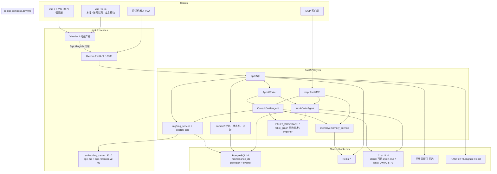
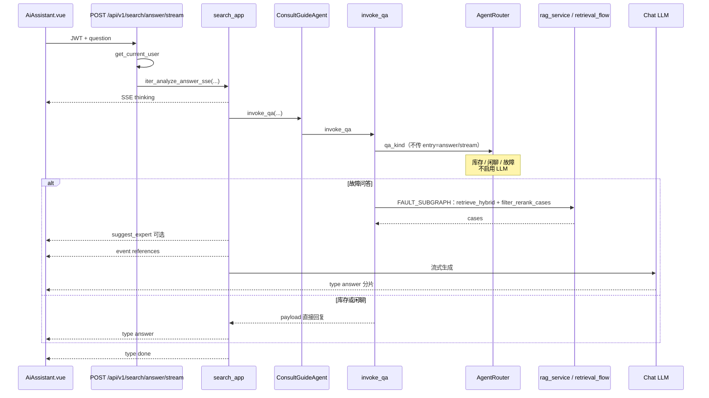
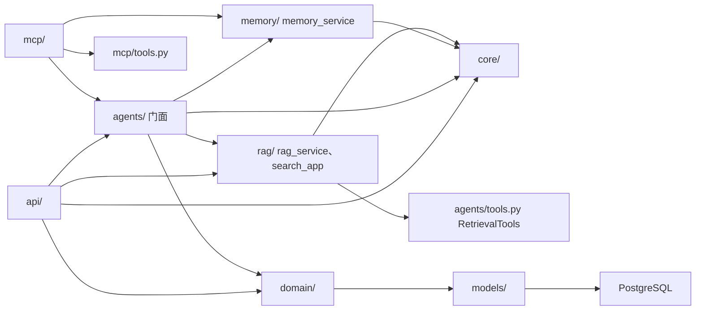
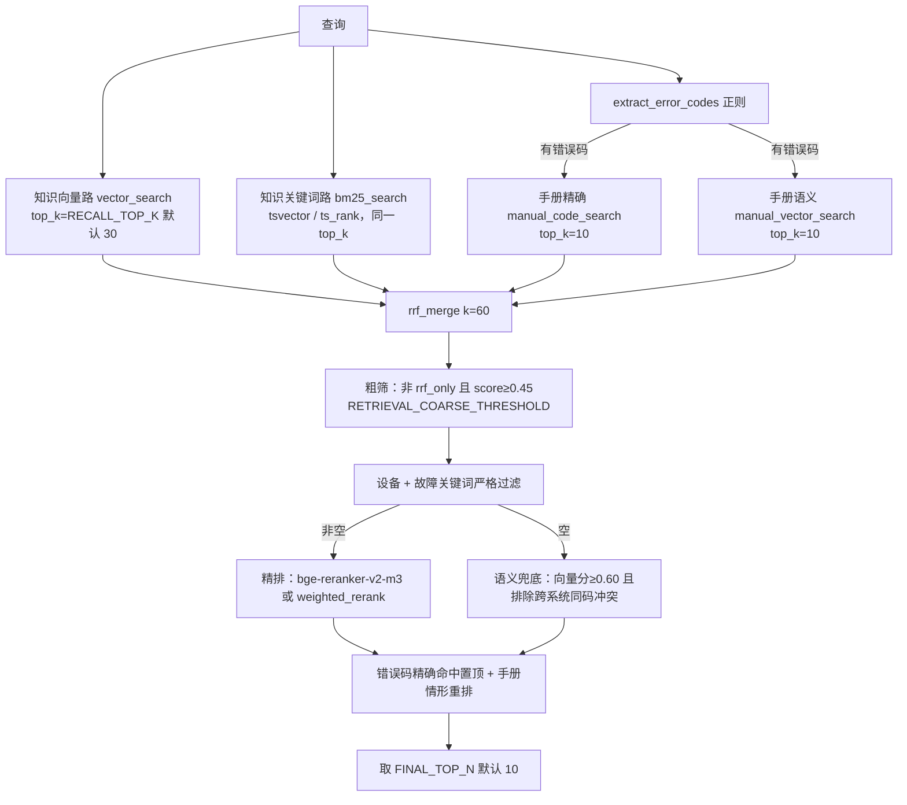
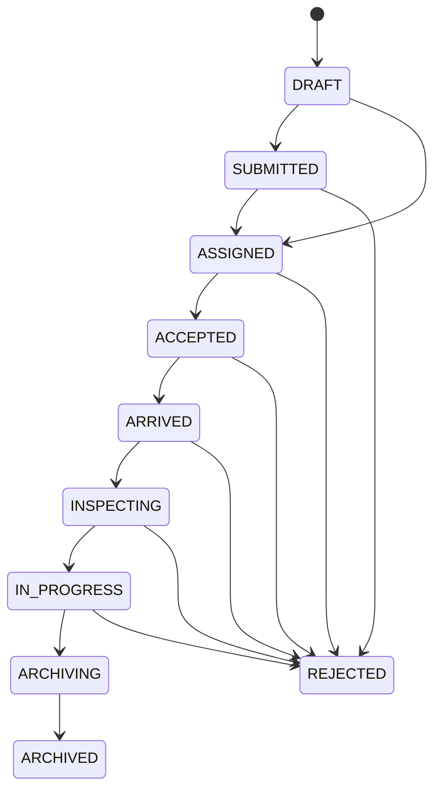
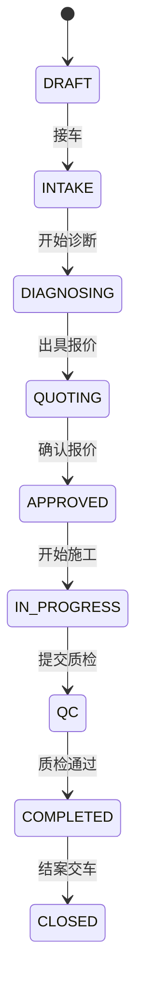
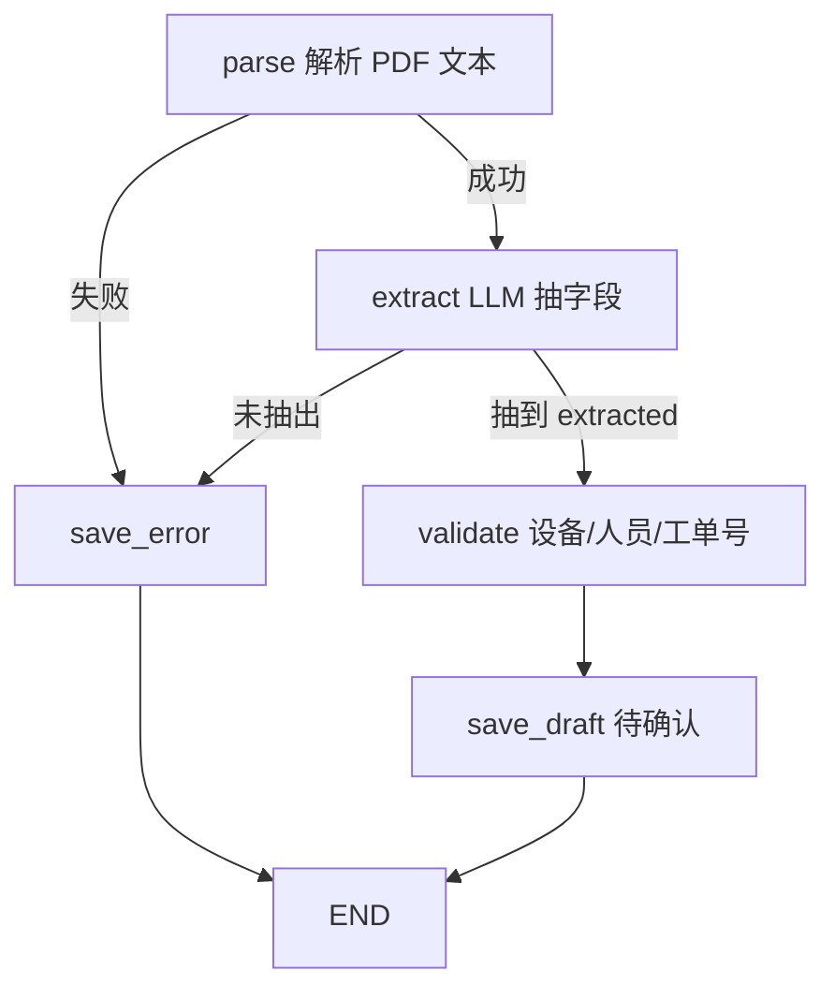
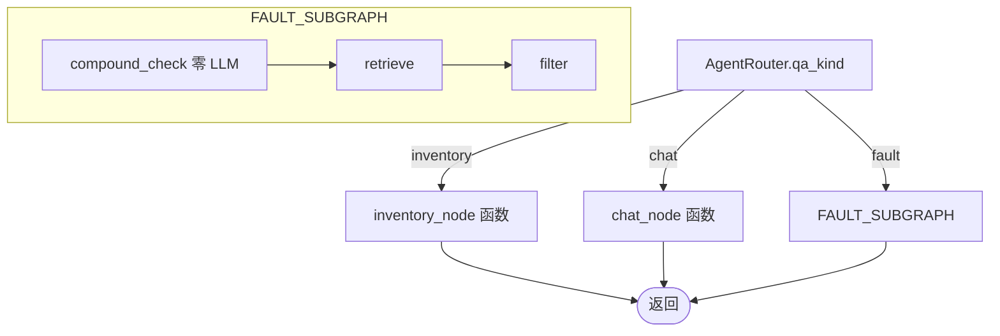
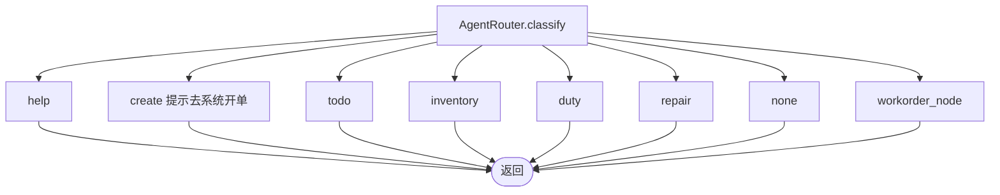
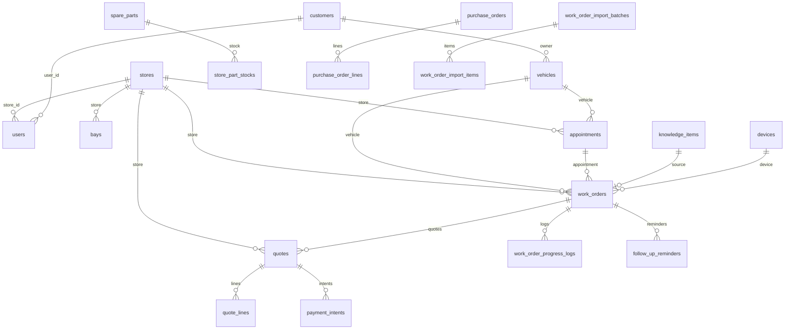

# Smart-Repair-System 系统总体架构文档

> 本文以仓库**当前代码**为唯一事实来源（截至 2026-11-18，对照当前工作区，含图与路由收口）。方案类 docs（如 `docs/双Agent精简技术方案.md`、`docs/汽修-Agent-平台改造方案.md`、后训练方案）只解释取舍；与代码冲突时以仓库实现为准。分层与依赖方向的契约见 `docs/HARNESS.md`，本文写现网结构与流程，不重复抄写契约全文。`README.md` 是入口页；阈值和已知偏差以本文为准。

---

## 目录

1. [系统总体架构](#1-系统总体架构)
2. [模块划分与依赖关系](#2-模块划分与依赖关系)（含 [2.4 各模块要解决的问题](#24-各模块要解决的问题)）
3. [第三方依赖、中间件与模型底座](#3-第三方依赖中间件与模型底座)
4. [核心模块详细设计](#4-核心模块详细设计)
5. [Agent 设计](#5-agent-设计)
6. [存储设计](#6-存储设计)
7. [项目结构与代码组织](#7-项目结构与代码组织)
8. [系统亮点与设计决策](#8-系统亮点与设计决策)
9. [附录：已知偏差与技术债](#9-附录已知偏差与技术债)

---

## 1. 系统总体架构

### 1.1 定位

Smart-Repair-System（仓库名 `Car-Repair-System`，`settings.APP_NAME` 为 `Smart-Repair-System`）是一套 **维修业务系统 + 咨询/引导与工单双门面 Agent**：门店或现场人员通过 Vue 管理端与移动端 H5 处理工单、库存、报价和知识，同时通过 HTTP SSE、钉钉机器人和 FastMCP 与 Agent 对话。系统同时承载一条既有的**工业设备维修车道**和一条后加的**汽修车道**，共用同一张工单状态表，见 [§4.2](#42-工单生命周期)。

四块核心能力：

| 能力 | 实现入口 |
|------|----------|
| **双门面 Agent** | `ConsultGuideAgent`（问答、追踪维修、专家模式、库存只读）与 `WorkOrderAgent`（理解、导入、生命周期写入口、报价/套餐、知识沉淀）。渠道经 `AgentRouter` 分发，路由本身不是第三 Agent，见 [§5](#5-agent-设计) |
| **公共检索漏斗** | 公开入口 `app.rag.rag_service`，实现 `app/rag/retrieval_flow.py`（`app/agents/retrieval_flow.py` 是兼容 shim）：知识库向量 + 关键词（工具名仍为 `bm25_search`，实现为 tsvector/`ts_rank`），手册错误码精确 + 语义，RRF 融合后粗筛、严格过滤、精排，见 [§4.1](#41-检索漏斗) |
| **维修业务域** | `domain/` + `api/`：工单双车道状态机、状态迁移 `work_order_transition.do_transition`、门店隔离、预约、报价规则引擎、采购入库、回访；支付只落占位单，不接清算渠道 |
| **渠道接入** | FastAPI `/api/v1/*`、Vue 3 管理端与 `/m` 车主/技师 H5、钉钉 Stream/HTTP 机器人、内部 `/mcp` 与默认关闭的 `/mcp/public` |

四条进程边界：本机用 `docker-compose.dev.yml` 跑 PostgreSQL（`pgvector/pgvector:pg16`，承担关系数据、pgvector 向量与 tsvector 关键词检索）和 Redis；统一推理服务 `python -m app.core.embedding_server` 占用 `:8010`，托管 bge-m3 与 bge-reranker-v2-m3；`uvicorn` 跑 FastAPI（HTTP、LangGraph、MCP 挂载、可选前端静态资源）；Vite 开发服务器默认 `:4173`，经代理打到后端 `:18080`。钉钉 Stream 与 OA 轮询挂在 FastAPI 进程内，不另起 worker。细则见 [§2.3](#23-进程边界) 与 [§7.4](#74-部署形态)。

三条写约束：工单状态迁移只认 `domain/work_order_status.py` 的 `VALID_TRANSITIONS`（报表 PUT 把已填草稿直接标成 `IN_PROGRESS` 是代码写明的既有捷径，不走该表）；报价金额只来自目录价与数量的确定性计算，LLM 不定价；咨询/引导门面不暴露工单写方法，写入与状态流转只走工单 Agent。见 [§2.2](#22-依赖关系与硬约束)。

### 1.2 分层架构图



上图方框是**本机多进程**，不是单个容器里的 App。基础设施在 Compose 里；后端、推理服务和前端开发服务器在宿主机上由 `start_all.ps1` 拉起。仓库根目录的 `docker-compose.yml` 是可选的 RAGFlow 编排，不是本系统的主数据面，见 [§7.4](#74-部署形态) 与附录。

HTTP 检索与知识/手册向量读写经 `rag_service` / `search_app`，路由不再直接调 `vector_store`。追踪维修与专家模式的 Redis 会话经 `memory_service`。漏斗内部仍调用 `RetrievalTools`，见 [§2.2](#22-依赖关系与硬约束) 与附录。

浏览器开发时访问 Vite `:4173`。`frontend/vite.config.js` 把 `/api` 和 `/dingtalk` 代理到 `http://127.0.0.1:18080`。后端默认 `BACKEND_PORT=18080`。`DEBUG=true` 时 CORS 放行任意来源；非调试必须配置 `CORS_ORIGINS`。若已执行 `npm run build` 且存在前端 `dist`，FastAPI 会挂载静态资源并用 SPA 回退返回 `index.html`。

### 1.3 一次智能问答（SSE）



`app/api/search.py` 只做鉴权、校验和 SSE 组装，编排在 `app/rag/search_app.py`。该入口要求登录。SSE 事件与 `qa_graph.py` / `search_app.py` 一致：先发 `{"type":"thinking"}`；复合故障预检为真时再发 `{"type":"suggest_expert"}`；参考案例走 `event: references`（最多 8 条）；回答是 `{"type":"answer","content":...}`；结束是 `{"type":"done","confidence":...,"sources_count":...}`。

问答入口用 `AgentRouter.qa_kind` 分成库存 / 闲聊 / 故障，**不会**在对话里把「查工单进度」自动转到工单只读工具。钉钉分类和渠道分发已收口到 `AgentRouter` 加处理函数，但处理函数仍直接调 `app.mcp.tools`。工单进度自动转接和钉钉直调工具是现网缺口，见 [§5.1](#51-双门面与-agentrouter) 与 [§9](#9-附录已知偏差与技术债)。

追踪维修与专家模式是另一条 HTTP 路径（`/guided-repair/*`、`/answer/expert*`），状态在 Redis，不跑问答入口，见 [§5.4](#54-多轮会话下图-redis-状态机)。

### 1.4 技术栈

版本以仓库锁文件或 `requirements.txt` / `frontend/package.json` 为准，不引用 README 里已过时的写法（README 仍写 Pinia，前端并没有装；见附录）。

#### 前端

| 技术 | 版本 | 用途 |
|------|------|------|
| Vue | ^3.4.0 | 管理端与移动端 H5 |
| Vite | ^5.0.0 | 开发服务器默认 `127.0.0.1:4173`，代理 `/api`、`/dingtalk` |
| Vue Router | ^4.3.0 | `createWebHistory`；登录守卫读 `localStorage` 的 `auth_token` / `current_user` |
| Element Plus + 图标 | ^2.5.0 / ^2.3.0 | UI，中文 locale |
| axios | ^1.6.0 | `frontend/src/api/` |
| dayjs | ^1.11.0 | 日期 |
| qrcode.vue | ^3.4.1 | 扫码展示 |

前端**没有** Pinia 或 Vuex。没有全局 store 包；登录态放在 `localStorage`。

#### 后端 / 数据 / 模型

| 技术 | 版本 | 用途 |
|------|------|------|
| FastAPI | 0.135.3 | HTTP、OpenAPI `/docs` |
| uvicorn[standard] | 0.42.0 | ASGI |
| Pydantic / pydantic-settings | 2.12.5 / 2.14.2 | 校验与 `.env` |
| SQLAlchemy | 2.0.25 | ORM；同步 `psycopg2`，异步 `asyncpg` 已建引擎 |
| Alembic | 1.13.1 | 迁移 |
| psycopg2-binary / asyncpg | 2.9.9 / 0.29.0 | PostgreSQL 驱动 |
| redis | 5.0.1 | 会话与缓存 |
| LangGraph | 1.2.6 | 故障检索子图 `FAULT_SUBGRAPH`、导入 DAG |
| langchain / langchain-openai / langchain-community | 1.3.13 / 1.2.2 / 0.4.2 | 千问 OpenAI 兼容 Chat、工具 |
| fastmcp | 3.4.5 | `/mcp`、`/mcp/public`，Streamable HTTP |
| pgvector | 0.3.6 | PostgreSQL 向量类型适配（`psycopg2` 注册 `vector`） |
| torch / transformers / FlagEmbedding | 2.6.0 / >=4.40.0 / >=1.2.10 | 推理服务加载 bge-m3 与 bge-reranker-v2-m3 |
| python-jose / passlib / bcrypt | 3.3.0 / 1.7.4 / 4.0.1 | JWT HS256、密码哈希；bcrypt 钉在 4.0.1 |
| httpx / aiohttp / requests | 0.28.1 / 3.13.5 / 2.33.1 | 对话 LLM、钉钉、追踪上报 |
| dingtalk-stream | 0.24.3 | 长连接收机器人/OA 事件 |
| APScheduler | 3.11.3 | OA 审批状态轮询 |
| 阿里云短信 SDK | dysmsapi20170525 >=3.1.0 | `SMS_ENABLED=true` 时发送 |
| loguru | 0.7.2 | 日志，10 MB 轮转、保留 30 天 |
| pytest / pytest-asyncio / pytest-cov | 9.1.1 / 1.4.0 / 7.1.0 | 测试 |

运行时约定：Python 3.10+；Node.js 18+；PostgreSQL 16（`pgvector/pgvector:pg16`）；Redis 7。

---

## 2. 模块划分与依赖关系

### 2.1 顶层包职责

| 包 / 目录 | 职责 |
|-----------|------|
| `frontend/` | Vue 3 页面、路由、axios 封装；不含独立状态库 |
| `backend/app/api/` | HTTP 路由：鉴权、参数校验、SSE/JSON 组装；检索编排在 `rag/search_app`，工单流转在 `domain/work_order_transition` |
| `backend/app/agents/` | 两个第一类 Agent 门面、`AgentRouter`、`intent_classifier`、故障检索子图、钉钉函数分发、导入 DAG 与内部能力；`retrieval_flow.py` 只是兼容 shim |
| `backend/app/rag/` | 检索公开入口 `rag_service`、漏斗实现 `retrieval_flow`、搜索编排 `search_app` |
| `backend/app/memory/` | Agent 记忆门面 `memory_service`：短期 Redis 会话与摘要入口；不托管工单/库存等业务表 |
| `backend/app/domain/` | 工单状态机、状态迁移、门店范围、报价规则、套餐排序、库存流水、预约、车主档案映射 |
| `backend/app/core/` | 配置、数据库、缓存、安全、向量库、推理客户端、钉钉、短信、追踪、限流 |
| `backend/app/mcp/` | FastMCP 工具与鉴权；实现多复用 `mcp/tools.py` |
| `backend/app/models/` | SQLAlchemy 模型，表结构的正本在模型 + Alembic |
| `backend/alembic/` | 迁移 |
| `backend/scripts/` | 分类种子、手册导入、向量同步、阈值校准、模型下载 |
| `backend/tests/` | 领域、检索、鉴权、双门面路由、分层与记忆门面、分阶段单测 |
| `docs/` | 方案、启用说明与本文；与代码冲突时以代码为准 |
| `docker-compose.dev.yml` | 本机数据面 |
| `docker-compose.yml` | 可选 RAGFlow 编排，不是主链路依赖 |

### 2.2 依赖关系与硬约束



硬约束（均可在代码里对上）：

1. **第一类 Agent 只有两个**。`ConsultGuideAgent.name == "consult"`，`WorkOrderAgent.name == "work_order"`。HTTP、Vue、钉钉、FastMCP 是渠道。`AgentRouter` 只做分发，不检索、不改工单。
2. **咨询可调工单只读，不可写**。`ConsultGuideAgent.WORK_ORDER_WRITE_METHODS` 列出的创建、导入、改状态、审批、完工、扣料、应用报价/套餐，咨询门面不得实现；`can_write_work_order()` 恒为 `False`。`query_work_order_progress` 转调 `WorkOrderAgent.query_work_order`。
3. **固定拓扑上图，多轮会话下图**。故障检索子图和导入 DAG 用 LangGraph。闲聊、库存和钉钉渠道动作用函数分发。追踪维修与专家模式用 Redis 状态机（TTL 24 小时、最多 30 步），不要搬上 LangGraph。
4. **检索只允许一套漏斗**。公开入口是 `app.rag.rag_service`，实现在 `app/rag/retrieval_flow.py`；`app/agents/retrieval_flow.py` 再导出同名符号，保持旧导入。故障检索子图、专家模式、钉钉/MCP 知识检索、历史检索端点都走这套漏斗，避免策略漂移。
5. **LLM 不定价**。`quote_service.create_draft` / `quote_lines.build_quote_lines` / `service_recommend.rank_offers` 是规则引擎；没有目录价就记 0，留给店员改。
6. **状态迁移认表**。除工单报表 PUT 的既有捷径外，允许的转移写在 `VALID_TRANSITIONS`。HTTP `/transition` 与钉钉卡片都走 `domain.work_order_transition.do_transition`；`core/dingtalk_wo_card.py` 不再 import `app.api`。
7. **生产拒绝占位密钥**。`assert_production_secrets()`：`DEBUG=false` 时拒绝默认或短于 24 字符的 `SECRET_KEY`，以及空的或已公开的 `SCHEDULER_TOKEN`（含 `sched_token_2026`）。
8. **Agent 会话 Redis 走记忆门面**。`memory_service` 持有逻辑 key 与 TTL，调用方不要自行拼接 `guided_repair_session:` 等前缀。现网没有独立长期记忆事实表，摘要写回短期会话的 `history_summary`。用户/配件等业务缓存仍直接用 `cache_service`。

现网仍存在的跨层存量（不是已经清掉）：转到 `COMPLETED` 时，`do_transition` 仍懒加载 `app.api.work_orders.complete_work_order_internal`（知识发布、备件扣减等完成链路仍在 API）；`app/rag/retrieval_flow.py` 仍依赖 `app.agents.tools.RetrievalTools`；`api/dispatch.py` 仍从 `api/work_orders.py` 的再导出 shim 取进度日志和工作量函数（API 内部兼容，不是 core 反向依赖）。

### 2.3 进程边界

| 进程 | 怎么启动 | 职责 |
|------|----------|------|
| PostgreSQL / Redis | `docker compose -f docker-compose.dev.yml up -d` | 关系数据、pgvector 向量、tsvector 关键词检索、缓存与会话 |
| 推理服务 `:8010` | `python -m app.core.embedding_server` 或 `start_embedding_server.ps1` | `POST /v1/embeddings`、`POST /v1/rerank`、`GET /health` |
| FastAPI `:18080` | `uvicorn app.main:app` | 全部 HTTP、图编排、MCP 挂载、钉钉 Stream（若启用）、OA 定时任务 |
| Vite `:4173` | `npm run dev` | 前端开发与反向代理 |
| RAGFlow（可选） | 根目录 `docker-compose.yml` | 仅当 `TRACING_BACKEND=ragflow` 且配置了地址时作为追踪后端 |

FastAPI lifespan 会调用 `assert_production_secrets()`，并探测推理服务，失败只打日志、不阻塞启动。检索在推理服务不可用时降级为关键词-only（tsvector，工具名仍为 `bm25_search`），见 [§4.1](#41-检索漏斗)。

### 2.4 各模块要解决的问题

| 模块 | 要解决的问题 |
|------|----------------|
| `ConsultGuideAgent` | 把问答、引导、专家、库存只读收成一个对外门面，不碰工单写路径 |
| `WorkOrderAgent` | 把理解、导入草稿、生命周期写入口、报价套餐、知识沉淀收成一个对外门面 |
| `AgentRouter` | 每个请求只选一个主责任方；显式 HTTP / MCP 入口一般不再按文本二次分类。`/answer/stream` 例外：实现走 `qa_kind` 做库存/闲聊/故障分流，见 [§5.1](#51-双门面与-agentrouter) |
| `rag_service` / `retrieval_flow` / `search_app` | 双库召回与过滤精排只有一份实现；HTTP 搜索路由不再内嵌检索步骤 |
| `memory_service` | Agent 会话与摘要的 Redis 读写只在一处拼 key、设 TTL |
| `domain.work_order_status` | 工业车道与汽修车道共用枚举，不能拆掉旧边 |
| `domain.work_order_transition` | 工单状态、进度日志和工作量变更只有一份持久化实现，供 API 与钉钉卡片复用 |
| `domain.store_scope` | 店内角色锁在本店；管理员可看全部或按 `X-Store-Id` 收窄；车主不走这套，走 `owner_access` |
| `domain.quote_*` | 报价草案与状态机，价格来自目录 |
| `work_order_importer` | PDF 只写导入草稿，人工确认后才进生产工单表 |
| `mcp` | 把已有能力暴露给外部模型客户端；公开入口与写工具默认关 |
| `core.embedding_server` | 把重模型推理移出 uvicorn，避免业务进程加载 GPU/CPU 模型 |

---

## 3. 第三方依赖、中间件与模型底座

本节只写代码和配置里出现的依赖。默认值来自 `backend/app/core/config.py`；`.env.example` 若不同，运行时以环境变量覆盖后的值为准。

### 3.1 PostgreSQL

业务正本在 PostgreSQL 16，库名默认 `maintenance_db`。本机映射端口默认 `15432`（容器内 5432）。连接串由 `DB_USER` / `DB_PASSWORD` / `DB_HOST` / `DB_PORT` / `DB_NAME` 拼出，或直接给 `DATABASE_URL`。

`core/database.py`：同步引擎 `postgresql+psycopg2`，异步引擎 `postgresql+asyncpg`，`pool_size=10`，`max_overflow=20`，`pool_pre_ping=True`，`echo=settings.DEBUG`。现网 API 主路径走同步 `SessionLocal` / `get_db()`。

除关系数据外，知识库关键词路与向量路都在 PostgreSQL 上完成。关键词路由 `RetrievalTools.bm25_search` 走生成列 `search_tsv` 与 `ts_rank`（分词与写入共用 `repair_text_tokens()` / `app.rag.lexical.tokenize_repair_text`：中文 2/3-gram、完整 CJK 片段、长度≥2 的英文和数字；查询与存储对齐）。失败时回退到原 ILIKE 加权路径。迁移 `7a8b9c0d1e2f_add_pg_trgm_indexes.py` 仍为模糊匹配保留 `pg_trgm` 索引；`c4d5e6f7a8b9_add_pgvector_and_tsvector.py` 增加 `vector` 扩展、`embedding` 列、HNSW 与 `search_tsv` GIN。不要用仓库根目录的 `init-db.sql` 建库，它的工单状态枚举是早期工业子集，文件自己写明会和 Alembic 分叉；新环境在 `backend` 目录执行 `alembic upgrade head`。已有 PG16 数据卷可继续使用，但必须换成 `pgvector/pgvector:pg16` 镜像并重建容器，再跑迁移；向量不会由迁移回填，需推理服务起来后执行发布同步或 `scripts/sync_vectors.py`。

### 3.2 Redis 用途一览

默认配置：`REDIS_HOST=localhost`，`REDIS_PORT=6379`，`REDIS_DB=0`。`.env.example` 把端口写成 `7379`，`docker-compose.dev.yml` 默认映射仍是 `${REDIS_PORT:-6379}:6379`。以实际 `.env` 为准。

`CacheService`（`core/cache_service.py`）前缀是 `maint:`，默认 TTL 300 秒；Redis 连不上时退回进程内字典。完整 Redis key 是此前缀加上业务逻辑 key。

Agent/对话记忆的读写统一走 `app.memory.memory_service`（底层仍用 `CacheService`）。库存、用户等业务缓存仍由各 API 直接调用 `cache_service`，不进入记忆模块。`/agent` 返回的 scratchpad、进程内限流、`sys_config` 短缓存也不是记忆门面的职责。

| Key 模式（含前缀） | TTL | 用途 |
|--------------------|-----|------|
| `maint:guided_repair_session:{session_id}` | 86400 秒（24 小时） | 追踪维修会话，最多 30 步 |
| `maint:expert_repair_session:{session_id}` | 86400 秒 | 专家模式会话，最多 30 步 |
| `maint:mcp/staff_guid:session:{staff_id}` | 86400 秒 | MCP/钉钉员工到追踪维修 `session_id` 的映射 |
| `maint:mcp/staff_guid:last:{staff_id}` | 86400 秒 | 该员工最后活动时间；空闲超过 24 小时开新会话 |
| `maint:{其它业务 key}` | 默认 300 秒，或调用方传入 | 业务缓存，如 `user:{id}`、`spare_part:{id}`、`stock_alerts:*`，不经记忆门面 |

追踪维修与专家模式的步数上限都是 30，超限后总结结束，不靠 Redis 的 key 数量限制。见 [§5.4](#54-多轮会话下图-redis-状态机)。

### 3.3 向量与全文检索（PostgreSQL）

开发编排不再启动 Milvus、etcd、MinIO 或 Attu。向量写在 `knowledge_items.embedding` 与 `manual_code_entries.embedding`（`vector(1024)`），与业务行同库，不再维护独立语义副本。索引为 HNSW，`vector_cosine_ops`，`m=16`，`ef_construction=64`；检索时设置 `hnsw.ef_search`，由 `PGVECTOR_EF_SEARCH` 控制，默认 64。pgvector 的 `<=>` 是余弦距离，检索出口把分数映射为 `1 - distance`，以便沿用原有 `RETRIEVAL_COARSE_THRESHOLD` 等相似度阈值。

`VectorStore` / `LogCodeVectorStore` 仍保留原方法名，读写的是上述列。`milvus_id` 列作为兼容点号保留，新写入为 `pg:k:{id}` / `pg:m:{id}`；旧 UUID 仍可按列回查。`flush` 对 PostgreSQL 是空操作。`delete` / `drop_collection` 只清空 embedding（及点号），不删业务行。schema 见 [§6.6](#66-向量与全文-schema)。

### 3.4 大模型底座：本地检索 vs 远程生成

#### 3.4.1 职责切分

| 职责 | 实现 | 失败时 |
|------|------|--------|
| 召回编码 | 本机推理服务 `BAAI/bge-m3`，1024 维，L2 归一化，`POST /v1/embeddings` | `encode_*` 抛 `RuntimeError`；混合检索降级为关键词-only（tsvector） |
| 精排 | 同一服务 `BAAI/bge-reranker-v2-m3`，`POST /v1/rerank`（分数 0~1） | 返回 `None`，`retrieval_flow` 回退 `weighted_rerank` |
| 生成 / 抽取 / 意图分类 / ReAct 决策 | `CHAT_LLM_MODE` 切换：cloud 走阿里云百炼 `qwen-plus`，local 走本机 vLLM `Qwen2.5-7B-Instruct`；统一 `make_chat_llm()` / `ChatOpenAI` | 各调用点打日志或返回降级文案，不改检索阈值 |

意图路由规则、错误码正则、关键词清洗、套餐排序、报价算术都是确定性逻辑，不调用 LLM。配置注释写明：粗筛阈值按 bge-m3 实测分布标定（无关约 0.35、英文日志 ≥0.495），本文不把这些观测写成线上指标。

#### 3.4.2 对话模型切换（`CHAT_LLM_MODE`）

所有生成调用经 `app.core.chat_llm.make_chat_llm`，按 `CHAT_LLM_MODE` 选择云端或本地，不再直接读 `DEEPSEEK_*`。

| 配置键 | 代码默认 | `.env.example` | 说明 |
|--------|----------|----------------|------|
| `CHAT_LLM_MODE` | `cloud` | `cloud` | `cloud` / `local`；兼容值 `deepseek` 才走旧的 `DEEPSEEK_*` |
| `CHAT_CLOUD_BASE_URL` | `https://dashscope.aliyuncs.com/compatible-mode/v1` | 同左 | 阿里云百炼 OpenAI 兼容口 |
| `CHAT_CLOUD_MODEL` | `qwen-plus` | 同左 | 可改为 `qwen-turbo` / `qwen-max` 等 |
| `CHAT_CLOUD_API_KEY` | 空 | 占位 `sk-your-dashscope-api-key` | cloud 模式必填；也可用 `DASHSCOPE_API_KEY` |
| `CHAT_LOCAL_BASE_URL` | `http://127.0.0.1:8001/v1` | 同左 | 本机 vLLM，不要占用 embedding 的 `8010` |
| `CHAT_LOCAL_MODEL` | `Qwen/Qwen2.5-7B-Instruct` | 同左 | 须与 vLLM `--served-model-name` 一致 |
| `CHAT_LOCAL_API_KEY` | `dummy` | `dummy` | 本地 vLLM 默认不校验 |
| `CHAT_LOCAL_TIMEOUT_FLOOR` | `30` | 无 | local 模式下低于此时长的调用会被抬到此值 |

cloud 未配密钥、或 local 未配地址/模型时，启动日志提示「未配置」。检索 ReAct 决策里温度为 `0.1`（`retrieval_agent.py`）。其它生成点的温度以各自模块为准，不在此统一杜撰。

#### 3.4.3 本地模型（bge-m3 / bge-reranker-v2-m3）

由独立进程托管，主链路只做 HTTP 客户端（`core/embeddings.py`、`core/reranker.py`）。

| 配置键 | 默认 | 说明 |
|--------|------|------|
| `EMBEDDING_SERVER_URL` | `http://localhost:8010` | 主链路地址 |
| `EMBEDDING_MODEL_NAME` | `BAAI/bge-m3` | 召回 |
| `EMBEDDING_MAX_LENGTH` | 512 | 编码截断 |
| `VECTOR_DIM` | 1024 | 维度；健康检查读不到 `dim` 时回退此值。`MILVUS_VECTOR_SIZE` 仍是兼容别名 |
| `PGVECTOR_EF_SEARCH` | 64 | HNSW 检索 `ef_search` |
| `TS_RANK_WEIGHTS` | `{0.1, 0.2, 0.4, 1.0}` | `ts_rank` 的 `{D,C,B,A}` 权重；标题与故障码为 A，正文为 B，标签为 C |
| `RERANKER_MODEL_NAME` | `BAAI/bge-reranker-v2-m3` | 精排（0~1 分；质量阀门阈值仍按原 Qwen 标定，尚未重标） |
| `RERANKER_ENABLED` | `True` | 总开关；CPU 延迟敏感时可关 |
| `RERANKER_CANDIDATES` | 30 | 送入精排的候选条数 |

精排主路径是 `FlagReranker(..., normalize=True)`，输出 0~1；加载失败则回退 `AutoModelForSequenceClassification` + sigmoid，尺度相同。旧版 Qwen3-Reranker 的 CausalLM Yes/No 打分路径已删除，避免误打 BGE 分数。`/v1/rerank` 入参出参未改。质量阀门与「结果是否充足」仍用 0.45 / 0.6 / 0.7 等按原 Qwen3-Reranker 标定的阈值，换模型后尚未重标，排序和充足判断可能变化。

Embedding 客户端超时 30 秒，失败重试 2 次。Reranker 超时 60 秒，文档截断 500 字，按 8 条分块，避免一次 30 条长文本把服务端注意力矩阵打满（模块注释写明 CPU 上曾出现 3.3~4.8GB 分配失败）。连续失败 3 次进入 60 秒冷却，期间直接返回 `None`。健康探测超时 2 秒。日志类输入跳过模型精排，按向量分排序，原因写在 `retrieval_flow._rerank_or_fallback`：跨语言精排收益低，且 CPU 上单块可能超过 60 秒。


#### 3.4.4 对比与推荐理由

代码和配置里写明的理由，不是外部评测结论：

- 把推理拆出 uvicorn，是为了主链路启动不加载模型，推理挂掉时检索可降级而不是整个 API 起不来（`embeddings.py`、`main.py` lifespan、`retrieval_flow.py` 降级注释）。
- 用 bge-m3 1024 维 dense，是当前向量维度和编码实现的既定选择；更换模型要重建索引。文档未写与其它 embedding 的对比实验，本文也不编。
- 精排与粗筛职责分开：Reranker「只排序、不过滤」，过滤仍由向量阈值和设备/关键词硬约束负责（`reranker.py` 模块说明）。

### 3.5 观测与限流

`TRACING_BACKEND` 可选 `ragflow` | `langfuse` | `local`。`config.py` 默认 `ragflow`，`.env.example` 写的是 `local`。RAGFlow 相关项：`RAGFLOW_HOST` 默认 `http://localhost:9380`，数据集名 `ticket_traces`，`RAGFLOW_ENABLED` 代码默认 `True`、示例环境为 `False`。Langfuse 默认关闭，`LANGFUSE_HOST` 默认 `https://cloud.langfuse.com`。实现见 `core/langfuse_tracer.py`。本文不把追踪当成现网默认已接通，以运行配置为准。

`core/rate_limit.py` 是**进程内**滑动窗口。`POST /api/v1/search/agent` 对 `search-agent:{user_id}` 限制 60 秒 20 次。多副本各算各的，不替代网关限流。问答 SSE 入口未挂同一套 `hit()`。

健康检查 `GET /health`：PostgreSQL 与 Redis 都连通才返回 `healthy`，否则 503 `degraded`。`pgvector` 探的是是否已安装 `vector` 扩展（`present` / `missing` / `down`），推理服务打 `/health`（`ready` / `down`），这两项不影响 `core_ok`。

### 3.6 其它外部集成

| 集成 | 配置要点 |
|------|----------|
| 钉钉 | `DINGTALK_APP_KEY` / `APP_SECRET` / `AGENT_ID` / `CORP_ID` / `ROBOT_CODE` 等。`DINGTALK_MOCK_MODE` 代码默认 `True`，示例环境为 `false`。`.env.example` 有 `DINGTALK_STREAM_MODE`，`Settings` 使用 `extra="ignore"`，该键不在 `config.py` 字段列表里，是否生效看 `dingtalk_stream` 等模块如何读取环境变量 |
| 短信 | `SMS_ENABLED` 默认 `False`；关闭时车主通知打日志，不请求阿里云。验证码模板与状态通知模板分开 |
| 设备同步 | `DEVICE_SYNC_API_KEY` 必填才接受 report/sync；配置了 `DEVICE_SYNC_HMAC_SECRET` 还要校验签名 |
| 调度内部口 | `SCHEDULER_TOKEN` 无默认口令，未配置则调度 HTTP 入口拒绝 |
| 钉钉内部同步 | `DINGTALK_INTERNAL_TOKEN` 为空则只能用管理员 JWT |
| MCP | `MCP_API_KEY`、`MCP_PUBLIC_ENABLED` 默认 `False`、`MCP_ENABLE_WRITE_TOOLS` 默认 `False` |

JWT：`ALGORITHM=HS256`，`ACCESS_TOKEN_EXPIRE_MINUTES=30`。生产密钥策略见 [§2.2](#22-依赖关系与硬约束)。

---

## 4. 核心模块详细设计

### 4.1 检索漏斗

公共实现是 `backend/app/rag/retrieval_flow.py`，公开入口是 `backend/app/rag/rag_service.py`。`backend/app/agents/retrieval_flow.py` 只再导出同名符号，保持旧导入可用。检索工具（向量、关键词 `bm25_search`、RRF、手册精确匹配等）仍在 `backend/app/agents/tools.py` 的 `RetrievalTools`，漏斗会调用它，这是现网存量的 RAG → Agent 依赖。检索协议未改：仍是最多四路召回 → RRF（k=60）→ 粗筛 → `bge-reranker-v2-m3`。

HTTP 的 `/search/quick`、`/hybrid`、`/agent`、`/manual-lookup`、`/answer/stream`、`/answer/expert*` 由 `app/api/search.py` 鉴权后交给 `app/rag/search_app.py` 编排；其中 `/answer/stream` 走 `consult_guide_agent.invoke_qa` → `AgentRouter.qa_kind` 分流，故障分支执行 `FAULT_SUBGRAPH`。这条路径不会把工单进度自动转到工单 Agent。其它入口还包括钉钉/MCP `search_knowledge`。



关键阈值与参数（均来自 `settings` 或函数默认值）：

| 键 / 常量 | 值 | 含义 |
|-----------|----|------|
| `RECALL_TOP_K` | 30 | 知识库向量路、关键词路（`bm25_search`）各自召回条数；RRF 候选池同值 |
| 手册两路 `top_k` | 10 | `retrieve_hybrid` 里写死，不是 `RECALL_TOP_K` |
| `RETRIEVAL_COARSE_THRESHOLD` | 0.45 | RRF 后向量相似度下限 |
| `SEMANTIC_RESCUE_THRESHOLD` | 0.60 | 严格过滤为空时的语义兜底线 |
| `RETRIEVAL_VECTOR_THRESHOLD` | 0.30 | 单路向量检索默认阈值（quick 等） |
| `FINAL_TOP_N` | 10 | 送生成或返回的条数 |
| `RERANKER_CANDIDATES` | 30 | 模型精排头部大小 |
| `rrf_merge(..., k=60)` | 60 | RRF 平滑参数，分式为 `1/(k+rank)` |
| `weighted_rerank` | `fault_weight=0.4`，`device_penalty=0.15` | 精排降级时的规则加分/罚分 |
| `MAX_VECTOR_CONTENT_LEN` | 500 | 知识向量编码文本截断 |
| `MAX_MANUAL_VECTOR_TEXT_LEN` | 1200 | 手册条目向量文本截断 |

融合去重键优先级：`_dedup_key`（知识 `K:{id}`、手册 `M:{id}`）> `knowledge_id` > `id`。向量路返回的 id 现为兼容点号 `pg:k:{id}` / `pg:m:{id}`（旧数据可能仍是 UUID），关键词路 id 仍是数据库整数，不能用原始 `id` 合并，否则双路命中无法把 `1/(k+r1)+1/(k+r2)` 加在同一条上（`rrf_merge` 注释）。

过滤规则：

- 粗筛跳过 `rrf_only`（无向量分、仅关键词/RRF 带来的条目），避免没有余弦分时被 0.45 误杀；关键词-only 降级时也会跳过分数阈值。
- 严格过滤在精排之前，先丢掉设备/关键词不匹配的候选。若提取出的设备类型并不在知识库实际设备集合里，设备约束失效，只按故障关键词过滤，避免「日志里写了 PLC、库里没有 PLC 手册」时整路被灭。
- 严格过滤为空时不做「再塞两条宽松结果」；只保留向量分 ≥ `SEMANTIC_RESCUE_THRESHOLD` 且非跨系统同码冲突的候选。再空则交给回答层如实说未检索到。
- 手册条目的 `conditions` 用查询 token 与 `signal` 做子串命中重排，命中项加 `[命中]` 前缀，无 LLM。
- 主路径的向量检索只要求 `embedding IS NOT NULL`，不过滤 `PUBLISHED`；主路径 tsvector/`ts_rank` 也不按 `status` 过滤。ILIKE 回退路径才会限制为已发布。因此草稿、审核中，以及已下架但仍留有向量的条目，可能被主检索召回。

维修意图阀门（钉钉 `repair_node` 等使用）分三层：① 错误码正则；② 关键词 / 短应答；③ 检索打分。注释中的无关判定线 `REPAIR_INTENT_RELEVANCE_THRESHOLD=0.4`；第三层「相关」默认与粗筛 0.45 对齐。快检已判无关则不跑检索。

检索质量判定（ReAct 用）：`AGENT_QUALITY_HIGH_SCORE=0.6`（单条高分），`RetrievalAssistantAgent.MIN_RESULTS_FOR_QUALITY=3`，最多 5 轮（`MAX_ITERATIONS`）。`AGENT_QUALITY_TARGET_SCORE=0.7` 写在配置里，是否每处都引用以调用点为准。

去重阈值：`DEDUP_CANDIDATE_THRESHOLD=0.45`，`DEDUP_LLM_THRESHOLD=0.55`，供知识沉淀，不属于检索漏斗本身。

### 4.2 工单生命周期

状态机在 `backend/app/domain/work_order_status.py`。同一枚举上有两条车道。工业车道原有边必须保留，因为钉钉卡片、主管派工和知识归档依赖它们。Phase 0 只追加汽修允许的转移。

工业主路径（示意，含既有分支）：



汽修主路径 `AUTO_REPAIR_PATH`：



补充事实：

- 非终态大多可以转到 `CANCELLED`。`APPROVED` 在工业侧原先几乎没有入边，现网派工不会进入；汽修侧把它重新作为「报价已确认」。
- `COMPLETED` 增加出边 `CLOSED`。钉钉卡片不会自动结案到 `CLOSED`。工业车道按钮「完成维修」把工单转到 `ARCHIVING`（待归档），引导回系统完善表单后再归档。汽修车道施工中的「完成维修」会被改写成「提交质检」（`QC`）；「质检通过」才到 `COMPLETED`。结案仍留给主管在系统里操作。
- 状态迁移的写路径是 `domain/work_order_transition.do_transition`（含权限判断、进度日志、工作量、响应组装）。`api/work_orders.py` 的 HTTP `/transition` 与 `core/dingtalk_wo_card.py` 都调用它；API 模块把原私有名再导出，供 `dispatch.py` 等继续 import。转到 `COMPLETED` 时，该领域函数仍懒加载 `complete_work_order_internal`（知识收录、备件扣减等仍在 API），这是现网存量的 domain → API 依赖。
- `IN_PROGRESS` 在工业侧仍可去 `ARCHIVING` / `REJECTED`，并多一条到 `QC`。
- 判定汽修车道：有 `vehicle_id` / `appointment_id` / `store_id`，或已经位于 `INTAKE` / `DIAGNOSING` / `QUOTING` / `QC`。否则 `IN_PROGRESS` / `COMPLETED` 仍走工业派工和归档。
- 预约不是工单状态。预约核销后落到 `INTAKE`。
- 领料允许状态见 `PARTS_ISSUE_STATUSES`（含两条车道的在办状态；已完成/已结案/已取消不再领料）。
- 维修报表 PUT 保存会把已填写的草稿直接标成 `IN_PROGRESS`，这是模块注释写明的既有捷径，不经过 `VALID_TRANSITIONS`。
- 工单号规范化为 `WO-YYYYMMDD-XXX`（`WorkOrderAgent._normalize_work_order_no`）。
- 工单 Agent 的写方法（`create_work_order`、`transition_status` 等）通过 `persist` 回调把校验和落库留在 API / 领域层，避免在门面里复制一份状态机。

完整允许转移表见源码 `VALID_TRANSITIONS`，中文名见 `STATUS_LABELS`。API 可用 `status_machine_payload()` 拉目录。

### 4.3 报价与套餐

报价是确定性规则，不是模型定价。

生成草案：`WorkOrderAgent.create_draft_quote` → `domain.quote_service.create_draft` → `domain.quote_lines.build_quote_lines`。明细来源：

- 工单领料 `used_parts`，单价取条目或备件目录 `unit_price`。
- 问诊文本里「建议项目」段落，最多 12 条；含「知识库未给出」的句子不进报价。能匹配备件目录则记 `PART`，匹配服务 SKU 则记 `LABOR`，否则记 `LABOR` 且单价 0。
- 可选套餐：`include_packages=True` 时用 `rank_offers` 排序，只取前 3 个写入，类型 `PACKAGE`，单价取 `list_price`。

套餐/服务项目排序（`domain/service_recommend.py`）：品牌、车系、里程区间是硬条件；症状关键词只加分和写原因，不作为淘汰条件。品牌命中 +3，车系 +2，里程区间命中 +3，再加症状命中数。不调用模型，也不输出命中率指标。

报价单号 `QT-YYYYMMDD-XXX`。状态机（`quote_status.py`）：

`DRAFT` → `STAFF_CONFIRMED` → `CUSTOMER_CONFIRMED`（终态）。`DRAFT` 可取消；`STAFF_CONFIRMED` 可被车主拒绝或取消。只有草案能改明细。合计是 `qty * unit_price` 再四舍五入到分。

没有「支付成功」态。支付意向是占位单，见 [§4.7](#47-支付占位与其它业务域)。

### 4.4 导入 DAG

`backend/app/agents/work_order_importer.py`，由 `WorkOrderAgent.import_pdf` 调用。确认前只写导入草稿表，不写生产 `work_orders`。



校验失败只记 `warnings`，仍然进入 `save_draft`，没有「抽取质量不足则失败」的条件边。人工确认在图外，由 `api/work_order_imports.py` 完成。草稿落在 `work_order_import_batches` / `work_order_import_items`，抽取原文截断到 4000 字。

闲聊、库存查询和钉钉工单号查询已改为普通函数，不再编译成子图。现网会编译的 LangGraph 图只剩故障检索子图和本导入 DAG。

### 4.5 门店隔离与车主范围

`domain/store_scope.py`：

| 角色 | `resolve_store_scope` |
|------|------------------------|
| `ADMIN` | 无门店参数时 `mode=all`；带 `store_id` / `X-Store-Id` 时锁这一家 |
| `SUPERVISOR` / `TECHNICIAN` / `WORKER` | 用户已绑 `store_id` 则锁定本店，请求不能改到别店；未绑定则 `legacy`，只看 `store_id` 为空的历史行 |
| 其它角色（含 `OWNER`） | 这里返回 `all`。注释写明：车主不走这套，仍按客户档案过滤 |

写入用 `ensure_writable_store`：店内角色不能写到别的店；`legacy` 账号不能写入已分店数据。

车主过滤在 `domain/owner_access.py`：`Customer.user_id` 对登录用户，`Vehicle.owner_id` 对客户。车主 H5 只看自己的客户、车辆、预约和工单。若某个接口只用 `store_scope`、忘了 `owner_access`，车主会被当成 `all`。已核对的缺口见 [§9](#9-附录已知偏差与技术债)。

`devices` 表没有 `store_id`，设备相关汇总无法按店切割。`customers` 也没有 `store_id`，店内账号需按本店工单/预约关联过滤。

### 4.6 钉钉与 MCP 渠道

钉钉机器人不是第一类 Agent。`robot_graph` 不再编译主图：`route_intent` 调用 `agent_router.classify(..., entry="dingtalk")`（可传入已算好的分类结果，避免重复跑 LLM），再按 `channel_action` 分发到处理函数：`help` / `create` / `todo` / `workorder` / `inventory` / `duty` / `repair` / `none`。`create` 只返回「请到系统维修报表新建」，不在钉钉里开单。短备件名（如「保险丝」）的库存兜底在 `AgentRouter` 里、仅钉钉路径生效；设备词兜底也在路由器的 LLM 回退里。

处理函数现状：`todo_node`、`inventory_node`、`duty_node`、`wo_query_node` 直接调用 `app.mcp.tools`；`repair_node` 过维修意图阀门后调用 `mcp.tools.guided_repair_track`，而不是 `ConsultGuideAgent` 门面。这与「渠道经门面办事」的目标不一致，见附录。

`none_node` 只返回未识别说明，不再做库存词或设备词的二次分流。

MCP：

- 内部 `FastMCP("Smart-Repair-System")` 挂在 `/mcp`。未配 `MCP_API_KEY` 时只允许本机 IP；配了 Key 则接受 Key 或带 `mcp:read`（登录 JWT 无 scope 视为只读）的令牌。
- 公开 `FastMCP("Car-Repair-Public")` 挂在 `/mcp/public`，默认 `MCP_PUBLIC_ENABLED=false`，未打开时鉴权层返回 404。只注册 `query_work_order`、`query_compatible_parts`、`recommend_service`、`query_inventory`、`get_workorder_stats`。
- 写工具 `draft_quote`、`guided_repair_chat` 默认不挂到 HTTP MCP（`MCP_ENABLE_WRITE_TOOLS=false`）。公开入口即使打开也不挂写工具。
- 智能工具超时：`search_knowledge` / 引导 25 秒，库存 15 秒，其它只读多为 10 秒。超时返回「请稍后再试」，不把异常堆栈给客户端。

`mcp/tools.py` 的业务函数与钉钉节点共用。知识检索走咨询门面的同步问答 `ConsultGuideAgent.answer_from_retrieval`（该包装内部仍用公共漏斗 + 生成器）。

### 4.7 支付占位与其它业务域

`api/payments.py` 模块说明：只落本地单据，不调用任何支付渠道。意向单号 `PI-YYYYMMDD-` + 8 位十六进制。`channel` 固定为 `STUB`（模型默认），状态只有 `CREATED` / `CANCELLED`。必须报价已到 `CUSTOMER_CONFIRMED` 才能创建；同一报价已有 `CREATED` 单则复用。取消仅主管或管理员。

其它现网能力（细节以对应 API / domain 为准，不在此展开状态表以外的流程）：预约与工位占用（`appointment_slots`）、回访提醒、采购入库与库存流水（`stock_ledger` / `procurement`）、排班与请假（可与钉钉 OA 同步）、设备心跳与外部同步、知识审核发布后写入 PostgreSQL embedding 列。

---

## 5. Agent 设计

产品层只承认两个第一类 Agent。下面出现的 `GuidedRepairAgent`、`ExpertRepairAgent`、`RetrievalAssistantAgent`、`ticket_agent`、`dedup_agent` 等，都是门面后的内部实现，不是并列的对外 Agent。钉钉 `robot_graph` 是渠道适配器，用函数分发，不再编译主图。

### 5.1 双门面与 AgentRouter

`backend/app/agents/router.py` 的模块说明写得很直接：每个请求只派给一个主责任方；本模块不实现检索或工单状态机。咨询过程中若问到某张工单、且已处于引导会话，主责任方仍是咨询/引导，通过工单 Agent 的只读工具查询；创建、改状态、审批、完工、扣料必须交给工单 Agent。

意图到 Agent 的映射见 `INTENT_TO_AGENT`。归咨询的包括：`fault_consult`、`manual_qa`、`chitchat`、`feature_intro`、`help`、`inventory_read`、`guided_repair`、`expert_repair`、`duty`（排班只读）。归工单的包括：`query_work_order`、`create_work_order`、`import_work_order`、`dispatch`、`transition_status`、`approve`、`complete_work_order`、`deduct_parts`、`quote`、`package`、`knowledge_extract`、`knowledge_dedup`、`todo`。

显式 HTTP / MCP 入口通过 `ENTRY_TO_INTENT` 直接定意图，不再按文本二次分类，例如 `answer/stream` → `fault_consult`，`guided-repair/*` → `guided_repair`，`mcp/draft_quote` → `quote`。`entry="dingtalk"` 需要按文本分类。

钉钉文本分类：关键词未命中时，`AgentRouter` 调用 `intent_classifier.classify_intent_llm`；失败则用与原机器人图一致的正则和设备词兜底。分类器与路由器集中维护，`robot_graph` 不再自己做分类。`robot_handler` 只分类一次：追踪维修时先发「思考中」提示，再把同一份 `RouteResult` 传给 `invoke_robot`。

**现网未打通的一点：** `POST /api/v1/search/answer/stream` 虽在 `ENTRY_TO_INTENT` 上对应 `fault_consult`，实现里是 `consult_guide_agent.invoke_qa` → `AgentRouter.qa_kind`。`qa_kind` 只区分库存 / 闲聊 / 故障，不会把工单查询改派到 `WorkOrderAgent.query_work_order`。咨询门面上虽然已经准备了 `query_work_order_progress`，HTTP 问诊主路径还没接到。`invoke_qa` 不会传入 `entry="answer/stream"`，否则所有问题都会被钉成故障咨询，无法再分库存和闲聊。

### 5.2 图拓扑与函数分发

现网会编译的 LangGraph 图只有两张，都是固定拓扑：故障检索子图，以及导入 DAG。闲聊、库存和钉钉渠道动作改为函数分发。

#### 问答入口 `qa_graph.py`



`AgentRouter.qa_kind`：调用 `route(..., use_llm=False)`。`inventory_read` 走库存函数；`help` / `chitchat` / `feature_intro` 走闲聊函数；其余再看 `answer_generator._is_technical_query`，非技术走闲聊，否则走故障子图。不启用 LLM，也不传入 `entry="answer/stream"`。故障子图：复合故障规则预检（连接词 + 多故障信号，不调用 LLM，命中则 `suggest_expert=True`）→ `retrieve_hybrid` → `filter_rerank_cases`。

#### 钉钉适配器 `robot_graph.py`



本模块不再编译 `StateGraph`。`workorder_node` 在同一个函数里提取并规范化工单号，再查询。`none` 只返回未识别说明。钉钉路径上的短备件名库存兜底在 `AgentRouter`，见 [§4.6](#46-钉钉与-mcp-渠道)。

#### 导入 DAG

见 [§4.4](#44-导入-dag)。两张编译图都不使用 LangGraph checkpoint 做跨请求会话。

### 5.3 状态

问答状态 `QaState`：`question`、`device_type`、`fault_code`、`top_k`、`kind`、`payload`、`error`、`suggest_expert`。闲聊和库存是函数更新这份状态；故障分支一次 `FAULT_SUBGRAPH.invoke` 结束即丢弃。

钉钉 `RobotState`：`text`、`staff_id`、`user_id`、`user_dt_userid`、`reply`、`wo_no`。单次函数分发后即丢弃，不再走图的 `invoke`。

导入 `ImportState` 含文件路径、批次 id、抽取文本与字段、警告或错误。持久化发生在 `save_draft` / `save_error` 节点写表，不靠图状态跨进程。

追踪维修 / 专家模式的会话不在图状态里，见下一节。

### 5.4 多轮会话下图：Redis 状态机

原则来自代码与 `docs/双Agent精简技术方案.md`：图解决「多个步骤按什么拓扑流转」；拓扑在运行时才确定的多轮对话，继续用 Redis，不上图。

会话 Redis 读写由 `app.memory.memory_service` 统一持有逻辑 key 与 TTL，Agent 与 `mcp/tools.py` 不再自行拼接前缀。完整 Redis key 仍是 `maint:` 加逻辑 key，见 [§3.2](#32-redis-用途一览)。

| 实现类 | Redis key（经 CacheService 后） | TTL | 步数上限 | 入口 |
|--------|--------------------------------|-----|----------|------|
| `guided_repair_agent`（`GuidedRepairAgent`） | `maint:guided_repair_session:{id}` | 24 小时 | 30 | `/api/v1/search/guided-repair/start`、`/{session_id}/step`、`/chat`；门面方法 `start_guided_repair` 等 |
| `expert_repair_agent`（`ExpertRepairAgent`） | `maint:expert_repair_session:{id}` | 24 小时 | 30 | `/answer/expert`、`/answer/expert/step` |
| `mcp/tools.py` 员工映射 | `maint:mcp/staff_guid:session:{staff_id}`、`maint:mcp/staff_guid:last:{staff_id}` | 24 小时 | — | `guided_repair_chat` / `guided_repair_track`；空闲超过 24 小时开新会话 |

超长历史由 `memory_service.summarize` 委托 `SessionSummarizer` 压缩，结果写回会话 payload 的 `history_summary`。现网 PostgreSQL 没有独立的「长期记忆事实表」，也没有把工单/库存/报价写入记忆模块。工作记忆（如 `/agent` 响应里的 scratchpad）只存在于当次请求，不落 Redis。专家模式首轮可先走 `fault_decomposer` 拆成子查询再并行分析，之后的回合是 `next_step`。这些类是咨询门面内部能力，对外仍叫咨询/引导 Agent。

### 5.5 咨询/引导门面能力

`ConsultGuideAgent` 委托关系：

| 方法 | 内部实现 |
|------|----------|
| `invoke_qa` | `qa_graph.invoke_qa`（`qa_kind` 分流，故障走子图） |
| `search_with_react` | `RetrievalAssistantAgent.search`，最多 5 轮 |
| `answer_from_retrieval` | `retrieve_hybrid` + `filter_rerank_cases`（`top_n=5`）+ `answer_generator` |
| `query_inventory_readonly` | `answer_generator.handle_inventory_query` |
| `start_guided_repair` / `guided_repair_*` | `guided_repair_agent` |
| `decompose_fault` / `expert_*` | `fault_decomposer`、`expert_repair_agent` |
| `summarize` | `memory_service.summarize`（内部仍是 `SessionSummarizer`） |
| `query_work_order_progress` | `WorkOrderAgent.query_work_order` |

不暴露任何 `WORK_ORDER_WRITE_METHODS`。

### 5.6 工单门面能力

| 方法 | 内部实现 |
|------|----------|
| `analyze_ticket` | `ticket_agent.analyze`；置信度供人工审核参考 |
| `import_pdf` | `invoke_import_pdf` |
| `extract_knowledge` / `check_dedup` | `knowledge_extractor`、`dedup_agent` |
| `query_inventory` / `list_compatible_parts` / `resolve_fitment_spec` | `inventory_tools` |
| `recommend_packages` / `create_draft_quote` | `service_tools`、`quote_service` |
| `query_work_order` / `query_my_work_orders` | 只读查库；后者按钉钉 `userid` 找用户，列出最多 10 条在办工单 |
| `create_work_order` / `transition_status` / `approve_work_order` / `complete_work_order` / `deduct_spare_parts` | `claim_write` 后交给 `persist` 回调 |

完工入口可先跑工单理解，再由 `persist` 做状态变更与扣料。

### 5.7 工具边界

检索工具集 `RetrievalTools`：`vector_search`、`bm25_search`、`manual_code_search`、`manual_vector_search`，以及条件查询、关联查询、查询改写，供 ReAct 选用。这些是检索能力，不是第一类 Agent 的对外工具目录。

MCP 对外工具见 [§4.6](#46-钉钉与-mcp-渠道)。内部 MCP 在写开关关闭时仍注册知识检索、查单、待办、库存、用户绑定查询、设备列表、知识/工单统计、适配备件、套餐推荐。

HTTP 检索相关其它端点（均需登录）：

| 路径 | 行为 |
|------|------|
| `GET /api/v1/search/quick` | 单路向量检索 |
| `POST /api/v1/search/hybrid` | 混合检索，不跑 ReAct |
| `POST /api/v1/search/agent` | ReAct，60 秒 20 次限流 |
| `POST /api/v1/search/manual-lookup` | 手册 + 案例，供错误码录入预填 |

---

## 6. 存储设计

表结构以 `backend/app/models/` 与 Alembic 为准。`init-db.sql` 只作历史对照，不要用来建现网库。模型普遍继承 `BaseModel`（`id`、`created_at`、`updated_at`）；部分表自管时间戳。完整建表语句（扩展、函数、枚举、34 张表和额外索引）在仓库 `sql/` 目录，是对照当前模型与 Alembic 头修订 `c4d5e6f7a8b9` 的快照；运行库仍用 Alembic 升级。

### 6.1 ER 图（核心关系）



工业维修可以没有车辆/门店；汽修工单通常带 `vehicle_id`、`store_id` 或 `appointment_id`。设备与知识条目目前没有门店外键。

### 6.2 表结构

下面按主题列出当前模型中的 **34** 张表，每张表现网字段都用表格描述。完整 `CREATE TABLE` 见 [`sql/`](../sql/)。默认值若写「数据库」，表示迁移或模型里有 `server_default`，已写入 `sql/` 的 `DEFAULT`；若写「应用侧」，表示只在 SQLAlchemy 插入时写入，建表语句里没有数据库 `DEFAULT`。

`fault_code_mappings`、`fault_phenomenon_categories`、`root_cause_categories` 只在模型里定义，Alembic 没有对应的 `create_table`；只跑迁移的空库不会自动出现这三张表。

#### 组织与账号

#### `users`

现网角色取值包括 `ADMIN`、`SUPERVISOR`、`TECHNICIAN`、`WORKER`、`OWNER`（字符串列，不是 PostgreSQL 枚举）。`skills` 与 `skills_json` 并存。

| 字段 | 类型 | 可空 | 默认值 | 约束 | 说明 |
|------|------|------|--------|------|------|
| `id` | `INTEGER` | 否 | — | 主键；自增；索引 | — |
| `username` | `VARCHAR(50)` | 否 | — | 唯一 | — |
| `employee_id` | `VARCHAR(50)` | 是 | — | 唯一 | 工号，唯一 |
| `password_hash` | `VARCHAR(255)` | 否 | — | — | — |
| `real_name` | `VARCHAR(100)` | 否 | — | — | — |
| `email` | `VARCHAR(200)` | 是 | — | — | — |
| `phone` | `VARCHAR(20)` | 是 | — | — | — |
| `role` | `VARCHAR(20)` | 否 | 应用侧 `TECHNICIAN` | — | 取值 `ADMIN` / `SUPERVISOR` / `TECHNICIAN` / `WORKER` / `OWNER` |
| `is_active` | `BOOLEAN` | 是 | 应用侧 `true` | — | — |
| `dingtalk_userid` | `VARCHAR(100)` | 是 | — | 唯一 | — |
| `dingtalk_name` | `VARCHAR(100)` | 是 | — | — | 钉钉账号昵称 |
| `dingtalk_union_id` | `VARCHAR(100)` | 是 | — | 索引 | 钉钉 unionId（跨应用唯一，机器人识别用） |
| `dingtalk_bound_at` | `TIMESTAMP` | 是 | — | — | 钉钉账号绑定时间 |
| `store_id` | `INTEGER` | 是 | — | 索引；外键 → `stores.id` ON DELETE SET NULL | 所属门店，空表示未绑定 |
| `department` | `VARCHAR(200)` | 是 | — | — | — |
| `title` | `VARCHAR(100)` | 是 | — | — | — |
| `skills` | `VARCHAR(500)` | 是 | — | — | 旧:技能标签(逗号分隔),保留1个月 |
| `skills_json` | `JSONB` | 是 | — | — | 技能熟练度字典 {类型: 1-5} |
| `current_workload_count` | `INTEGER` | 否 | 数据库 `0` | — | 当前未完成工单数(冗余) |
| `last_online_at` | `TIMESTAMP` | 是 | — | — | 最近在线时间 |
| `last_login_at` | `TIMESTAMP` | 是 | — | — | — |
| `created_at` | `TIMESTAMP` | 否 | 应用侧 `datetime.utcnow` | — | — |
| `updated_at` | `TIMESTAMP` | 否 | 应用侧 `datetime.utcnow` | — | — |

#### `sys_configs`

系统配置键值表。

| 字段 | 类型 | 可空 | 默认值 | 约束 | 说明 |
|------|------|------|--------|------|------|
| `id` | `INTEGER` | 否 | — | 主键；自增；索引 | — |
| `key` | `VARCHAR(100)` | 否 | — | 唯一 | 配置键 |
| `value` | `TEXT` | 否 | — | — | 配置值（字符串，按需要解析） |
| `description` | `VARCHAR(500)` | 是 | — | — | 说明 |
| `created_at` | `TIMESTAMP` | 否 | 数据库 `now()` | — | — |
| `updated_at` | `TIMESTAMP` | 否 | 数据库 `now()` | — | — |

#### `notifications`

站内通知。

| 字段 | 类型 | 可空 | 默认值 | 约束 | 说明 |
|------|------|------|--------|------|------|
| `id` | `INTEGER` | 否 | — | 主键；自增；索引 | — |
| `user_id` | `INTEGER` | 否 | — | 索引；外键 → `users.id` | — |
| `type` | `VARCHAR(50)` | 否 | 数据库 `'work_order'` | — | — |
| `title` | `VARCHAR(200)` | 否 | — | — | — |
| `content` | `TEXT` | 否 | — | — | — |
| `work_order_id` | `INTEGER` | 是 | — | 索引 | — |
| `is_read` | `BOOLEAN` | 否 | 数据库 `false` | 索引 | — |
| `extra` | `TEXT` | 是 | — | — | — |
| `created_at` | `TIMESTAMP` | 否 | 应用侧 `datetime.utcnow` | — | — |
| `updated_at` | `TIMESTAMP` | 否 | 应用侧 `datetime.utcnow` | — | — |


#### 门店、客户与车辆

#### `stores`

门店主数据。预约、工单、报价、库存等通过 `store_id` 关联。

| 字段 | 类型 | 可空 | 默认值 | 约束 | 说明 |
|------|------|------|--------|------|------|
| `id` | `INTEGER` | 否 | — | 主键；自增；索引 | — |
| `code` | `VARCHAR(50)` | 否 | — | 唯一 | 门店编码 |
| `name` | `VARCHAR(200)` | 否 | — | — | 门店名称 |
| `address` | `VARCHAR(300)` | 是 | — | — | 地址 |
| `phone` | `VARCHAR(20)` | 是 | — | — | 联系电话 |
| `is_active` | `BOOLEAN` | 否 | 数据库 `true` | — | 是否营业 |
| `created_at` | `TIMESTAMP` | 否 | 应用侧 `datetime.utcnow` | — | — |
| `updated_at` | `TIMESTAMP` | 否 | 应用侧 `datetime.utcnow` | — | — |

#### `bays`

工位隶属门店。预约和工单可占用工位。同店工位编码唯一。

| 字段 | 类型 | 可空 | 默认值 | 约束 | 说明 |
|------|------|------|--------|------|------|
| `id` | `INTEGER` | 否 | — | 主键；自增；索引 | — |
| `store_id` | `INTEGER` | 否 | — | 索引；外键 → `stores.id` ON DELETE CASCADE | 所属门店 |
| `code` | `VARCHAR(50)` | 否 | — | — | 工位编码，门店内唯一 |
| `name` | `VARCHAR(100)` | 否 | — | — | 工位名称 |
| `bay_type` | `VARCHAR(30)` | 是 | 应用侧 `通用` | — | 工位类型：通用/机电/钣喷 |
| `is_active` | `BOOLEAN` | 否 | 数据库 `true` | — | 是否可用 |
| `created_at` | `TIMESTAMP` | 否 | 应用侧 `datetime.utcnow` | — | — |
| `updated_at` | `TIMESTAMP` | 否 | 应用侧 `datetime.utcnow` | — | — |

表级约束与额外索引：

- 唯一约束 `uq_bays_store_code`：(`store_id`, `code`)

#### `customers`

客户档案没有 `store_id`。车主登录用户通过 `user_id` 关联。

| 字段 | 类型 | 可空 | 默认值 | 约束 | 说明 |
|------|------|------|--------|------|------|
| `id` | `INTEGER` | 否 | — | 主键；自增；索引 | — |
| `name` | `VARCHAR(100)` | 否 | — | — | 客户姓名 |
| `phone` | `VARCHAR(20)` | 是 | — | 索引 | 手机号 |
| `email` | `VARCHAR(200)` | 是 | — | — | 邮箱 |
| `id_no` | `VARCHAR(30)` | 是 | — | — | 证件号占位，Phase 0 不校验格式 |
| `remark` | `TEXT` | 是 | — | — | 备注 |
| `user_id` | `INTEGER` | 是 | — | 外键 → `users.id` ON DELETE SET NULL | 可选关联系统用户（客户本人有账号时） |
| `created_at` | `TIMESTAMP` | 否 | 应用侧 `datetime.utcnow` | — | — |
| `updated_at` | `TIMESTAMP` | 否 | 应用侧 `datetime.utcnow` | — | — |

#### `vehicles`

车辆通过 `owner_id` 指向客户；字段为品牌、车型、年款。套餐适配另读套餐上的品牌/车系/里程条件。

| 字段 | 类型 | 可空 | 默认值 | 约束 | 说明 |
|------|------|------|--------|------|------|
| `id` | `INTEGER` | 否 | — | 主键；自增；索引 | — |
| `plate` | `VARCHAR(20)` | 否 | — | 唯一 | 车牌号 |
| `vin` | `VARCHAR(17)` | 是 | — | 唯一 | 车架号 VIN，可空 |
| `make` | `VARCHAR(50)` | 是 | — | — | 品牌 |
| `model` | `VARCHAR(80)` | 是 | — | — | 车型 |
| `year` | `INTEGER` | 是 | — | — | 年款 |
| `owner_id` | `INTEGER` | 是 | — | 索引；外键 → `customers.id` ON DELETE SET NULL | 车主，关联客户 |
| `created_at` | `TIMESTAMP` | 否 | 应用侧 `datetime.utcnow` | — | — |
| `updated_at` | `TIMESTAMP` | 否 | 应用侧 `datetime.utcnow` | — | — |


#### 工单与导入

#### `work_orders`

工业维修可以没有车辆/门店；汽修工单通常带 `vehicle_id`、`store_id` 或 `appointment_id`。`status` 是 PostgreSQL 枚举 `workorderstatus`（20 个取值，见 `sql/02_enums.sql`）。

| 字段 | 类型 | 可空 | 默认值 | 约束 | 说明 |
|------|------|------|--------|------|------|
| `id` | `INTEGER` | 否 | — | 主键；自增；索引 | — |
| `work_order_no` | `VARCHAR(50)` | 否 | — | 唯一 | — |
| `device_id` | `INTEGER` | 是 | — | 外键 → `devices.id` | — |
| `device_code` | `VARCHAR(50)` | 是 | — | — | — |
| `fault_code` | `TEXT` | 是 | — | — | 故障码，多个用逗号分隔 |
| `device_error_code` | `VARCHAR(200)` | 是 | — | — | 设备运行日志/屏幕报警的错误码（如 SV0436 / 6401），仅带错误码的机电设备填，多个用逗号分隔 |
| `log_text` | `TEXT` | 是 | — | — | 设备日志/屏幕原文（错误码录入模式粘贴，供知识抽取抠码与溯源） |
| `fault_description` | `TEXT` | 否 | — | — | — |
| `fault_category` | `VARCHAR(100)` | 是 | — | — | 故障大类 |
| `fault_phenomenon_type` | `VARCHAR(200)` | 是 | — | — | 故障具体现象（级联二级） |
| `fault_phenomenon` | `TEXT` | 是 | — | — | 故障现象补充描述 |
| `fault_media` | `JSONB` | 是 | — | — | 移动端上报的图片/语音文件URL列表 |
| `attachments` | `JSONB` | 是 | — | — | 附件列表 [{url, name, type}] |
| `root_cause_category` | `VARCHAR(100)` | 是 | — | — | 根本原因大类 |
| `root_cause_type` | `VARCHAR(200)` | 是 | — | — | 根本原因具体类型（级联二级） |
| `root_cause` | `TEXT` | 是 | — | — | 根本原因补充说明 |
| `solution_steps` | `TEXT` | 是 | — | — | — |
| `solution_ref_knowledge_id` | `INTEGER` | 是 | — | — | 引用的知识条目ID |
| `repair_result` | `VARCHAR(20)` | 是 | — | — | 维修结果: PERMANENT_FIX / TEMPORARY_FIX / UNABLE_FIX |
| `follow_up_plan` | `TEXT` | 是 | — | — | 临时措施后续计划 |
| `work_hours` | `FLOAT` | 是 | — | — | 工时（小时） |
| `used_parts` | `JSONB` | 是 | — | — | — |
| `start_time` | `TIMESTAMP` | 是 | — | — | — |
| `end_time` | `TIMESTAMP` | 是 | — | — | — |
| `technician_id` | `INTEGER` | 是 | — | 外键 → `users.id` | 指派的维修人员 ID |
| `assignee_id` | `INTEGER` | 是 | — | 外键 → `users.id` | 当前处理人 ID |
| `reporter_id` | `INTEGER` | 是 | — | 外键 → `users.id` | 上报人员 ID（移动端提交） |
| `priority` | `VARCHAR(10)` | 是 | 应用侧 `MEDIUM` | — | 优先级: LOW/MEDIUM/HIGH/CRITICAL |
| `location` | `VARCHAR(200)` | 是 | — | — | 故障设备位置 |
| `status` | `workorderstatus` | 否 | 应用侧 `DRAFT` | — | 枚举 `workorderstatus`，20 个取值，见 `sql/02_enums.sql` |
| `tags` | `JSONB` | 是 | — | — | — |
| `confidence` | `FLOAT` | 是 | — | — | AI 分析置信度 (0-1) |
| `analysis_result` | `JSONB` | 是 | — | — | AI 分析结果完整记录 |
| `dispatch_score` | `JSONB` | 是 | — | — | 派工评分详情 |
| `completion_report` | `JSONB` | 是 | — | — | 维修完成报告（工时/备件/照片） |
| `created_by` | `INTEGER` | 是 | — | 外键 → `users.id` | 创建者 ID，仅创建者可编辑 |
| `vehicle_id` | `INTEGER` | 是 | — | 索引；外键 → `vehicles.id` ON DELETE SET NULL | 关联车辆 |
| `customer_id` | `INTEGER` | 是 | — | 索引；外键 → `customers.id` ON DELETE SET NULL | 关联客户 |
| `store_id` | `INTEGER` | 是 | — | 索引；外键 → `stores.id` ON DELETE SET NULL | 服务门店 |
| `bay_id` | `INTEGER` | 是 | — | 外键 → `bays.id` ON DELETE SET NULL | 占用工位 |
| `appointment_id` | `INTEGER` | 是 | — | 外键 → `appointments.id` ON DELETE SET NULL | 来源预约 |
| `created_at` | `TIMESTAMP` | 否 | 应用侧 `datetime.utcnow` | — | — |
| `updated_at` | `TIMESTAMP` | 否 | 应用侧 `datetime.utcnow` | — | — |

#### `work_order_progress_logs`

状态迁移流水。组合索引 `(work_order_id, created_at)` 服务看板查询。`created_at` 在模型里覆盖了基类字段，数据库默认为 `now()`。

| 字段 | 类型 | 可空 | 默认值 | 约束 | 说明 |
|------|------|------|--------|------|------|
| `id` | `INTEGER` | 否 | — | 主键；自增；索引 | — |
| `work_order_id` | `INTEGER` | 否 | — | 索引；外键 → `work_orders.id` ON DELETE CASCADE | — |
| `from_status` | `workorderstatus` | 是 | — | — | 枚举 `workorderstatus` |
| `to_status` | `workorderstatus` | 否 | — | — | 枚举 `workorderstatus` |
| `operator_id` | `INTEGER` | 是 | — | 外键 → `users.id` ON DELETE SET NULL | — |
| `operator_name` | `VARCHAR(100)` | 是 | — | — | — |
| `source` | `VARCHAR(30)` | 否 | 数据库 `'WEB'` | — | WEB / MOBILE / DINGTALK_CARD / SYSTEM |
| `remark` | `TEXT` | 是 | — | — | — |
| `location` | `VARCHAR(200)` | 是 | — | — | — |
| `attachments` | `JSONB` | 是 | — | — | — |
| `created_at` | `TIMESTAMP` | 否 | 数据库 `now()` | — | — |
| `updated_at` | `TIMESTAMP` | 否 | 应用侧 `datetime.utcnow` | — | — |

表级约束与额外索引：

- 索引 `ix_progress_logs_woid_created`：(`work_order_id`, `created_at`)

#### `work_order_import_batches`

PDF 导入批次。确认前只写导入表，不写生产 `work_orders`。模型已定义，但未列入 `models/__init__.py` 的 `__all__`。

| 字段 | 类型 | 可空 | 默认值 | 约束 | 说明 |
|------|------|------|--------|------|------|
| `id` | `INTEGER` | 否 | — | 主键；自增；索引 | — |
| `batch_no` | `VARCHAR(50)` | 否 | — | 唯一 | — |
| `status` | `VARCHAR(20)` | 否 | 应用侧 `PROCESSING` | — | PROCESSING / DONE / PARTIAL |
| `file_count` | `INTEGER` | 否 | 应用侧 `0` | — | — |
| `total_count` | `INTEGER` | 否 | 应用侧 `0` | — | 抽取成功进入待确认数 |
| `success_count` | `INTEGER` | 否 | 应用侧 `0` | — | 确认入库数 |
| `failed_count` | `INTEGER` | 否 | 应用侧 `0` | — | 解析/抽取失败数 |
| `report` | `JSONB` | 是 | — | — | 每份 PDF 的处理结果摘要 |
| `created_by` | `INTEGER` | 是 | — | 外键 → `users.id` | — |
| `created_at` | `TIMESTAMP` | 否 | 应用侧 `datetime.utcnow` | — | — |
| `updated_at` | `TIMESTAMP` | 否 | 应用侧 `datetime.utcnow` | — | — |

#### `work_order_import_items`

批次中的一条抽取草稿。确认后才写入 `work_order_id`。模型已定义，但未列入 `models/__init__.py` 的 `__all__`。

| 字段 | 类型 | 可空 | 默认值 | 约束 | 说明 |
|------|------|------|--------|------|------|
| `id` | `INTEGER` | 否 | — | 主键；自增；索引 | — |
| `batch_id` | `INTEGER` | 否 | — | 索引；外键 → `work_order_import_batches.id` ON DELETE CASCADE | — |
| `file_name` | `VARCHAR(255)` | 否 | — | — | — |
| `file_path` | `VARCHAR(500)` | 是 | — | — | — |
| `status` | `VARCHAR(20)` | 否 | 应用侧 `PENDING` | — | PENDING(待确认) / CONFIRMED(已入库) / REJECTED(已拒绝) / ERROR(解析失败) |
| `error_message` | `TEXT` | 是 | — | — | 解析/抽取失败原因 |
| `extracted_text` | `TEXT` | 是 | — | — | PDF 提取的原始文本（供人工核对） |
| `extracted_data` | `JSONB` | 是 | — | — | LLM 抽取的系统工单字段（待人工确认） |
| `validate_warnings` | `JSONB` | 是 | — | — | 校验警告（设备/维修员/工单号等） |
| `work_order_id` | `INTEGER` | 是 | — | 外键 → `work_orders.id` | 确认后生成的工单 id |
| `confirmed_at` | `TIMESTAMP` | 是 | — | — | — |
| `confirmed_by` | `INTEGER` | 是 | — | 外键 → `users.id` | — |
| `created_at` | `TIMESTAMP` | 否 | 应用侧 `datetime.utcnow` | — | — |
| `updated_at` | `TIMESTAMP` | 否 | 应用侧 `datetime.utcnow` | — | — |

表级约束与额外索引：

- 索引 `ix_woi_batch_status`：(`batch_id`, `status`)


#### 知识与手册

#### `knowledge_items`

`search_tsv` 是生成列，由 `knowledge_search_tsv()` 计算，不能直接 UPDATE。`milvus_id` 现为兼容点号 `pg:k:{id}`。主检索路径不过滤 `PUBLISHED`，见 [§4.1](#41-检索漏斗)。

| 字段 | 类型 | 可空 | 默认值 | 约束 | 说明 |
|------|------|------|--------|------|------|
| `id` | `INTEGER` | 否 | — | 主键；自增；索引 | — |
| `milvus_id` | `VARCHAR(100)` | 是 | — | 唯一 | — |
| `embedding` | `vector(1024)` | 是 | — | — | bge-m3，1024 维；HNSW 余弦索引 |
| `search_tsv` | `tsvector（生成列）` | 否 | 生成列，无 DEFAULT | 生成列 STORED | 由 `knowledge_search_tsv(title, content, fault_code, fault_tags)` 生成；标题与故障码权重 A，正文 B，标签 C |
| `title` | `VARCHAR(300)` | 否 | — | — | — |
| `content` | `TEXT` | 否 | — | — | — |
| `device_type` | `VARCHAR(100)` | 是 | — | — | — |
| `fault_code` | `TEXT` | 是 | — | — | 故障码，多个用逗号分隔 |
| `fault_tags` | `JSONB` | 是 | — | — | — |
| `source_type` | `VARCHAR(20)` | 是 | — | — | — |
| `source_id` | `INTEGER` | 是 | — | — | — |
| `status` | `knowledgestatus` | 否 | 应用侧 `DRAFT` | — | 枚举 `knowledgestatus`：`DRAFT` / `UNDER_REVIEW` / `PUBLISHED` / `DEPRECATED` / `ARCHIVED` |
| `version` | `INTEGER` | 是 | 应用侧 `1` | — | — |
| `review_comment` | `TEXT` | 是 | — | — | 审核备注（驳回原因/修改建议） |
| `extraction_meta` | `JSONB` | 是 | — | — | 提取元数据（去重分数/关联工单/关联知识等） |
| `created_at` | `TIMESTAMP` | 否 | 应用侧 `datetime.utcnow` | — | — |
| `updated_at` | `TIMESTAMP` | 否 | 应用侧 `datetime.utcnow` | — | — |

表级约束与额外索引：

- HNSW 索引 `idx_knowledge_items_embedding_hnsw`：`embedding vector_cosine_ops`（m=16, ef_construction=64）
- GIN 索引 `idx_knowledge_items_search_tsv`：`search_tsv`
- `pg_trgm` GIN 索引 `idx_knowledge_title_trgm` / `idx_knowledge_content_trgm`：供 ILIKE 回退

#### `manual_code_entries`

手册错误码权威映射。有 `embedding`，不建 `search_tsv`；关键词路仍走精确错误码。`causes` / `solutions` 为过渡期兼容字段。`milvus_id` 新值为 `pg:m:{id}`。

| 字段 | 类型 | 可空 | 默认值 | 约束 | 说明 |
|------|------|------|--------|------|------|
| `id` | `INTEGER` | 否 | — | 主键；自增；索引 | — |
| `milvus_id` | `VARCHAR(100)` | 是 | — | 唯一 | 兼容字段：现为 pg:m:{id}，不再指向 Milvus |
| `embedding` | `vector(1024)` | 是 | — | — | bge-m3 1024 维向量，未同步时为空；bge-m3，1024 维；HNSW 余弦索引 |
| `manual_name` | `VARCHAR(200)` | 否 | — | — | 设备说明书/手册名称，如 KUKA KR210 维修手册 |
| `device_type` | `VARCHAR(100)` | 是 | — | — | 设备类型（机械臂/数控机床等） |
| `error_code` | `VARCHAR(100)` | 否 | — | 索引 | 错误码/报警码，如 SV0436 / ALM-6401 |
| `title` | `VARCHAR(300)` | 否 | — | — | 错误码标题（如：主轴过流） |
| `description` | `TEXT` | 否 | — | — | 错误含义/触发条件（说明书原文） |
| `message_text` | `TEXT` | 是 | — | — | 屏幕/日志原文（用户看到的报警原文，逐字照抄，检索锚点） |
| `severity` | `VARCHAR(20)` | 是 | — | — | 报警等级: EX急停 / OH停机 / INFO提示 |
| `effect` | `VARCHAR(50)` | 是 | — | — | 对设备的影响（展示向）：急停 / 停机 / 仅提示 |
| `conditions` | `JSONB` | 是 | 应用侧 `list` | — | 情形数组 [{signal, cause, steps}]：按日志可观察信号拆分的原因与排查步骤 |
| `related_codes` | `JSONB` | 是 | 应用侧 `list` | — | 伴随报警交叉引用（错误码字符串数组） |
| `causes` | `TEXT` | 是 | — | — | 可能原因（说明书原文）[deprecated: 结构化后由 conditions 承载，过渡期兼容] |
| `solutions` | `TEXT` | 是 | — | — | 处理步骤/排查方向（说明书原文）[deprecated: 结构化后由 conditions 承载，过渡期兼容] |
| `chapter` | `VARCHAR(200)` | 是 | — | — | 所属章节（出处回溯） |
| `page` | `VARCHAR(50)` | 是 | — | — | 页码（出处回溯） |
| `version` | `INTEGER` | 是 | 应用侧 `1` | — | 条目版本 |
| `created_at` | `TIMESTAMP` | 否 | 应用侧 `datetime.utcnow` | — | — |
| `updated_at` | `TIMESTAMP` | 否 | 应用侧 `datetime.utcnow` | — | — |

表级约束与额外索引：

- HNSW 索引 `idx_manual_code_entries_embedding_hnsw`：`embedding vector_cosine_ops`（m=16, ef_construction=64）


#### 设备与分类

#### `devices`

工业维修车道的设备台账，**无** `store_id`。曾有 `health_score`，已在迁移 `59fa4817b5b4` 删除。

| 字段 | 类型 | 可空 | 默认值 | 约束 | 说明 |
|------|------|------|--------|------|------|
| `id` | `INTEGER` | 否 | — | 主键；自增；索引 | — |
| `device_code` | `VARCHAR(50)` | 否 | — | 唯一 | — |
| `device_name` | `VARCHAR(200)` | 否 | — | — | — |
| `device_type` | `VARCHAR(100)` | 是 | — | — | — |
| `model` | `VARCHAR(100)` | 是 | — | — | — |
| `manufacturer` | `VARCHAR(200)` | 是 | — | — | — |
| `location` | `VARCHAR(200)` | 是 | — | — | — |
| `purchase_date` | `DATE` | 是 | — | — | — |
| `warranty_expiry` | `DATE` | 是 | — | — | — |
| `remark` | `TEXT` | 是 | — | — | — |
| `run_status` | `VARCHAR(20)` | 是 | 应用侧 `UNKNOWN` | — | 运行状态 ONLINE/OFFLINE/ALARM/FAULT/UNKNOWN |
| `last_heartbeat` | `TIMESTAMP` | 是 | — | — | 最后心跳时间 |
| `fault_tags` | `JSONB` | 是 | — | — | 故障标签数组 [{'code','name','level'}] |
| `ext_system_id` | `VARCHAR(100)` | 是 | — | — | 外部监控系统关联ID（唯一） |
| `status_source` | `VARCHAR(50)` | 是 | — | — | 状态来源：manual 手动/external 外部系统/auto 自动推断 |
| `status_reason` | `VARCHAR(200)` | 是 | — | — | 状态原因/证据说明（证据链，便于反推） |
| `last_sync_time` | `TIMESTAMP` | 是 | — | — | 与外部系统最后同步时间 |
| `monitor_extra` | `JSONB` | 是 | — | — | 监控扩展字段，对接外部系统时按需写入 |
| `created_at` | `TIMESTAMP` | 否 | 应用侧 `datetime.utcnow` | — | — |
| `updated_at` | `TIMESTAMP` | 否 | 应用侧 `datetime.utcnow` | — | — |

#### `fault_code_mappings`

故障码映射，`fault_code` 唯一。此表在当前模型中有定义，但 Alembic 迁移链没有 `create_table`（历史 `init-db.sql` 里有建表语句）。只跑迁移的空库不会自动出现这张表。

| 字段 | 类型 | 可空 | 默认值 | 约束 | 说明 |
|------|------|------|--------|------|------|
| `id` | `INTEGER` | 否 | — | 主键；自增；索引 | — |
| `fault_code` | `VARCHAR(100)` | 否 | — | 唯一 | 故障码 |
| `fault_description` | `TEXT` | 否 | — | — | 故障描述/现象 |
| `device_type` | `VARCHAR(100)` | 是 | — | — | 设备类型（可选） |
| `source` | `VARCHAR(20)` | 是 | 应用侧 `system` | — | 来源: system(工单自动生成)/seed(种子数据)/manual(手动) |
| `created_at` | `TIMESTAMP` | 否 | 应用侧 `datetime.utcnow` | — | — |
| `updated_at` | `TIMESTAMP` | 否 | 应用侧 `datetime.utcnow` | — | — |

#### `fault_phenomenon_categories`

故障现象分类。同样只在模型中定义，Alembic 没有对应 `create_table`。

| 字段 | 类型 | 可空 | 默认值 | 约束 | 说明 |
|------|------|------|--------|------|------|
| `id` | `INTEGER` | 否 | — | 主键；自增；索引 | — |
| `parent_id` | `INTEGER` | 是 | — | — | 父级ID，NULL=大类 |
| `name` | `VARCHAR(200)` | 否 | — | — | 分类名称 |
| `device_type` | `VARCHAR(100)` | 是 | — | — | 关联设备类型，NULL=通用 |
| `description` | `TEXT` | 是 | — | — | 分类描述 |
| `sort_order` | `INTEGER` | 是 | 应用侧 `0` | — | 排序 |
| `created_at` | `TIMESTAMP` | 否 | 应用侧 `datetime.utcnow` | — | — |
| `updated_at` | `TIMESTAMP` | 否 | 应用侧 `datetime.utcnow` | — | — |

#### `root_cause_categories`

根本原因分类。同样只在模型中定义，Alembic 没有对应 `create_table`。

| 字段 | 类型 | 可空 | 默认值 | 约束 | 说明 |
|------|------|------|--------|------|------|
| `id` | `INTEGER` | 否 | — | 主键；自增；索引 | — |
| `parent_id` | `INTEGER` | 是 | — | — | 父级ID，NULL=大类 |
| `name` | `VARCHAR(200)` | 否 | — | — | 分类名称 |
| `description` | `TEXT` | 是 | — | — | 分类描述 |
| `sort_order` | `INTEGER` | 是 | 应用侧 `0` | — | 排序 |
| `created_at` | `TIMESTAMP` | 否 | 应用侧 `datetime.utcnow` | — | — |
| `updated_at` | `TIMESTAMP` | 否 | 应用侧 `datetime.utcnow` | — | — |

#### `categories`

通用分类树，可用于设备类型、故障类型等；`parent_id` 自关联。

| 字段 | 类型 | 可空 | 默认值 | 约束 | 说明 |
|------|------|------|--------|------|------|
| `id` | `INTEGER` | 否 | — | 主键；自增；索引 | — |
| `name` | `VARCHAR(100)` | 否 | — | — | — |
| `code` | `VARCHAR(50)` | 否 | — | 唯一 | — |
| `parent_id` | `INTEGER` | 是 | — | 外键 → `categories.id` | — |
| `category_type` | `VARCHAR(30)` | 否 | — | 索引 | — |
| `sort_order` | `INTEGER` | 是 | 应用侧 `0` | — | — |
| `description` | `VARCHAR(500)` | 是 | — | — | — |
| `created_at` | `TIMESTAMP` | 否 | 应用侧 `datetime.utcnow` | — | — |
| `updated_at` | `TIMESTAMP` | 否 | 应用侧 `datetime.utcnow` | — | — |


#### 备件、库存与采购

#### `part_skus`

备件 SKU 目录，含指导价/成本价占位。

| 字段 | 类型 | 可空 | 默认值 | 约束 | 说明 |
|------|------|------|--------|------|------|
| `id` | `INTEGER` | 否 | — | 主键；自增；索引 | — |
| `code` | `VARCHAR(50)` | 否 | — | 唯一 | SKU 编码 |
| `name` | `VARCHAR(200)` | 否 | — | — | 配件名称 |
| `brand` | `VARCHAR(100)` | 是 | — | — | 品牌 |
| `unit` | `VARCHAR(20)` | 是 | 应用侧 `个` | — | 单位 |
| `list_price` | `FLOAT` | 是 | 应用侧 `0.0` | — | 指导价占位 |
| `cost_price` | `FLOAT` | 是 | 应用侧 `0.0` | — | 成本价占位 |
| `specification` | `VARCHAR(200)` | 是 | — | — | 规格 |
| `is_active` | `BOOLEAN` | 否 | 数据库 `true` | — | 是否在售 |
| `created_at` | `TIMESTAMP` | 否 | 应用侧 `datetime.utcnow` | — | — |
| `updated_at` | `TIMESTAMP` | 否 | 应用侧 `datetime.utcnow` | — | — |

#### `spare_parts`

备件主数据，含安全库存、当前库存与适配规则 `fitment`。

| 字段 | 类型 | 可空 | 默认值 | 约束 | 说明 |
|------|------|------|--------|------|------|
| `id` | `INTEGER` | 否 | — | 主键；自增；索引 | — |
| `part_code` | `VARCHAR(50)` | 否 | — | 唯一 | — |
| `part_name` | `VARCHAR(200)` | 否 | — | — | — |
| `specification` | `VARCHAR(200)` | 是 | — | — | — |
| `unit` | `VARCHAR(20)` | 是 | 应用侧 `个` | — | — |
| `stock_quantity` | `INTEGER` | 是 | 应用侧 `0` | — | — |
| `safety_stock` | `INTEGER` | 是 | 应用侧 `0` | — | — |
| `unit_price` | `FLOAT` | 是 | 应用侧 `0.0` | — | — |
| `device_type` | `VARCHAR(100)` | 是 | — | — | — |
| `location` | `VARCHAR(200)` | 是 | — | — | — |
| `supplier` | `VARCHAR(200)` | 是 | — | — | — |
| `sku_id` | `INTEGER` | 是 | — | 索引；外键 → `part_skus.id` ON DELETE SET NULL | 关联配件目录 SKU |
| `store_id` | `INTEGER` | 是 | — | 索引；外键 → `stores.id` ON DELETE SET NULL | 归属门店，空表示未分店 |
| `fitment` | `JSONB` | 是 | — | — | 适配规则 [{brand, series, year_from, year_to, engine}]，空字段表示该维不限 |
| `created_at` | `TIMESTAMP` | 否 | 应用侧 `datetime.utcnow` | — | — |
| `updated_at` | `TIMESTAMP` | 否 | 应用侧 `datetime.utcnow` | — | — |

#### `store_part_stocks`

门店维度库存。`(store_id, spare_part_id)` 唯一。

| 字段 | 类型 | 可空 | 默认值 | 约束 | 说明 |
|------|------|------|--------|------|------|
| `id` | `INTEGER` | 否 | — | 主键；自增；索引 | — |
| `store_id` | `INTEGER` | 否 | — | 索引；外键 → `stores.id` ON DELETE CASCADE | — |
| `spare_part_id` | `INTEGER` | 否 | — | 索引；外键 → `spare_parts.id` ON DELETE CASCADE | — |
| `quantity` | `INTEGER` | 否 | 数据库 `0` | — | 本店结存 |
| `created_at` | `TIMESTAMP` | 否 | 应用侧 `datetime.utcnow` | — | — |
| `updated_at` | `TIMESTAMP` | 否 | 应用侧 `datetime.utcnow` | — | — |

表级约束与额外索引：

- 唯一约束 `uq_store_part_stock`：(`store_id`, `spare_part_id`)

#### `stock_movements`

库存流水。

| 字段 | 类型 | 可空 | 默认值 | 约束 | 说明 |
|------|------|------|--------|------|------|
| `id` | `INTEGER` | 否 | — | 主键；自增；索引 | — |
| `store_id` | `INTEGER` | 是 | — | 索引；外键 → `stores.id` ON DELETE SET NULL | — |
| `spare_part_id` | `INTEGER` | 是 | — | 索引；外键 → `spare_parts.id` ON DELETE SET NULL | — |
| `part_code` | `VARCHAR(50)` | 否 | — | — | — |
| `qty_delta` | `INTEGER` | 否 | — | — | 正数入库，负数出库 |
| `movement_type` | `VARCHAR(30)` | 否 | — | — | PO_RECEIVE/IMPORT/ISSUE |
| `ref_type` | `VARCHAR(30)` | 是 | — | — | purchase_order/work_order/import |
| `ref_id` | `INTEGER` | 是 | — | — | — |
| `balance_after` | `INTEGER` | 是 | — | — | 变动后的总库存 |
| `store_balance_after` | `INTEGER` | 是 | — | — | 变动后的本店结存 |
| `operator_id` | `INTEGER` | 是 | — | 外键 → `users.id` ON DELETE SET NULL | — |
| `note` | `TEXT` | 是 | — | — | — |
| `created_at` | `TIMESTAMP` | 否 | 应用侧 `datetime.utcnow` | — | — |
| `updated_at` | `TIMESTAMP` | 否 | 应用侧 `datetime.utcnow` | — | — |

#### `purchase_orders`

采购单，状态取值见模型/API：`ORDERED` / `PARTIAL` / `RECEIVED` / `CANCELLED`。

| 字段 | 类型 | 可空 | 默认值 | 约束 | 说明 |
|------|------|------|--------|------|------|
| `id` | `INTEGER` | 否 | — | 主键；自增；索引 | — |
| `po_no` | `VARCHAR(40)` | 否 | — | 唯一 | 采购单号 |
| `store_id` | `INTEGER` | 否 | — | 索引；外键 → `stores.id` ON DELETE RESTRICT | — |
| `supplier` | `VARCHAR(200)` | 是 | — | — | 供应商 |
| `status` | `VARCHAR(20)` | 否 | 数据库 `'ORDERED'` | 索引 | ORDERED/PARTIAL/RECEIVED/CANCELLED |
| `note` | `TEXT` | 是 | — | — | — |
| `created_by` | `INTEGER` | 是 | — | 外键 → `users.id` ON DELETE SET NULL | — |
| `created_at` | `TIMESTAMP` | 否 | 应用侧 `datetime.utcnow` | — | — |
| `updated_at` | `TIMESTAMP` | 否 | 应用侧 `datetime.utcnow` | — | — |

#### `purchase_order_lines`

采购单明细。

| 字段 | 类型 | 可空 | 默认值 | 约束 | 说明 |
|------|------|------|--------|------|------|
| `id` | `INTEGER` | 否 | — | 主键；自增；索引 | — |
| `purchase_order_id` | `INTEGER` | 否 | — | 索引；外键 → `purchase_orders.id` ON DELETE CASCADE | — |
| `spare_part_id` | `INTEGER` | 是 | — | 外键 → `spare_parts.id` ON DELETE SET NULL | — |
| `part_code` | `VARCHAR(50)` | 否 | — | — | 备件编码 |
| `part_name` | `VARCHAR(200)` | 否 | — | — | 备件名称 |
| `qty_ordered` | `INTEGER` | 否 | — | — | — |
| `qty_received` | `INTEGER` | 否 | 数据库 `0` | — | — |
| `unit_price` | `FLOAT` | 否 | 数据库 `0` | — | — |
| `created_at` | `TIMESTAMP` | 否 | 应用侧 `datetime.utcnow` | — | — |
| `updated_at` | `TIMESTAMP` | 否 | 应用侧 `datetime.utcnow` | — | — |


#### 套餐、报价与支付

#### `service_packages`

保养/服务套餐：品牌、车系、里程区间、症状关键词是排序条件，见 [§4.3](#43-报价与套餐)。

| 字段 | 类型 | 可空 | 默认值 | 约束 | 说明 |
|------|------|------|--------|------|------|
| `id` | `INTEGER` | 否 | — | 主键；自增；索引 | — |
| `code` | `VARCHAR(50)` | 否 | — | 唯一 | 套餐编码 |
| `name` | `VARCHAR(200)` | 否 | — | — | 套餐名称 |
| `description` | `TEXT` | 是 | — | — | 说明 |
| `brand` | `VARCHAR(50)` | 是 | — | — | 适用品牌，空为不限 |
| `series` | `VARCHAR(80)` | 是 | — | — | 适用车系，空为不限 |
| `mileage_from` | `INTEGER` | 是 | — | — | 里程下限 km，空为不限 |
| `mileage_to` | `INTEGER` | 是 | — | — | 里程上限 km，空为不限 |
| `symptom_keywords` | `JSONB` | 是 | — | — | 症状关键词 |
| `list_price` | `FLOAT` | 否 | 数据库 `0` | — | 套餐价 |
| `is_active` | `BOOLEAN` | 否 | 数据库 `true` | — | 是否在售 |
| `created_at` | `TIMESTAMP` | 否 | 应用侧 `datetime.utcnow` | — | — |
| `updated_at` | `TIMESTAMP` | 否 | 应用侧 `datetime.utcnow` | — | — |

#### `service_skus`

服务项目，可挂到套餐。

| 字段 | 类型 | 可空 | 默认值 | 约束 | 说明 |
|------|------|------|--------|------|------|
| `id` | `INTEGER` | 否 | — | 主键；自增；索引 | — |
| `code` | `VARCHAR(50)` | 否 | — | 唯一 | 项目编码 |
| `name` | `VARCHAR(200)` | 否 | — | — | 项目名称 |
| `labor_minutes` | `INTEGER` | 否 | 数据库 `0` | — | 工时分钟 |
| `base_price` | `FLOAT` | 否 | 数据库 `0` | — | 基础价 |
| `package_id` | `INTEGER` | 是 | — | 索引；外键 → `service_packages.id` ON DELETE SET NULL | 所属套餐 |
| `category` | `VARCHAR(50)` | 是 | — | — | 类别：保养/维修/检测 |
| `symptom_keywords` | `JSONB` | 是 | — | — | 症状关键词 |
| `brand` | `VARCHAR(50)` | 是 | — | — | 适用品牌，空为不限 |
| `series` | `VARCHAR(80)` | 是 | — | — | 适用车系，空为不限 |
| `mileage_from` | `INTEGER` | 是 | — | — | 里程下限 km |
| `mileage_to` | `INTEGER` | 是 | — | — | 里程上限 km |
| `is_active` | `BOOLEAN` | 否 | 数据库 `true` | — | 是否在售 |
| `created_at` | `TIMESTAMP` | 否 | 应用侧 `datetime.utcnow` | — | — |
| `updated_at` | `TIMESTAMP` | 否 | 应用侧 `datetime.utcnow` | — | — |

#### `quotes`

报价单状态机见 [§4.3](#43-报价与套餐)。

| 字段 | 类型 | 可空 | 默认值 | 约束 | 说明 |
|------|------|------|--------|------|------|
| `id` | `INTEGER` | 否 | — | 主键；自增；索引 | — |
| `quote_no` | `VARCHAR(50)` | 否 | — | 唯一 | 报价单号 |
| `work_order_id` | `INTEGER` | 是 | — | 索引；外键 → `work_orders.id` ON DELETE SET NULL | — |
| `vehicle_id` | `INTEGER` | 是 | — | 索引；外键 → `vehicles.id` ON DELETE SET NULL | — |
| `customer_id` | `INTEGER` | 是 | — | 索引；外键 → `customers.id` ON DELETE SET NULL | — |
| `store_id` | `INTEGER` | 是 | — | 索引；外键 → `stores.id` ON DELETE SET NULL | — |
| `status` | `VARCHAR(30)` | 否 | 数据库 `'DRAFT'` | 索引 | DRAFT/STAFF_CONFIRMED/CUSTOMER_CONFIRMED/REJECTED/CANCELLED |
| `customer_confirm` | `BOOLEAN` | 否 | 数据库 `false` | — | 车主是否已确认 |
| `total` | `FLOAT` | 否 | 数据库 `0` | — | 合计 |
| `mileage` | `INTEGER` | 是 | — | — | 生成报价时的里程 km |
| `symptoms` | `TEXT` | 是 | — | — | 症状原文 |
| `consult_text` | `TEXT` | 是 | — | — | 问诊建议原文 |
| `note` | `TEXT` | 是 | — | — | 生成说明 |
| `created_by` | `INTEGER` | 是 | — | 外键 → `users.id` ON DELETE SET NULL | — |
| `staff_confirmed_by` | `INTEGER` | 是 | — | 外键 → `users.id` ON DELETE SET NULL | — |
| `customer_confirmed_at` | `TIMESTAMP` | 是 | — | — | — |
| `created_at` | `TIMESTAMP` | 否 | 应用侧 `datetime.utcnow` | — | — |
| `updated_at` | `TIMESTAMP` | 否 | 应用侧 `datetime.utcnow` | — | — |

#### `quote_lines`

明细类型 `PART` / `LABOR` / `PACKAGE`；`source` 区分工单、问诊、套餐或手工。

| 字段 | 类型 | 可空 | 默认值 | 约束 | 说明 |
|------|------|------|--------|------|------|
| `id` | `INTEGER` | 否 | — | 主键；自增；索引 | — |
| `quote_id` | `INTEGER` | 否 | — | 索引；外键 → `quotes.id` ON DELETE CASCADE | — |
| `line_no` | `INTEGER` | 否 | 数据库 `1` | — | — |
| `line_type` | `VARCHAR(20)` | 否 | 数据库 `'LABOR'` | — | PART/LABOR/PACKAGE |
| `name` | `VARCHAR(200)` | 否 | — | — | — |
| `code` | `VARCHAR(50)` | 是 | — | — | — |
| `qty` | `FLOAT` | 否 | 数据库 `1` | — | — |
| `unit_price` | `FLOAT` | 否 | 数据库 `0` | — | — |
| `amount` | `FLOAT` | 否 | 数据库 `0` | — | — |
| `source` | `VARCHAR(30)` | 是 | — | — | work_order/consult/package/manual |
| `ref_id` | `INTEGER` | 是 | — | — | 来源配件、项目或套餐 id |
| `created_at` | `TIMESTAMP` | 否 | 应用侧 `datetime.utcnow` | — | — |
| `updated_at` | `TIMESTAMP` | 否 | 应用侧 `datetime.utcnow` | — | — |

#### `payment_intents`

支付意向占位单，见 [§4.7](#47-支付占位与其它业务域)。`currency` 默认 `CNY`。

| 字段 | 类型 | 可空 | 默认值 | 约束 | 说明 |
|------|------|------|--------|------|------|
| `id` | `INTEGER` | 否 | — | 主键；自增；索引 | — |
| `intent_no` | `VARCHAR(40)` | 否 | — | 唯一 | 意向单号 |
| `quote_id` | `INTEGER` | 是 | — | 索引；外键 → `quotes.id` ON DELETE SET NULL | — |
| `work_order_id` | `INTEGER` | 是 | — | 索引；外键 → `work_orders.id` ON DELETE SET NULL | — |
| `amount` | `FLOAT` | 否 | 数据库 `0` | — | 金额，来自报价合计 |
| `currency` | `VARCHAR(8)` | 否 | 数据库 `'CNY'` | — | — |
| `channel` | `VARCHAR(20)` | 否 | 数据库 `'STUB'` | — | 固定 STUB，未接渠道 |
| `status` | `VARCHAR(20)` | 否 | 数据库 `'CREATED'` | 索引 | CREATED/CANCELLED |
| `note` | `VARCHAR(200)` | 否 | 数据库 `'占位订单，未接入清算'` | — | — |
| `created_at` | `TIMESTAMP` | 否 | 应用侧 `datetime.utcnow` | — | — |
| `updated_at` | `TIMESTAMP` | 否 | 应用侧 `datetime.utcnow` | — | — |


#### 预约与回访

#### `appointments`

预约不是工单状态。核销后工单落到 `INTAKE`。状态 `PENDING` / `CONFIRMED` / `CANCELLED` / `COMPLETED`。

| 字段 | 类型 | 可空 | 默认值 | 约束 | 说明 |
|------|------|------|--------|------|------|
| `id` | `INTEGER` | 否 | — | 主键；自增；索引 | — |
| `store_id` | `INTEGER` | 否 | — | 索引；外键 → `stores.id` ON DELETE RESTRICT | 预约门店 |
| `bay_id` | `INTEGER` | 是 | — | 外键 → `bays.id` ON DELETE SET NULL | 预约工位，可空 |
| `customer_id` | `INTEGER` | 是 | — | 索引；外键 → `customers.id` ON DELETE SET NULL | 客户 |
| `vehicle_id` | `INTEGER` | 是 | — | 索引；外键 → `vehicles.id` ON DELETE SET NULL | 车辆 |
| `scheduled_at` | `TIMESTAMP` | 否 | — | — | 预约到店时间 |
| `status` | `VARCHAR(20)` | 否 | 数据库 `'PENDING'` | — | PENDING/CONFIRMED/CANCELLED/COMPLETED |
| `remark` | `TEXT` | 是 | — | — | 备注 |
| `created_at` | `TIMESTAMP` | 否 | 应用侧 `datetime.utcnow` | — | — |
| `updated_at` | `TIMESTAMP` | 否 | 应用侧 `datetime.utcnow` | — | — |

#### `follow_up_reminders`

`kind` 为 `REVISIT` / `RATING`；状态 `SCHEDULED` / `SENT` / `CANCELLED` / `SKIPPED`。

| 字段 | 类型 | 可空 | 默认值 | 约束 | 说明 |
|------|------|------|--------|------|------|
| `id` | `INTEGER` | 否 | — | 主键；自增；索引 | — |
| `store_id` | `INTEGER` | 是 | — | 索引；外键 → `stores.id` ON DELETE SET NULL | — |
| `work_order_id` | `INTEGER` | 否 | — | 索引；外键 → `work_orders.id` ON DELETE CASCADE | — |
| `customer_id` | `INTEGER` | 是 | — | 外键 → `customers.id` ON DELETE SET NULL | — |
| `vehicle_id` | `INTEGER` | 是 | — | 外键 → `vehicles.id` ON DELETE SET NULL | — |
| `kind` | `VARCHAR(20)` | 否 | — | — | REVISIT 回访 / RATING 评价 |
| `status` | `VARCHAR(20)` | 否 | 数据库 `'SCHEDULED'` | 索引 | SCHEDULED/SENT/CANCELLED/SKIPPED |
| `scheduled_at` | `TIMESTAMP` | 否 | — | 索引 | 计划发送时间 |
| `sent_at` | `TIMESTAMP` | 是 | — | — | — |
| `channel_result` | `JSONB` | 是 | — | — | 短信/钉钉/站内的发送结果 |
| `note` | `TEXT` | 是 | — | — | — |
| `created_by` | `INTEGER` | 是 | — | 外键 → `users.id` ON DELETE SET NULL | — |
| `created_at` | `TIMESTAMP` | 否 | 应用侧 `datetime.utcnow` | — | — |
| `updated_at` | `TIMESTAMP` | 否 | 应用侧 `datetime.utcnow` | — | — |


#### 排班与请假

#### `duty_schedules`

排班按日期+班次+用户。班次取值 `MORNING` / `AFTERNOON` / `NIGHT`。

| 字段 | 类型 | 可空 | 默认值 | 约束 | 说明 |
|------|------|------|--------|------|------|
| `id` | `INTEGER` | 否 | — | 主键；自增；索引 | — |
| `date` | `DATE` | 否 | — | 索引 | — |
| `shift` | `VARCHAR(20)` | 否 | 数据库 `'MORNING'` | — | — |
| `user_id` | `INTEGER` | 否 | — | 索引；外键 → `users.id` ON DELETE CASCADE | — |
| `schedule_type` | `VARCHAR(30)` | 否 | 数据库 `'MANUAL'` | — | WEEKLY_ROUTINE / MANUAL / LEAVE / SUBSTITUTE |
| `note` | `VARCHAR(200)` | 是 | — | — | — |
| `leave_type` | `VARCHAR(30)` | 是 | — | — | — |
| `leave_status` | `VARCHAR(20)` | 否 | 数据库 `'APPROVED'` | — | — |
| `source_leave_request_id` | `INTEGER` | 是 | — | 外键 → `leave_requests.id` ON DELETE SET NULL | 生成这条排班记录的请假申请 ID；便于追溯/撤销 |
| `source_substitute_for_id` | `INTEGER` | 是 | — | — | 若 schedule_type=SUBSTITUTE 时，顶替的是哪个请假申请 id（冗余） |
| `created_at` | `TIMESTAMP` | 否 | 数据库 `now()` | — | — |
| `updated_at` | `TIMESTAMP` | 否 | 应用侧 `datetime.utcnow` | — | — |

表级约束与额外索引：

- 索引 `ix_duty_date_shift`：(`date`, `shift`)

#### `leave_requests`

请假主表，可关联钉钉 OA（`correlation_id` 做幂等）。

| 字段 | 类型 | 可空 | 默认值 | 约束 | 说明 |
|------|------|------|--------|------|------|
| `id` | `INTEGER` | 否 | — | 主键；自增；索引 | — |
| `requester_id` | `INTEGER` | 否 | — | 索引；外键 → `users.id` ON DELETE CASCADE | 申请人 user_id（维修师傅） |
| `requester_name` | `VARCHAR(100)` | 否 | — | — | 冗余姓名，卡片展示用 |
| `leave_type` | `VARCHAR(30)` | 否 | 数据库 `'ANNUAL'` | — | 假别：ANNUAL/SICK/PERSONAL/COMPENSATION/MARRIAGE/MATERNITY/FUNERAL/OTHER |
| `leave_reason` | `TEXT` | 是 | — | — | 请假理由（师傅填） |
| `status` | `VARCHAR(20)` | 否 | 数据库 `'PENDING'` | 索引 | PENDING / APPROVED / REJECTED / CANCELLED |
| `approver_id` | `INTEGER` | 是 | — | 外键 → `users.id` ON DELETE SET NULL | 审批人（主管）user_id |
| `approver_comment` | `TEXT` | 是 | — | — | 拒绝必填理由 / 同意备注 |
| `substitute_user_id` | `INTEGER` | 是 | — | 外键 → `users.id` ON DELETE SET NULL | 人数不足时主管强制指定的顶岗人 user_id，生成排班时用 |
| `correlation_id` | `VARCHAR(100)` | 否 | — | 唯一 | 钉钉 outTrackId / processInstanceId，唯一索引做幂等，防钉钉重试重复提交 |
| `submitted_at` | `TIMESTAMP` | 否 | 数据库 `now()` | — | 师傅提交时间 |
| `handled_at` | `TIMESTAMP` | 是 | — | — | 主管审批/拒绝时间 |
| `created_at` | `TIMESTAMP` | 否 | 数据库 `now()` | — | — |
| `updated_at` | `TIMESTAMP` | 否 | 数据库 `now()` | — | — |

#### `leave_requests_details`

请假明细（某一天的班次）。`(leave_request_id, leave_date, leave_shift)` 唯一。

| 字段 | 类型 | 可空 | 默认值 | 约束 | 说明 |
|------|------|------|--------|------|------|
| `id` | `INTEGER` | 否 | — | 主键；自增；索引 | — |
| `leave_request_id` | `INTEGER` | 否 | — | 索引；外键 → `leave_requests.id` ON DELETE CASCADE | — |
| `leave_date` | `DATE` | 否 | — | 索引 | 具体某一天 |
| `leave_shift` | `VARCHAR(20)` | 否 | 数据库 `'ALL_DAY'` | — | ALL_DAY / MORNING / AFTERNOON |
| `created_at` | `TIMESTAMP` | 否 | 数据库 `now()` | — | — |
| `updated_at` | `TIMESTAMP` | 否 | 数据库 `now()` | — | — |

表级约束与额外索引：

- 唯一约束 `uq_leave_req_day_shift`：(`leave_request_id`, `leave_date`, `leave_shift`)
- 索引 `ix_lrd_date_shift`：(`leave_date`, `leave_shift`)

### 6.3 分库分表策略

代码和迁移里**没有**分库分表或按门店拆库。门店隔离是查询条件（`apply_store_column`），不是物理分片。单库即可覆盖现网模型。

### 6.4 索引设计（意图）

从模型与 Alembic 能核对到的意图，而不是凭空的「高性能方案」：

- 业务单号唯一索引：`work_order_no`、`quote_no`、`intent_no`、`po_no`、`batch_no`、`device_code`、`part_code`、用户名与工号。
- 门店与外键上的普通索引：`store_id`、`vehicle_id`、`customer_id`、`work_order_id` 等，服务列表过滤。
- 进度日志 `(work_order_id, created_at)`，避免看板 N+1。
- `pg_trgm` 迁移为需要模糊匹配的文本列补充 GIN/GiST（以该修订为准）。
- 知识与手册 `embedding` 上的 HNSW（`vector_cosine_ops`），知识 `search_tsv` 上的 GIN。
- 知识 `milvus_id`（兼容点号）、手册 `error_code` 服务点号回查和精确码查询。

现网关键词检索以迁移生成的 `search_tsv` 为准（`simple` 配置加上应用侧 `repair_text_tokens()`）。不要用仓库根目录 `init-db.sql` 里那套过时全文索引建库或当作现网描述。

### 6.5 多级缓存

没有独立的「本地 → Redis → DB」分层框架。实际是：

1. Redis（`maint:` 前缀）或进程内存回退，TTL 见 [§3.2](#32-redis-用途一览)。Agent 会话经 `memory_service` 读写；业务缓存（如 `user:{id}`、`spare_part:{id}`、`stock_alerts:*`）仍直接走 `cache_service`。
2. PostgreSQL 正本，同时持有知识/手册的 `embedding` 与 `search_tsv`。发布或同步脚本写入向量列，它不是另一套缓存。现网没有独立长期记忆事实表。

向量内容截断长度见 [§4.1](#41-检索漏斗)，避免超长文本进入编码。

### 6.6 向量与全文 Schema

维度 `VECTOR_DIM=1024`（`MILVUS_VECTOR_SIZE` 为兼容别名）。向量列在业务表上，检索时回表取标题、正文等字段，不再把这些字段复制到独立集合。

#### `knowledge_items` 检索列

| 字段 | 类型 | 说明 |
|------|------|------|
| `embedding` | `vector(1024)` | bge-m3 dense，HNSW 余弦索引 |
| `search_tsv` | 生成列 `tsvector` | 由 `knowledge_search_tsv()` 生成：标题与 `fault_code` 权重 A，正文 B，`fault_tags` C |
| `milvus_id` | VARCHAR，唯一 | 兼容点号，新值为 `pg:k:{id}` |

#### `manual_code_entries` 检索列

| 字段 | 类型 | 说明 |
|------|------|------|
| `embedding` | `vector(1024)` | 同模型、同索引；手册关键词仍走精确错误码路，不建 `search_tsv` |
| `milvus_id` | VARCHAR，唯一 | 兼容点号，新值为 `pg:m:{id}` |

`LogCodeVectorStore` 复用同一套写入与距离换算逻辑。编码文本还可能包含 `message_text` 与前 3 条情形信号，那是写入时的拼接规则（`MAX_MANUAL_VECTOR_TEXT_LEN`），不是单独的向量字段。

### 6.7 Redis Key 与过期

见 [§3.2](#32-redis-用途一览)。JWT 过期在令牌 `exp` 上，30 分钟，不单独写 Redis 会话。限流计数在进程内存，不写 Redis。

### 6.8 其它过期策略

日志文件 10 MB 轮转，保留 30 天。Reranker 冷却 60 秒是进程内时间戳，不是 Redis TTL。导入草稿、报价、支付意向都没有代码里的自动过期任务。追踪维修/专家会话到期后 `CacheService.get` 返回空，调用方按会话不存在处理。

---

## 7. 项目结构与代码组织

### 7.1 目录树

以仓库当前布局为准（省略 `__pycache__`、`node_modules`、虚拟环境与构建产物）：

```text
Car-Repair-System/
├── backend/
│   ├── app/
│   │   ├── main.py                 # FastAPI 入口、路由挂载、MCP、健康检查、SPA 回退
│   │   ├── schemas.py
│   │   ├── agents/                 # 双门面、Router、intent_classifier、图与渠道分发；retrieval_flow 为 shim
│   │   ├── api/                    # HTTP 路由（鉴权/校验/组装）
│   │   ├── rag/                    # rag_service、retrieval_flow、search_app
│   │   ├── memory/                 # memory_service 记忆门面
│   │   ├── core/                   # 配置、DB、缓存、向量、推理、钉钉、短信
│   │   ├── domain/                 # 状态机、流转、范围、报价、库存、预约
│   │   ├── mcp/                    # FastMCP 内部/公开入口与工具
│   │   └── models/                 # SQLAlchemy
│   ├── alembic/versions/
│   ├── scripts/
│   ├── tests/
│   ├── Dockerfile
│   ├── alembic.ini
│   └── .env.example
├── frontend/
│   ├── src/api/
│   ├── src/layouts/                # MainLayout、MobileLayout
│   ├── src/router/index.js
│   ├── src/views/                  # 管理端与 mobile/
│   ├── src/main.js                 # Vue + Element Plus，无 Pinia
│   ├── vite.config.js              # :4173，代理 /api、/dingtalk
│   └── package.json
├── sql/                            # 现网表结构建表语句（对照模型与 Alembic 的快照）
├── docs/                           # 本文、HARNESS 契约与方案/启用说明
├── 项目说明/                       # 操作指南与讲解稿，不是现网合同
├── docker-compose.dev.yml          # 本机数据面
├── docker-compose.yml              # 可选 RAGFlow
├── requirements.txt
├── init-db.sql                     # 历史对照，禁止用来建现网库
├── setup.ps1 / start_all.ps1 / start_embedding_server.ps1
└── README.md
```

README 目录树曾漏写 `app/domain/`，且仍把路由模块数写成 21；`main.py` 当前 `include_router` 为 33 路（含车辆、门店、报价、支付、回访、采购等）。以本文和 `main.py` 为准。

### 7.2 分层约定

- **api**：鉴权（`get_current_user`）、范围（`store_scope` / `owner_access`）、HTTP 形状、SSE 帧。不把检索漏斗、精排阈值或工单状态机写进路由。
- **rag**：向量编码/读写、混合检索与精排；`search_app` 承担搜索 HTTP 的编排。外部不要直接调 `vector_store` / `embeddings` / `reranker`。
- **memory**：Agent 短期会话与摘要入口；不承接业务表写入。
- **domain**：状态允许转移、状态迁移持久化、范围计算、报价与套餐规则、库存流水。`work_order_status` 不依赖 FastAPI；`work_order_transition` 为保持与下沉前相同的错误形状，仍抛 `fastapi.HTTPException`。
- **agents**：门面编排、意图分类、故障检索子图、钉钉函数分发、LLM 调用。检索漏斗的实现已迁到 `rag/`，本包保留 shim。写工单时把门面 `persist` 回给 API/domain。
- **core**：基础设施客户端。`Settings` 用绝对路径加载 `backend/.env`，避免 uvicorn 工作目录导致读不到配置。
- **models**：表与枚举。迁移与模型不一致时先对迁移和当前模型，再对口头文档。
- **mcp**：渠道适配，尽量转调门面或与门面共用的 tools；现网仍有直调，见附录。

业务写库走 API + domain + ORM，没有单独的 `services/` 包。

### 7.3 前端组织

路由见 `frontend/src/router/index.js`。

- PC：`MainLayout` 下驾驶舱、维修报表、工单表单、设备、车辆、保养套餐、知识库（列表/手册/表单）、库存、仓库、采购、回访、用户、分类、`/ai-assistant`（咨询/引导）、故障码、工单导入、个人设置与安全、帮助、主管派工/进度看板/排班。`/search` 重定向到 `/ai-assistant`。导入页限制 `ADMIN` / `SUPERVISOR` / `TECHNICIAN`；主管页限制 `SUPERVISOR` / `ADMIN`。
- 登录页独立，`meta.noAuth`。
- 移动端 `/m`：故障上报、技师队列与详情、车主预约与进度。`OWNER` 访问 `/m`、`/m/report`、`/m/queue` 会被赶到 `/m/book`。
- 守卫：无 `auth_token` 且无 `current_user` 则去登录；`meta.roles` 不匹配则车主去预约页，其它去驾驶舱。

没有 Pinia。角色与令牌存在 `localStorage`。开发端口 4173 是为了避开 Hyper-V/WSL 保留端口冲突，注释写在 `vite.config.js`。

### 7.4 部署形态

#### 本机开发

1. `docker compose -f docker-compose.dev.yml up -d` 启动 PostgreSQL（`pgvector/pgvector:pg16`）和 Redis。若数据卷来自旧的 `postgres:16-alpine` 容器，先用新镜像重建容器（卷可保留），再执行 Alembic。
2. `python -m app.core.embedding_server --host 0.0.0.0 --port 8010`。
3. 首次：`alembic upgrade head`（含 pgvector/tsvector 迁移），再按需跑 `scripts/init_categories.py`、手册导入、`scripts/sync_vectors.py`。迁移不会回填向量，需推理服务已启动。
4. `uvicorn app.main:app --host 0.0.0.0 --port 18080`（`DEBUG` 时 reload）。
5. `frontend` 下 `npm run dev`，浏览器访问 `http://127.0.0.1:4173`。后端文档 `http://127.0.0.1:18080/docs`，健康检查 `/health`，推理健康检查 `http://127.0.0.1:8010/health`。

`setup.ps1` / `start_all.ps1` 把上述步骤串起来，并处理 Windows 保留端口问题。这是仓库里能核对的本机形态。

`postgres` 数据卷在 compose 里声明为外部卷 `weizhiworks_postgres_data`，首次需要自行创建。

#### 生产相关说明

`README.md` 描述企业内网用 Docker + Nginx 终结 HTTPS、反代 `/api` 与钉钉回调，并把 `DEBUG` 设为 false、配置独立 `SECRET_KEY` 与 `SCHEDULER_TOKEN`。仓库内**没有**与 AgentCommerce 示例相当的 k3s 清单或 Nginx 配置正本。本文把 Nginx/HTTPS 视为 README 给出的目标形态，不把它写成已经落在本仓库的编排代码。

根目录 `docker-compose.yml` 引用 `./docker-compose-base.yml`，内容是 RAGFlow CPU/GPU 服务，不是本系统的 PostgreSQL 数据面。可选追踪后端需要时再启用，缺 `docker-compose-base.yml` 时该文件不能单独 `compose up`。

`backend/Dockerfile` 存在，用于后端镜像；本机开发默认不走它。

### 7.5 质量门

仓库测试在 `backend/tests/`，现有文件包括：

- `test_two_agent_router.py`：双门面与路由边界
- `test_auth_scope.py`：鉴权与范围
- `test_phase0_domain.py` / `test_phase1_loop.py` / `test_phase2_commerce.py` / `test_phase3_platform.py`：领域分阶段
- `test_retrieval_rank.py`、`test_extract_error_codes.py`、`test_pgvector_tsvector.py`、`test_rag_layer_imports.py`
- `test_employee_id_migration.py`

前端有 `npm run build`，没有在 `package.json` 里声明单元测试脚本。方案文档把「pytest 通过；前端有改动则 build 通过」列为落地检查，仓库未见强制 CI 配置出现在本次通读的根目录文件中；若后续加入 GitHub Actions，以当时工作流为准，本文不编造已有的覆盖率门槛。

---

## 8. 系统亮点与设计决策

只写能在代码、配置或仓库文档里对上的点。没有写明理由的，会标明「代码/文档未写明选型理由」。

1. **两个第一类 Agent，而不是再做一个协调 Agent。** 意图分析与路由是 `AgentRouter` 的调度职责，响应协调（SSE、卡片、钉钉回复）在渠道层。这个边界写在门面模块说明、`agents/__init__.py` 和 `docs/双Agent精简技术方案.md`。
2. **固定拓扑上图，多轮会话下图。** 故障检索子图和导入 DAG 有事先确定的边，适合 LangGraph。闲聊、库存和钉钉渠道动作用函数分发。追踪维修和专家模式是跨请求、步数不确定的对话，状态放 Redis。硬上图要自接 checkpoint，与现有会话重复，方案文档与 README 3.6 节写了这条原则。
3. **检索漏斗只实现一次。** 公开入口是 `app.rag.rag_service`，实现仍在 `retrieval_flow`，开篇列出所有复用入口，避免各图各写一套阈值。RRF 去重键、粗筛与语义兜底、严格过滤为空不塞噪声，都在函数注释里写了针对过的具体失败模式。
4. **推理进程与业务进程分离。** 编码/精排走 `:8010`，uvicorn 不加载 torch 模型。推理失败时 BM25 与规则重排顶上，启动不被阻塞。
5. **本地召回 + 生成可切换。** 向量与精排在本机 `8010`；对话生成由 `CHAT_LLM_MODE` 在云端百炼千问和本机 vLLM 之间切换。规则能做的（错误码、库存意图、套餐排序、报价算术）不交给 LLM。
6. **报价与套餐是规则引擎。** 价格来自目录，匹配不上就记 0 留给店员。工单 Agent 明确「LLM 不得改价格」。
7. **导入确认在图外。** DAG 只落到草稿表，避免 LLM 抽取直接写生产工单。
8. **双车道共用一张状态表。** 工业边不能删，汽修只加转移和专有状态。用车辆/预约/门店或专有状态区分车道，而不是拆表。这是领域模块顶部注释给出的约束，不是「更好的领域模型」广告。
9. **门店范围与车主范围分开实现。** 店内角色锁店；车主走客户档案。代码写明了这种切分。落实是否覆盖每一个列表接口，见附录。
10. **生产密钥门禁与 MCP 默认收紧。** `assert_production_secrets`、公开 MCP 与写工具默认关闭，是配置和鉴权代码里的明确策略。
11. **精排模型为何选 bge-reranker-v2-m3、召回为何选 bge-m3：** 这是现网默认实现。粗筛阈值按 bge-m3 分布标定；质量阀门阈值仍按原 Qwen3-Reranker 的 0~1 分标定，换模型后尚未重标，排序与「结果是否充足」的判断可能变化。未提供与其它模型的对比实验，本文不补选型故事。
12. **为何把向量迁到 PostgreSQL pgvector、并把关键词路升到 tsvector：** 现网按门店规模把向量列与业务行放在同一 PostgreSQL，不再维护独立向量副本；关键词路由 tsvector/`ts_rank` 承担，工具名仍为 `bm25_search`，不另建 BM25 引擎或 OpenSearch。检索协议（四路召回、RRF、粗筛、bge-reranker）保持不变。仓库未写与 Milvus 的性能对比实验，本文不补选型故事。
13. **检索、记忆、工单流转分别收口到门面。** 代码与 `docs/HARNESS.md` 约定：向量只经 `rag_service`，Agent 会话 Redis 只经 `memory_service`，工单状态迁移经 `do_transition`。尚未拆掉的跨层存量见附录。

---

## 9. 附录：已知偏差与技术债

以下均对照当前工作区代码。方案里打算做但还没写进实现的，不充当现网能力。已过时的清单项（例如早期「用户 CRUD 无鉴权」一类，若当前 API 已挂 `get_current_user`）不再当作仍然存在。

### 9.1 路由与门面尚未完全收口

- **HTTP 问诊已走 `AgentRouter.qa_kind`，但仍不自动转接工单进度。** `POST /api/v1/search/answer/stream` 只把问题分成库存 / 闲聊 / 故障。对话中询问工单进度，不会自动转到 `WorkOrderAgent.query_work_order`。门面上的 `query_work_order_progress` 目前是能力，不是这条 HTTP 路径的行为。
- **钉钉处理函数仍直调 MCP 工具，而不是两个门面。** 分类已经改走 `AgentRouter`，但 `todo` / `inventory` / `duty` / 工单查询 / `repair`（`guided_repair_track`）仍 `import app.mcp.tools` 或直接调其中函数。

### 9.2 隔离与安全遗留

- **`GET /api/v1/work-orders/progress-board` 未按门店或车主过滤。** 接口需要登录，但查询的是「今天创建的全部工单」，没有 `apply_store_column`，也没有 `owner_access`。店内角色或车主只要登录即可看到他店或他人的当日看板数据。
- **`resolve_store_scope` 对 `OWNER` 返回 `all`。** 这是模块注释里的设计，前提是车主接口都走 `owner_access`。`GET /api/v1/payments/intents/{intent_id}` 在 `is_owner` 为真时直接返回记录，没有校验该意向是否属于当前车主的客户/车辆，存在越权读取风险。列表接口则有按客户过滤。
- **`devices` 没有 `store_id`。** 设备列表和涉及设备总数的汇总无法按店隔离。这是表结构限制，不是漏写一行 filter 就能彻底解决。
- **支付只是占位。** 不接清算渠道，状态没有支付成功。不能把它写成已上线的收款能力。
- **MCP 公开入口与写工具默认关闭。** 这是正确的默认值，不是缺陷；若生产误开 `MCP_PUBLIC_ENABLED` 又未配好 Key，公开只读工具会对外暴露工单统计和库存查询，需要按配置纪律处理。

未签名钉钉回调等条目，本次未在已摘录的 `dingtalk.py` 全文上逐项复验（该文件较长，且鉴权修复 PR 已改过技师队列与免登换 JWT）。不能确认的不写入「仍开放」；也不能宣称全部钉钉入口已签名。后续复核应直接读 `api/dingtalk.py` 与 Stream 入口。

### 9.3 文档与仓库卫生

- `README.md` 技术栈仍写 **Pinia**，`frontend/package.json` 与 `main.js` 没有这个依赖。
- README 写「21 个路由模块」、目录树漏 `domain/`、把 Redis 端口画成 7379。`main.py` 当前 `include_router` 为 33 路；7379 出现在 `backend/.env.example` 和 README 示意图，compose 与 `config.py` 默认是 6379。
- `init-db.sql` 自己声明不要用来建库，工单枚举过时。
- `docker-compose.yml` 是 RAGFlow 模板，依赖可能不在本仓库的 `docker-compose-base.yml`。不要把它当成一键拉起本系统数据面的文件。
- 旧的 `DEEPSEEK_*` 仅在 `CHAT_LLM_MODE=deepseek` 时生效；默认 cloud 走百炼 `qwen-plus`，local 走本机 `Qwen2.5-7B-Instruct`。
- `DINGTALK_REDIRECT_URI` 在 `config.py` 默认仍写 `:8000`，后端端口默认已是 `18080`。
- `WorkOrderImport*` 模型未列入 `models/__init__.py` 的 `__all__`，不影响 Alembic，但容易让「读 models 包就等于全表」的假设落空。

### 9.4 领域与检索上的已知妥协

- 工业 / 汽修双域共用一张工单状态枚举，转移表因此更宽。报表 PUT 可把已填草稿直接标成 `IN_PROGRESS`，绕过状态机。
- 领域层转到 `COMPLETED` 时仍懒加载 `app.api.work_orders.complete_work_order_internal`（domain → API）。完成链路（知识去重发布、备件扣减等）尚未下沉。
- `app/rag/retrieval_flow.py` 仍依赖 `app.agents.tools.RetrievalTools`（RAG → Agent）。
- `dispatch.py` 从 `work_orders` 再导出 shim 取 `_add_progress_log` / `_update_workload`，属于 API 内部兼容。
- 质量阀门阈值 0.45 / 0.6 / 0.7 仍按原 Qwen3-Reranker 标定，尚未按 `bge-reranker-v2-m3` 重标，排序与「结果是否充足」的判断可能变化。
- 主检索路径（pgvector 与 tsvector）不过滤知识 `status=PUBLISHED`；只有关键词 ILIKE 回退会过滤。已下架但仍留 embedding 的条目也可能被召回。
- 导入 DAG 在抽取质量一般时仍 `save_draft`，只附警告，没有质量失败边，也没有按文件并行的图内实现（并行若存在，应在 API 批量层，不在这张单文件图里）。
- 缓存与限流在 Redis 不可用或多副本时行为会漂：缓存退回进程内存，限流各算各的。
- JWT 只有 30 分钟 access token，代码里未见 refresh token。
- `DEBUG=true` 时 CORS 为 `*`，只适合本机。

### 9.5 明确未实现或不在现网主链路的事项

- 没有把追踪维修 / 专家模式改写成 LangGraph。
- 没有第三个「响应协调 Agent」。
- 没有 LLM 直接定价。
- 没有支付渠道、webhook 履约或除 STUB 以外的清算。
- 没有本仓库内可核对的 k3s / 生产 Ingress 清单。
- 开源模型后训练方案与执行手册是独立 docs，不表示现网已经换成后训练权重；现网 Chat 走 `CHAT_LLM_MODE`（默认云端 `qwen-plus`，本地可切 vLLM）。

---

本文结束。阈值、检索字段、状态机和门面边界若再变更，应先改代码，再改本文，而不是以方案稿覆盖实现。
