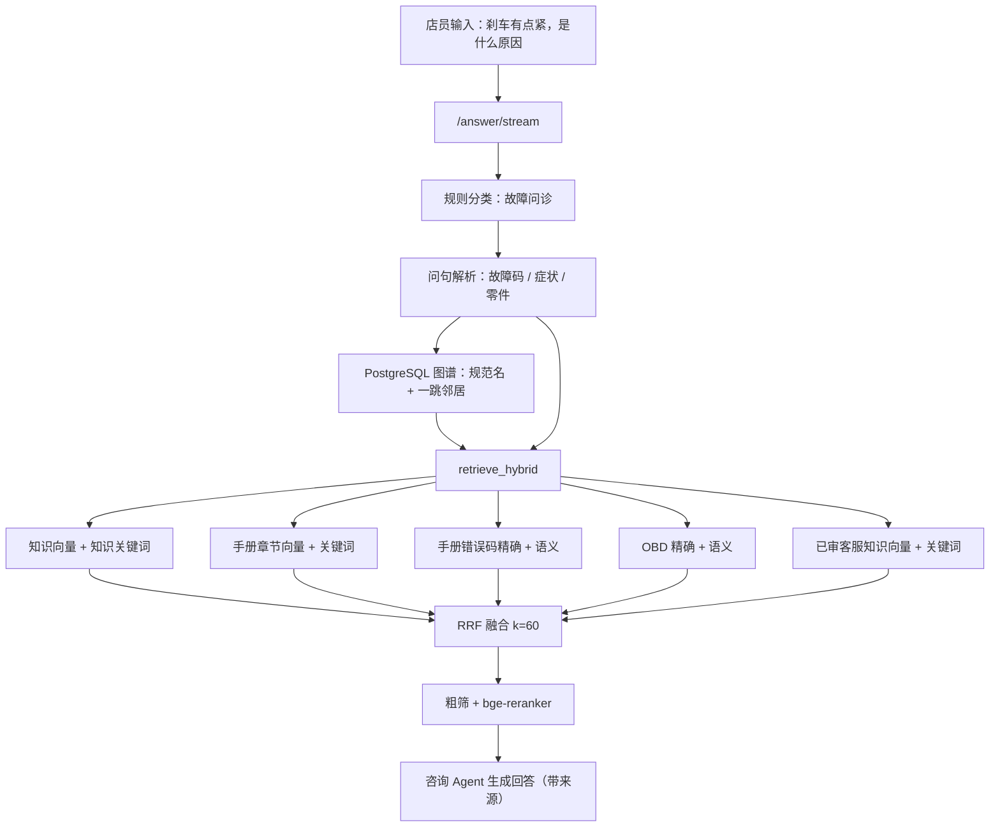

# RAG 多源改造技术方案

- **仓库**：[SHUN-EI/Car-Repair-System](https://github.com/SHUN-EI/Car-Repair-System)
- **编写日期**：2026-11-18（Asia/Shanghai）
- **依据版本**：对照当前工作区代码（主分支已含 pgvector / tsvector 混合检索与双 Agent 收口）
- **状态**：第一期已落地，并已补齐问诊链路：来源登记、OBD 库、手册章节与已审客服知识表接入 `retrieve_hybrid`；生成层按来源标注并遵守出处优先级；RRF 把新的关键词路按关键词分归一化；精确命中在截断前置顶；知识库主检索只召回已发布条目。原厂 PDF 自动切片入库、咨询会话自动落库与聊天蒸馏、工单发布时自动写图谱边尚未实现。现网表结构以 [ARCHITECTURE.md](./ARCHITECTURE.md) 和 Alembic `d6e7f8a9b0c1` 为准；本文与代码不一致时，以代码为准。
- **目标**：让现有 RAG 同时支撑非结构化维修文档（原厂维修手册、技术手册、完工工单、历史工单、用户与客服聊天记录）、结构化知识图谱（实体-关系-属性三元组）和 OBD 故障码库。
- **原则**：不换检索引擎；按来源分表；图谱用 PostgreSQL 实体表和关系表，不先引入 Neo4j；不新增第三个业务 Agent；不编造召回率或准确率。

正文用「刹车有点紧，是什么原因」做主例子，并用「热车怠速抖动，读到 P0300」对照有故障码时的差异。

---

## 1. 目标与原则

改造后，RAG 要同时支撑五类非结构化文档：原厂维修手册、技术手册、完工工单、历史工单、用户与客服聊天记录；再加上结构化三元组和 OBD 标准码库。原则如下。

1. **不换检索引擎**。继续使用现在的 PostgreSQL、pgvector、tsvector、RRF 和 `bge-reranker-v2-m3`。不引入 Milvus、OpenSearch 或独立图数据库作为本阶段的前提。
2. **按来源分表**。不要把所有文本写入 `knowledge_items`。案例归案例，手册归手册，OBD 归标准码，聊天原文先落业务表，审核后的客服知识才能进检索。
3. **图谱只做结构化扩展**。实体表和关系表回答「和谁相关」；原文检索仍走向量和关键词。问诊时默认只扩展一跳邻居。
4. **出处可追溯**。手册给章节和页码，案例给工单号，OBD 给标准码，客服知识给已审条目编号。
5. **合规**。原厂手册只用于门店内检索，不外发、不拿到外面做训练。原始聊天默认不直接进检索，须脱敏并经抽取、审核后再用。
6. **回答优先级**。原厂手册和 OBD 标准定义优先于店内案例，案例优先于客服常见问题。价格继续由目录规则计算，不用模型定价。
7. **产品边界不变**。问诊仍走咨询 / 引导 Agent；工单闭环仍走工单 Agent。HTTP、前端、钉钉、MCP 是渠道，不是第三 Agent。

---

## 2. 现网基线

现在实际可检索的只有两类。

| 现网对象 | 作用 | 缺口 |
| --- | --- | --- |
| `knowledge_items` | 完工工单抽取的维修案例；店员也可手工录入；种子样例带「案例」「保养规范」标签 | 没有知识类型字段；不适合存放原厂全文或聊天原文 |
| `manual_code_entries` | 说明书里的「错误码 → 诊断」权威映射 | 没有手册 PDF 入库，也没有按章节、页码切的正文 |
| 历史工单 PDF 导入 | 先解析成待确认工单，确认后再写入 `work_orders`，并可沉淀到案例库 | 这条链路是工单导入，不是原厂手册入库 |
| 汽修种子手册码 | P0300、P0420、C0035 三条样例 | 不是 OBD 标准码库 |
| `fault_code_mappings` | 工单填写用的内部对照表；手工新增会按工业设备类型生成 6 位编码 | 与 OBD 的 P/C/B/U 标准码不是同一套；且 Alembic 没有建表，只跑迁移的空库不会自动出现这张表 |
| Redis 会话 | 引导维修、专家模式等会话，TTL 约 86400 秒 | 不是可检索的客服语料库 |
| 图谱 | 无 | 没有实体表、关系表，也没有规范名合并 |

店员在「咨询 / 引导」页输入「刹车有点紧，是什么原因」时，现网只能走 `/answer/stream` 的规则分类和四路检索（知识向量、知识关键词、手册码精确、手册码语义），在已有案例和手册错误码里找相似内容。没有症状实体，没有手册制动章节，也没有标准 OBD 码库，材料不足时只能建议到店。

公共检索入口仍是 `backend/app/rag/retrieval_flow.py` 的 `retrieve_hybrid`，协议见 [ARCHITECTURE.md §4.1](./ARCHITECTURE.md#41-检索漏斗)。本文只扩展它的召回路和入参，不另起一套检索服务。

---

## 3. 总体架构

请求仍从 PC「咨询 / 引导」页进入 `/answer/stream`，由规则分类后交给咨询 / 引导 Agent。新增一个很浅的问句解析：抽出故障码、症状、零件，到图谱里找一跳邻居，再把这些编号和原句一起交给 `retrieve_hybrid`。检索入口不变，内部增加手册章节、OBD 和已审客服知识这几路召回，融合、粗筛、重排后把带出处的结果交给回答生成。



数据上新增来源登记、手册及章节、OBD 标准码、会话与消息、已审客服知识、图谱实体和关系。完工和历史工单继续进入现有案例库，发布时同步补图谱边。

---

## 4. 数据模型

### 4.1 来源登记

来源登记表记录每一批数据的种类、标题、版本、适用车型、原文件位置、校验和、版权与发布状态。种类至少包括：原厂维修手册、技术手册、完工工单、历史工单、客服对话、OBD 码库、图谱三元组。

例如：一本「2020 款某车维修手册」、一份标准 OBD 码表、一条已发布的刹车工单知识，都应在这里有登记，便于追溯和作废。

### 4.2 原厂维修手册与技术手册

单独建手册库，不要把全文写入 `knowledge_items`。

- **手册表**：厂牌、车型、年款区间、类型（原厂 / 技术手册）、语言、版本、原文件、版权说明、发布状态。
- **章节切片表**：所属手册、章节、页码起止、切片类型（工序、扭矩规格、电路说明、保养周期、一般说明）、正文、embedding、search_tsv。
- **原文件保留备查**，不要只存切片。电路图等以文件加说明为主；当前项目还没有看图诊断，本方案不把视觉模型纳入范围。
- 有故障码的章节仍写入现有 `manual_code_entries`，并增加手册编号、可选的 OBD 标准码外键。

以刹车为例，切片可能是：第 5 章第 32 页，「制动发紧检查：查看刹车片剩余量、盘面和导向销是否卡滞」。

### 4.3 完工工单与历史工单

继续走现有路径，不必另建一套案例库。

- 完工抽取、去重、审核、发布后同步向量，内容格式仍是故障现象、原因分析、排查步骤、处理方法、预防措施。
- 历史工单 PDF 仍经现有导入图，人工确认后再进入 `work_orders` 和知识库。
- 发布时可补上车型、系统、故障码等与图谱、OBD、手册章节的关联，但 `knowledge_items` 的职责不变：只存店里修过的经验。

例如完工工单「导向销卡滞导致刹车发紧」发布后，案例正文照旧，另增加与症状「刹车紧」、零件「导向销」、相关手册章节的关联。

### 4.4 用户与客服聊天记录

分成两层，避免把原始对话当成对其他用户的检索语料。

- **会话表与消息表**：渠道（咨询页、钉钉等）、门店、时间，以及脱敏后的原文。用于本会话上下文或质检，不默认进入 `retrieve_hybrid`。
- **已审客服知识表**：定期把有价值的对话抽成常见问题或症状说明，审核通过后再写入可检索库，并生成向量和关键词。来源标记为客服知识。

例如：原始对话「我这车刹车有点紧，昨天刚换过片」只留在该会话里，车牌和身份信息脱敏。抽取并审核后的可检索条目可以是「有人问刹车紧，常见方向是先检查盘片和导向销」。其他客户提问时，检索的是这条已审知识，不是某位车主的聊天原文。

咨询和钉钉会话不能只放在 Redis 里（现网约一天过期），需要持久化。

### 4.5 OBD 故障码库

新建标准码表，与现有两张码表分开。

| 表 | 表示什么 | 例子 |
| --- | --- | --- |
| 新建 `obd_codes`（名称以落地时的迁移为准） | SAE 风格的 P/C/B/U 标准定义：中英文含义、系统分类、常见原因、常规步骤、embedding、search_tsv | P0300 = 多缸随机失火 |
| 现有 `manual_code_entries` | 某本原厂或技术手册对错误码的权威说明 | 某车维修手册对 P0300 的点火系统步骤 |
| 现有 `fault_code_mappings` | 工单填写用的内部对照，不承担 OBD 标准库职责 | 工业设备 6 位编码，或工单补录的码 |

三者用关联接起来，不要合并成一张表。OBD 用许可或可商用的标准码表批量导入，按码去重。管理员可修订，但不要和内部 6 位工业编码混号。

### 4.6 结构化知识图谱（PostgreSQL）

用两张核心表，不必上 Neo4j。Neo4j 适合更深的多跳分析和可视化；本阶段问诊只需一跳扩展，用 PostgreSQL 即可与 pgvector、工单、手册共用事务、备份和门店部署。表结构预留以后迁出的可能，但不作为本阶段前置。

**实体表**记录类型、名称、规范名和 JSONB 属性。类型至少包括：车型、系统、零件、症状、故障码、工序、原因。规范名用来合并「刹车有点紧」「刹车发紧」「刹车紧」，以及「刹车片」「制动片」，避免重复建点。

**关系表**记录起点实体、关系类型、终点实体，属性放在 JSONB 中，并强制记下来源（哪篇手册章节、哪条 OBD、哪个工单案例或哪条已审客服知识）和置信度。关系类型至少包括：适用于、表现为、由……引起、对应故障码、需要零件、属于步骤 / 建议先做。

针对「刹车有点紧」，图谱里可以有：

| 起点 | 关系 | 终点 | 来源（示例） |
| --- | --- | --- | --- |
| 症状：刹车紧 | 涉及 | 零件：刹车片 | 原厂手册第 5 章第 32 页 |
| 症状：刹车紧 | 涉及 | 零件：导向销 | 原厂手册第 5 章第 32 页 |
| 症状：刹车紧 | 表现为 / 由……引起 | 原因：导向销卡滞 | 已发布工单案例 |
| 原因：导向销卡滞 | 建议先做 | 工序：检查导向销 | 原厂手册或案例 |

针对「P0300」可以有：故障码 P0300 —表现为→ 症状：怠速抖动；P0300 —可能由→ 零件：火花塞 / 点火线圈；P0300 —建议先做→ 工序：读取失火计数。来源分别是 OBD 标准定义、原厂手册或历史案例。

写入按规范名幂等，同一条三元组不重复插入。发布知识或导入手册时增量补边，改错时能按来源回滚。关系上建 `(起点, 关系类型)` 和 `(终点, 关系类型)` 索引。

和检索的分工：图谱负责「和谁相关」；向量和关键词负责「哪段原文该读」。

---

## 5. 入库流水线

### 5.1 手册

上传 PDF → 保存原文件并做来源登记 → 用现有 `pdfplumber` 解析，扫描件再走 OCR → 按标题和页码切片并分类 → 生成向量和关键词 → 人工核对后发布。错误码章节同步进入 `manual_code_entries`，并尽量挂到 OBD 标准码。制动相关章节发布时，同步建立「刹车紧」等实体和边。

这条流水线单独建设，不复用历史工单导入图的「抽成工单」语义，只复用解析能力。

### 5.2 完工工单与历史工单

保持现有完工自动抽取和历史 PDF 导入。知识发布时，除了写向量，再抽取实体和关系写入图谱，并尽量挂上 OBD 码或手册章节。抽取失败不得阻塞工单完成，可记为待补边。

### 5.3 聊天

从咨询页、钉钉等渠道落库并脱敏（车牌、电话、姓名等）。批量任务把对话抽成待审客服知识，店员或审核人通过后才进入检索。抽取失败或含隐私的内容不得自动发布。

### 5.4 OBD

用许可或可商用的标准码表做 JSON / CSV 批量导入，按码去重，生成向量。P0300 导入后即可被精确码检索命中。不把三条汽修样例当成码库已经就绪。

### 5.5 图谱

随 OBD、手册和已发布案例增量构建。必要时用对话模型抽三元组，但必须能回溯到原文，并允许人工改错。同一实体用规范名合并。

---

## 6. 问诊完整链路（结合例子）

### 6.1 主例子：刹车有点紧，是什么原因

店员在「咨询 / 引导」页输入该问句后，请求进入 `/answer/stream`。

1. **分类**。规则分类把它判为故障问诊，而不是闲聊或查库存，然后交给咨询 / 引导 Agent。`/answer/stream` 现网仍是规则分类、不用 LLM 兜底，本方案不改这一条。
2. **问句解析**。抽出症状「刹车紧」，没有故障码。将「刹车有点紧」归到规范名「刹车紧」。
3. **图谱一跳**。用规范名找到该症状，只看直接邻居，得到刹车片、导向销、检查导向销等实体，以及它们指向的手册章节、案例和客服知识编号。
4. **混合检索**。这些编号和原句一起进入 `retrieve_hybrid`。原有四路保留，并增加手册章节的向量和关键词、OBD 精确与语义、已审客服知识的向量和关键词。没有故障码时，OBD 精确匹配通常为空，主要靠章节、案例和客服知识召回。
5. **融合与重排**。RRF（k=60）融合后粗筛，再交给 `bge-reranker-v2-m3`。精确命中的 OBD 或手册码加权更高，图谱扩展出的结果低于直接命中。去重按来源编号。返回结果必须带来源类型和标题，以及手册的章节页码、工单号或已审客服知识编号。
6. **生成回答**。咨询 Agent 先说明刹车发紧的常见方向，再给出建议检查项目，并判断是否到店。出处分开写：原厂手册说法优先于店内案例，案例优先于客服知识。材料不足就建议预约到店，不编造唯一原因，也不给出模型估算价格。

示例回答结构（文案以落地实现为准，这里只约束信息结构）：

- 症状理解：刹车发紧，可能与盘片、导向销等有关。
- 建议项目：检查刹车片剩余量、盘面和导向销是否卡滞（注明手册第 5 章第 32 页）。
- 店内经验：若已有「导向销卡滞」案例，作为参考单独注明工单来源。
- 是否到店：涉及制动安全，建议预约到店检测。

若后来又有完工工单证实导向销卡滞，发布后图谱多一条来自该工单的边。下次再问类似问题，检索就能多带上这条真实案例。

### 6.2 对照例子：热车怠速抖动，读到 P0300

与上一例的差异只在解析和召回。

1. 系统同时抽出症状「怠速抖动」和故障码 `P0300`。
2. 图谱从故障码和症状两边扩展，带出火花塞、点火线圈、工序「读取失火计数」。
3. OBD 精确路直接命中标准定义「多缸随机失火」；手册精确或语义路可能命中该车型的失火说明；案例路召回店内类似工单。
4. 回答须明确区分三层出处：P0300 的标准含义是什么，原厂手册建议先做什么，店里以往类似工单是怎么处理的。引导排查时应停在「读取失火计数、检查点火侧」这一步，不把尚未确认的更换零件写成结论。

---

## 7. 检索协议、权限与评测

`retrieve_hybrid` 仍是唯一检索入口，对外保持「查询进，带出处的结果出」。问句解析得到的实体和图谱邻居作为可选过滤或加权信号传入，不绕开漏斗另查一套。

阈值先沿用现网配置（见 ARCHITECTURE.md），上线后再按「刹车紧」「P0300」这类样例题分路重调。方案里不预设召回率或准确率。评测集应分来源看：出处是否正确、冲突时是否遵守优先级、材料不足时能否拒绝编造、是否泄漏其他客户的聊天原文。

权限：

- 店员问诊可以使用已发布的全部来源。
- 若以后开放车主问诊，默认只给 OBD 通用解释和经过允许的手册摘录，不能看到他人的工单或聊天；原厂全文仍受版权限制。车主问诊本身不在本方案的实施范围内，只预留权限边界。
- 案例和聊天按门店隔离（设计如此）。`consult_faqs` 检索已支持按 `store_id` 过滤（含全局条目）；问诊入口尚未传入当前门店。`knowledge_items` 仍没有门店字段，案例暂时全库可见。
- 入库、发布、作废由管理员或指定审核人操作。

---

## 8. 落地顺序

| 阶段 | 内容 | 验收直观标准（不设虚假指标） | 落地情况 |
| --- | --- | --- | --- |
| 一 | 来源登记；新建 OBD 标准码库并导入；把 OBD 精确和语义检索接入 `retrieve_hybrid` | 店员输入 P0300，能看到标准含义和常规步骤，并带来源 | **已落地**：表 `obd_codes`、接口 `/api/v1/obd-codes`、样例脚本 `scripts/seed_rag_multisource.py` |
| 二 | 原厂 / 技术手册 PDF 入库、章节检索和出处展示；手册错误码挂到 OBD | 「刹车有点紧」能引用手册制动章节和页码，而不只靠案例 | **部分落地**：`repair_manuals` / `repair_manual_chunks` 与章节检索已接通；样例写入制动章节。PDF 自动切片入库未做 |
| 三 | 补强完工和历史工单链路，已发布案例关联 OBD、手册和图谱实体 | 发布刹车相关工单后，案例能挂到「刹车紧」等实体 | 尚未自动从发布工单写图谱边；样例把既有「发动机怠速抖动」案例链到 P0300 |
| 四 | 咨询和客服对话持久化、脱敏、抽取与审核 | 原始聊天不进检索；已审客服知识可被召回并带来源 | **部分落地**：会话表和 `consult_faqs` 检索已接通，并有一条已审样例。问诊通道尚未自动写会话，蒸馏未做 |
| 五 | 实体表、关系表、规范名合并和一跳扩展；分来源评测集 | 「刹车有点紧」能经图谱扩展后再检索，回答遵守出处优先级 | **部分落地**：图谱一跳已接通；问诊提示词与参考文本已写入出处优先级（原厂/OBD 高于案例，案例高于客服知识）。分来源评测集未做 |

需要启用时：先执行 `alembic upgrade head`（修订 `d6e7f8a9b0c1`），再在 `backend` 目录运行 `python scripts/seed_rag_multisource.py`；推理服务可用时加上 `--sync` 回写向量。新表未迁移时，对应召回路会记日志并返回空，不打断原有四路。

---

## 9. 明确不做的事

- 不要把原厂全文、聊天记录和 OBD 码全部写入 `knowledge_items`。
- 不要为这几类数据再引入搜索引擎或图数据库；若以后出现稳定的多跳分析需求，再把同一份三元组迁到 Neo4j。
- 不要新增第三个业务 Agent。
- 不要把未审核的聊天或未发布的手册送进检索。
- 不要在没有评测集之前，用假的召回率或准确率做验收。
- 不要顺手修改现网权限漏洞、钉钉门面接线、支付清算、看图诊断或车主问诊，那些不在本文范围。

---

## 10. 与现有文档的关系

- 现网检索漏斗、阈值和表结构以 [ARCHITECTURE.md](./ARCHITECTURE.md) 为准；多源表字段见该文档 §6.2。
- 中间件（PostgreSQL、Redis，以及为何没有 MySQL / Milvus / Kafka）以 [中间件.md](./中间件.md) 为准。
- 双 Agent 边界以 [双Agent精简技术方案.md](./双Agent精简技术方案.md) 为准。本文只扩展咨询 Agent 使用的检索语料，不改变 Agent 数量。
- 建表快照在仓库 `sql/`，Alembic 头修订为 `d6e7f8a9b0c1`，共 43 张表。

---

## 11. 核心代码举例

以下摘自当前工作区实现，便于对照方案阅读；完整逻辑以对应源文件为准。

### 11.1 问句解析：口语症状归到规范名

店员输入「刹车有点紧，是什么原因」时，先把「刹车有点紧」归到「刹车紧」，再拿这个规范名去查图谱。故障码继续复用现有 `extract_error_codes`，并补上 SAE 形态的 P/C/B/U。

```python
# backend/app/rag/query_parse.py
SYMPTOM_ALIASES = {
    "刹车有点紧": "刹车紧",
    "刹车发紧": "刹车紧",
    "刹车很紧": "刹车紧",
    "刹车紧": "刹车紧",
    "制动发紧": "刹车紧",
    "踏板发硬": "刹车紧",
    "热车怠速抖动": "怠速抖动",
    "怠速抖动": "怠速抖动",
    "怠速不稳": "怠速抖动",
    "车身抖动": "怠速抖动",
}

parsed = parse_consult_query("刹车有点紧，是什么原因")
# parsed.symptoms == ["刹车紧"]
# parsed.error_codes == []
# parsed.canonical_keys == ["刹车紧"]
```

「热车怠速抖动，读到 P0300」会同时得到症状「怠速抖动」和标准码 `P0300`。

### 11.2 混合检索入口：原有四路之外再追加多源

`retrieve_hybrid` 仍返回 `(merged, error_codes, tools)`，避免打坏现有调用方。新表不存在或查询失败时，对应路返回空列表。

```python
# backend/app/rag/retrieval_flow.py（多源追加段）
if parsed.error_codes:
    obd_exact = search_obd_exact(parsed.error_codes, top_k=10)
    if obd_exact:
        result_sets.append(obd_exact)
obd_sem = search_obd_semantic(query, top_k=10)
# 手册章节、已审客服知识同样各走向量 + 关键词
chunk_vec = search_manual_chunks_vector(query, top_k=top_k)
chunk_kw = search_manual_chunks_keyword(query, top_k=top_k)
faq_vec = search_faq_vector(query, top_k=top_k)
faq_kw = search_faq_keyword(query, top_k=top_k)

if expand_graph and parsed.canonical_keys:
    expansion = expand_one_hop(graph_db, parsed.canonical_keys)
    linked = fetch_linked_sources(expansion.get("source_refs") or [], db=graph_db)
    if linked:
        result_sets.append(linked)

# 先完整融合，再把 OBD / 手册错误码精确命中置顶后截断，避免先截断丢掉权威命中
merged = rrf_merge(result_sets, top_n=None) if result_sets else []
merged = pin_exact_hits(merged, top_k)
return merged, error_codes, tools
```

客服知识检索在传入 `store_id` 时，只返回该门店或 `store_id` 为空的全局条目。

去重键必须带来源前缀，避免和知识库、手册错误码的自增主键撞车：案例 `K:{id}`、手册错误码 `M:{id}`、OBD `O:{id}`、手册章节 `C:{id}`、客服知识 `F:{id}`。

### 11.3 OBD 精确命中

P0300 走精确路时，命中分记为 1.0，方法名为 `obd_code_exact`，只取已发布条目。

```python
# backend/app/rag/multisource_search.py
rows = (
    session.query(ObdCode)
    .filter(ObdCode.code.in_(wanted), ObdCode.status == "PUBLISHED")
    .limit(top_k)
    .all()
)
return [_obd_item(row, score=1.0, method="obd_code_exact") for row in rows]
```

### 11.4 图谱一跳后回查原文

「刹车紧」命中实体后，不把图谱三元组直接当答案，而是取出关系上的 `source_ref`（如 `chunk:12`、`faq:3`、`obd:P0300`），再把对应正文送进 RRF。

```python
# backend/app/rag/graph_service.py
starts = _find_entities(db, keys)
start_ids = {row.id for row in starts}
relations = db.query(KgRelation).filter(
    (KgRelation.subject_id.in_(start_ids)) | (KgRelation.object_id.in_(start_ids))
).all()
# 每条关系收集 {"kind": source_kind, "ref": source_ref}
# 再由 fetch_linked_sources() 取出手册章节、OBD、已审客服知识或案例正文
```

### 11.5 样例数据如何对应两个问句

`backend/scripts/seed_rag_multisource.py` 会幂等写入：

- OBD 样例码：`P0300`、`P0301`、`P0420`、`C0035`、`P0171`
- 原厂手册样例中的「制动踏板发紧的检查步骤」（第 5 章，页码 5-12 至 5-14）
- 已审客服知识「刹车有点紧常见原因」
- 图谱：`刹车紧`（别名含「刹车有点紧」）→ `caused_by` 卡钳回位不良，并挂上手册章节；`怠速抖动` → `has_code` `P0300`

因此迁移并执行种子脚本后，「刹车有点紧」应能引用手册章节和已审客服知识，「读到 P0300」应能引用标准码含义。向量列需推理服务可用时加 `--sync` 才写入；未同步时关键词路仍可用。

### 11.6 来源标注、关键词融合与已发布过滤

生成层不再只区分「手册错误码 / 工单案例」。`app.rag.source_cite` 按 `source_type` 写出 OBD、原厂手册、技术手册、设备手册、工单案例和客服知识的出处；智能问答、追踪维修和专家模式注入模型的参考文本都走同一套标注。提示词要求冲突时按「原厂手册 / OBD > 技术手册与设备手册错误码 > 工单案例 > 客服知识」取舍，价格仍以目录为准。

`rrf_merge` 把 `obd_keyword_search`、`manual_chunk_keyword`、`faq_keyword_search` 与原来的 `bm25_search` 一样当作关键词分并打上 `rrf_only`，未同步向量时这些结果不会因为 `ts_rank` 低于 0.45 被粗筛丢掉。`filter_rerank_cases` 对 `obd_code_exact` 与 `manual_code_exact` 同等置顶和低分豁免。

知识库主检索（`vector_store.search` 与 tsvector 关键词路）默认只召回 `status = PUBLISHED` 的条目。知识去重仍会把 `published_only=False` 传进去，以便看到草稿和审核中的相似条目。
