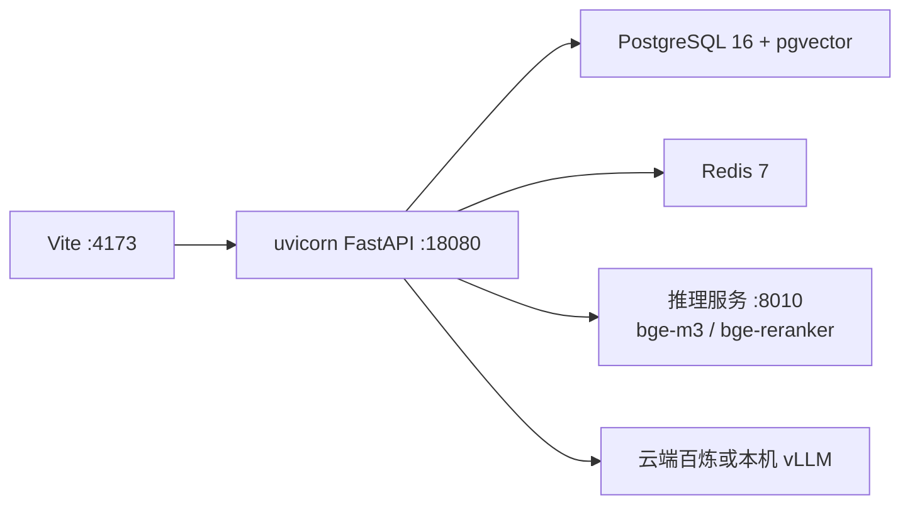

# 中间件：PostgreSQL、Redis

本文按「先列介质、再写键与表、只写仓库里已经在用的东西」这一体例，整理本项目的中间件。参考的是另一份四存储说明的写法，但介质以本仓库现网代码为准：业务库和检索都在 PostgreSQL，短期会话和业务缓存在 Redis。本项目没有 MySQL、没有独立的向量库 Milvus，也没有 Kafka。

规格、阈值和表字段仍以 [`ARCHITECTURE.md`](./ARCHITECTURE.md) 为准。建表语句的可读快照在仓库根目录 [`sql/`](../sql/)，现网升级请用 Alembic，不要用这些文件或根目录的 `init-db.sql` 建库。

---

## 术语表

- **OLTP**：本项目 PostgreSQL 库，默认名 `maintenance_db`。工单、账号、知识、库存、预约、报价等业务行都在这一库。
- **pgvector**：PostgreSQL 扩展。知识条目和手册错误码的 `embedding vector(1024)` 写在业务表上，与行数据同库，不再复制到独立集合。
- **tsvector / `search_tsv`**：知识表上的生成列，供关键词路 `ts_rank` 使用。分词由 `repair_text_tokens()` 与 `app.rag.lexical.tokenize_repair_text` 共用。
- **兼容点号 `milvus_id`**：列名还在，值已是 `pg:k:{id}` / `pg:m:{id}`，不再指向 Milvus。
- **`CacheService`**：`app.core.cache_service` 里的 Redis 客户端封装。逻辑键会再加前缀 `maint:`，默认 TTL 300 秒；连不上 Redis 时退回进程内字典。
- **记忆门面**：`app.memory.memory_service`。引导维修、专家模式和 MCP 员工会话走这里；库存、用户等业务缓存仍由各 API 直接调 `cache_service`。
- **Alembic**：数据库结构的应用路径，当前头修订是 `c4d5e6f7a8b9`。

---

## 数据放在哪

| 介质 | 在项目里干什么 | 权威 | 挂了会怎样 |
|------|----------------|------|------------|
| PostgreSQL 16，镜像 `pgvector/pgvector:pg16`，库 `maintenance_db` | 全部业务表、知识/手册向量、知识关键词检索、`pg_trgm` 模糊匹配 | 业务行和向量列 | 接口读不了库。`/health` 为 degraded。进程可以起来，但主路径不可用。代码和迁移里没有分库分表 |
| Redis 7 | 短期会话，以及用户、备件、库存预警等读缓存 | 会话以 Redis 为准（挂了会降到进程内存，多进程不共享）；业务行仍以 PostgreSQL 为准 | 缓存和会话退到进程内字典。`/health` 为 degraded。不阻止 FastAPI 启动。限流本来就不走 Redis |

开发编排是仓库根目录的 `docker-compose.dev.yml`：只启动 PostgreSQL 和 Redis，后端在本地跑。默认映射是 Postgres `15432→5432`、Redis `6379→6379`。`backend/.env.example` 里 Redis 端口写成过 `7379`，以实际 `.env` 和 `config.py` 为准，后者默认仍是 `6379`。

根目录另有一份 `docker-compose.yml`，内容是 RAGFlow 编排（其中出现 MySQL）。本应用的启动和检索链路不使用它，也不要把那里的 MySQL 当成本项目的业务库。

推理服务和对话模型是模型底座，不是中间件，详见 [ARCHITECTURE §3.4](./ARCHITECTURE.md#34-大模型底座本地检索-vs-远程生成)。钉钉 Stream、OA 同步和到期回访提醒挂在 FastAPI 进程内的 APScheduler 上，没有消息队列。

---

## PostgreSQL

连接串由 `DB_USER` / `DB_PASSWORD` / `DB_HOST` / `DB_PORT` / `DB_NAME` 拼出，或直接给 `DATABASE_URL`。代码默认是 `admin` / `admin123` / `localhost` / `15432` / `maintenance_db`。

`app.core.database`：同步引擎 `postgresql+psycopg2`，异步引擎 `postgresql+asyncpg`，`pool_size=10`，`max_overflow=20`，`pool_pre_ping=True`。每个同步连接会注册 pgvector 适配器。现网 API 主路径走同步 `SessionLocal` / `get_db()`。

扩展在迁移里安装，快照见 `sql/00_extensions.sql`：`vector`、`pg_trgm`。函数 `repair_text_tokens()`、`knowledge_search_tsv()` 见 `sql/01_functions.sql`。原生枚举只有 `workorderstatus`（20 个值）和 `knowledgestatus`（5 个值），见 `sql/02_enums.sql`。角色、请假、班次、报价和支付状态是 VARCHAR，不是 PostgreSQL 枚举。

### 业务表

代码里能核对到 34 张 SQLAlchemy 表，建表语句按外键顺序写在 `sql/03_tables.sql`，字段表格见 [ARCHITECTURE §6.2](./ARCHITECTURE.md#62-表结构)。分组如下：

| 分组 | 表 |
|------|----|
| 组织与账号 | `users`、`customers` |
| 门店、客户与车辆 | `stores`、`bays`、`vehicles` |
| 工单与导入 | `work_orders`、`work_order_progress_logs`、`work_order_imports`、`work_order_import_items` |
| 知识与手册 | `knowledge_items`、`manual_code_entries` |
| 设备与分类 | `devices`、`categories`、`fault_codes`、`fault_code_mappings`、`fault_phenomenon_categories`、`root_cause_categories`、`sys_configs` |
| 备件、库存与采购 | `part_skus`、`spare_parts`、`store_part_stocks`、`stock_transactions`、`purchase_orders`、`purchase_order_items` |
| 套餐、报价与支付 | `service_packages`、`service_skus`、`quotes`、`payment_intents` |
| 预约与回访 | `appointments`、`follow_up_reminders`、`notifications` |
| 排班与请假 | `duty_schedules`、`leave_requests` |

其中 `fault_code_mappings`、`fault_phenomenon_categories`、`root_cause_categories` 只在模型（以及历史 `init-db.sql`）里定义，Alembic 没有 `create_table`。只跑迁移的空库不会自动出现这三张表，语句仍写在 `sql/` 里便于对照。

门店隔离是查询条件 `store_scope`，不是物理分片。没有分库分表。

### 向量与关键词检索

这两路都在同一套 PostgreSQL 里完成，开发编排不再启动 Milvus、etcd、MinIO 或 Attu。

| 对象 | 说明 |
|------|------|
| `knowledge_items.embedding` | `vector(1024)`，bge-m3 dense，HNSW（`vector_cosine_ops`，`m=16`，`ef_construction=64`） |
| `knowledge_items.search_tsv` | 生成列 `tsvector`：标题和故障码权重 A，正文 B，标签 C |
| `knowledge_items.milvus_id` | 兼容点号，新值为 `pg:k:{id}` |
| `manual_code_entries.embedding` | 同模型、同索引；手册关键词仍走精确错误码路，不建 `search_tsv` |
| `manual_code_entries.milvus_id` | 兼容点号，新值为 `pg:m:{id}` |

检索时设置 `hnsw.ef_search`，由 `PGVECTOR_EF_SEARCH` 控制，默认 64。pgvector 的 `<=>` 是余弦距离，出口分数映射为 `1 - distance`。关键词路工具名仍叫 `bm25_search`，实际是 `ts_rank`；失败时回退加权 ILIKE。额外的 HNSW / GIN / `pg_trgm` 索引见 `sql/04_indexes.sql`。

`VectorStore` / `LogCodeVectorStore` 保留原方法名，读写的是上述列。`flush` 对 PostgreSQL 是空操作。`delete` / `drop_collection` 只清空 embedding 和点号，不删业务行。发布知识或跑 `scripts/sync_vectors.py` 才会写入向量；迁移不会回填 embedding。推理服务不可用时，混合检索降级为关键词-only。

不要用根目录 `init-db.sql` 建现网库：它的工单状态枚举是早期工业子集，文件自己写明会和 Alembic 分叉。新环境在 `backend` 目录执行 `alembic upgrade head`。已有 PG16 数据卷可继续使用，但必须换成带 pgvector 的镜像并重建容器，再跑迁移。

---

## Redis

默认配置：`REDIS_HOST=localhost`，`REDIS_PORT=6379`，`REDIS_DB=0`，无密码。未填写 `REDIS_URL` 时由这几项拼出。容器名在开发编排里是 `maintenance_redis`。

`CacheService` 用 `redis.from_url`，`decode_responses=True`，连接超时 2 秒，首次使用时才 `ping`。值以 JSON 写入，键类型是 String，过期用 `SET EX`。按模式失效走 `SCAN` + `DELETE`。模块注释里提到「分布式锁基础」，但代码没有实现锁接口，现网也不用 Redis 做锁、限流、JWT 会话或 LangGraph 检查点。

装饰器 `memoize` 已定义，调用方尚未使用。`ticket_agent.py` 虽然导入了 `cache_service`，现网分析路径并不读写 Redis。

### 短期会话（经记忆门面）

调用方不要自己拼 key 或传 TTL。下面写的是加上 `maint:` 之后的实际 Redis 键。TTL 都是 86400 秒（24 小时）。

| Key | TTL | 用途 |
|-----|-----|------|
| `maint:guided_repair_session:{session_id}` | 86400 | 追踪维修短期会话，最多 30 步 |
| `maint:expert_repair_session:{session_id}` | 86400 | 专家模式短期会话，最多 30 步 |
| `maint:mcp/staff_guid:session:{staff_id}` | 86400 | MCP/钉钉员工到追踪维修 `session_id` 的映射 |
| `maint:mcp/staff_guid:last:{staff_id}` | 86400 | 该员工最后活动时间；空闲超过 24 小时开新会话 |

会话到期后 `CacheService.get` 返回空，调用方按会话不存在处理。工作记忆（scratchpad）只存在于当次请求，不写 Redis。现网没有独立的长期记忆事实表，会话摘要计算后仍写回短期会话 payload。JWT 过期在令牌 `exp` 上，30 分钟，不单独写 Redis。

### 业务读缓存（直接走 `cache_service`）

| Key | TTL | 写入 / 失效 |
|-----|-----|-------------|
| `maint:user:{user_id}` | 300 秒 | 用户详情命中缓存；更新或删除该用户时删键 |
| `maint:spare_part:{part_id}` | 300 秒 | 备件详情命中缓存；改库存或删备件时删键 |
| `maint:stock_alerts:{scope.mode}:{store_id 或 none}` | 30 秒 | 库存预警列表；领料、改库存、采购入库等路径按 `stock_alerts:*` 失效 |

业务行的权威仍是 PostgreSQL。缓存只加速高频读，失效失败不会改业务结果。

### 不在 Redis 里的东西

`app.core.rate_limit.hit` 是进程内滑动窗口：`/api/v1/session` 的摘要接口按 `session-summarize:{user_id}` 限制 60 秒 10 次，`/api/v1/search` 的 agent 检索按 `search-agent:{user_id}` 限制 60 秒 20 次。多副本时各算各的，不能替代网关限流。Reranker 冷却 60 秒也是进程内时间戳。

`/health` 会分别探测数据库、Redis、`pgvector` 扩展和推理服务。整体是否 healthy 只看数据库和 Redis 是否连通；pgvector 或推理服务单独失败不会把核心状态直接打成 down，但检索可能降级。

---

## 本项目没有的中间件

对照那份「MySQL、Redis、Milvus、Kafka」说明，下面这些在本仓库现网代码里都不存在，也不要按那套链路去部署。

| 介质 | 本项目现状 |
|------|------------|
| MySQL | 业务库是 PostgreSQL。不要把根目录 `docker-compose.yml` 里 RAGFlow 的 MySQL 当成应用依赖 |
| Milvus（以及 etcd、MinIO、Attu） | 已迁到 pgvector。`docker-compose.dev.yml` 明确不再启动它们。配置里的 `MILVUS_VECTOR_SIZE` 只是 `VECTOR_DIM` 的兼容别名 |
| Kafka | 没有采集主题、没有 drain 消费组、没有发件箱表。凌晨同步类任务若存在，也是 FastAPI 进程内的 APScheduler：每天 01:00 同步近 3 天钉钉 OA 请假审批，每 30 分钟发送已到期的回访/评价提醒 |

如果以后要加消息队列或独立向量库，需要另写方案并改代码，不能直接套用那份四存储文档里的表、collection 或主题。
