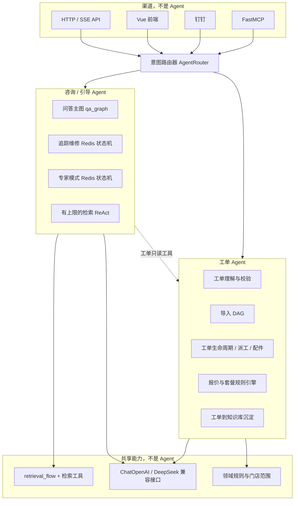

# 汽修系统双 Agent 精简技术方案

- **仓库**：[SHUN-EI/Car-Repair-System](https://github.com/SHUN-EI/Car-Repair-System)
- **依据版本**：当前 `main`（PR #6 已合并，提交 `c605c6f6`；落地前再核对最新 HEAD）
- **编写日期**：2026-11-12（Asia/Shanghai）
- **目标**：把第一类 Agent 精简为恰好 2 个——**咨询/引导 Agent**、**工单 Agent**
- **原则**：严格按现网代码梳理能力，不编造功能或量化指标；渠道不是 Agent；现有 HTTP 路径尽量兼容；本方案不顺手修复 PR #6 合并后仍遗留的隔离/鉴权问题

---

## 1. 要解决什么问题

现网已经具备完整的问答、引导维修、工单闭环和知识沉淀能力，但「Agent」在代码里是多套并列入口，而不是统一产品形态：

- `backend/app/agents/` 下一共 18 个业务模块，其中至少 8 个以 Agent / Graph 自居（问答图、检索 ReAct、追踪维修、专家模式、工单理解、去重、知识抽取、钉钉机器人图、工单导入 DAG 等）。
- 同一类用户请求会从不同入口进入：`/api/v1/search/answer/stream`、`/answer/expert`、`/guided-repair/*`、钉钉 `RobotGraph`、MCP `search_knowledge`，检索策略虽已收到 `retrieval_flow.py`，但编排和会话状态仍分散。
- 钉钉 `robot_graph.py` 把帮助、建单、待办、库存、维修引导、值班、工单查询写在同一张图里，咨询与工单写操作缠在一起。
- 前端同时存在 `search`、`ai-assistant` 等入口，产品层缺少「只有两个 Agent」的清晰边界。

本方案要做的是**编排收敛**，不是重写检索或重做业务域：对外只暴露两个 Agent，对内把现有模块收成「能力」挂到这两个门面之下。

---

## 2. 现网 Agent 与相关模块（基于代码）

### 2.1 `backend/app/agents/` 模块清单

| 模块 | 现网角色（摘自模块说明） | 精简后归属 |
| --- | --- | --- |
| `qa_graph.py` | 智能问答 LangGraph：主图意图路由到闲聊 / 库存 / 故障问答子图；由 `POST /api/v1/search/answer/stream` 调用 | **咨询/引导 Agent**（问答主图保留） |
| `retrieval_agent.py` | 知识检索助手：向量 + 关键词 + RRF，有上限的 ReAct 循环，不足则改写重试 | **咨询/引导 Agent** 内部检索循环 |
| `guided_repair_agent.py` | 追踪维修引导：逐步排查，Redis 会话，返回结构化选项 | **咨询/引导 Agent**（多轮不上图） |
| `expert_repair_agent.py` | 专家模式多轮：首轮拆解与并行分析之后的会话（TTL 24h、最多 30 步，超长历史由摘要压缩） | **咨询/引导 Agent**（多轮不上图） |
| `fault_decomposer.py` | 复合故障拆成单故障子查询，供专家模式并行检索 | 咨询/引导 Agent 内部能力 |
| `session_summarizer.py` | 压缩长对话历史 | 咨询/引导 Agent 内部能力 |
| `query_extractor.py` | 查询关键词：白名单优先，LLM 兜底 | 共享检索能力（两 Agent 只读复用） |
| `answer_generator.py` | 分析型回答生成器，模块自身标明「功能工具模块，非 Agent」 | 共享生成能力 |
| `retrieval_flow.py` / `tools.py` | 公共检索编排与检索工具集（双库 + RRF + 粗筛/精排），供问答图、钉钉/MCP、专家模式、历史检索端点复用 | **共享检索层**，不属于任一 Agent 独占 |
| `ticket_agent.py` | 工单理解：标准化 / 分类 / 校验，置信度仅供人工审核参考 | **工单 Agent** |
| `work_order_importer.py` | 历史工单 PDF 导入 LangGraph：parse → extract → validate → save_draft，人工确认后才写生产库 | **工单 Agent** |
| `knowledge_extractor.py` | 从已审核工单提炼知识条目 | **工单 Agent**（工单→知识沉淀） |
| `dedup_agent.py` | 知识条目去重判定（同原因+同方案才算重复） | **工单 Agent**（沉淀链路） |
| `inventory_tools.py` | 库存/适配查询，说明用于工单录入时关联备件 | **工单 Agent** 工具；咨询侧库存问询只读调用 |
| `service_tools.py` | 保养套餐推荐，规则在 `domain.service_recommend`，供 API 与 MCP 共用 | **工单 Agent** 工具（规则引擎，不交给 LLM 定价） |
| `manual_structurizer.py` | 手册错误码原文结构化，只出结构化结果、不落库，供人工核对 | **知识录入辅助工具**，不是第三 Agent |
| `robot_graph.py` | 钉钉机器人主图：help / create / todo / inventory / repair / duty + 工单查询子图 | **渠道适配器 + 路由**，不再作为独立 Agent |

### 2.2 现网主要入口

| 入口 | 路径或位置 | 现网行为 |
| --- | --- | --- |
| 智能问答 SSE | `POST /api/v1/search/answer/stream` | `qa_graph`：thinking →（suggest_expert）→ references → 流式 answer → done |
| 专家模式 | `POST /api/v1/search/answer/expert`、`/answer/expert/step` | 首轮拆解 + 并行检索分析，后续轮走 `ExpertRepairAgent` |
| 追踪维修 | `POST /api/v1/search/guided-repair/start`、`/{session_id}/step`、`/chat` | `GuidedRepairAgent` Redis 状态机 |
| 历史检索端点 | `GET /quick`、`POST /hybrid`、`/agent`、`/manual-lookup` | 复用 `retrieval_flow` |
| 会话摘要 | `POST /api/v1/session/summarize` | 压缩对话历史 |
| 钉钉机器人 | `POST /api/v1/dingtalk/robot/callback` 等 | `RobotGraph` 混合咨询与工单动作；技术完成等走工单状态机 |
| 工单导入 | `backend/app/api/work_order_imports.py` | 调用导入 DAG，待人工确认 |
| 工单域 HTTP | `work_orders.py` 及报价、派工、配件等路由 | 工单生命周期，当前主要是 API/领域服务，尚未收口到单一 Agent 门面 |
| MCP | `backend/app/mcp/`（FastMCP） | 检索问答、库存查询等工具；公开入口与写工具默认关闭 |
| 前端 | `search`、`ai-assistant`、工单/导入/套餐等页面 | 多入口，尚未按两个 Agent 呈现 |

### 2.3 必须保留的现网约束（本方案不改策略）

- 检索：BAAI/bge-m3（1024 维）+ Qwen3-Reranker-0.6B；四路混合检索（知识向量、关键词 ILIKE + `pg_trgm`、手册精确与语义）；RRF `k=60`；粗筛与质量阀；Reranker 不可用时回退规则重排。
- 对话模型：LangChain `ChatOpenAI` + `DEEPSEEK_BASE_URL` / `DEEPSEEK_MODEL`，切换本机 vLLM 或后训练模型只改环境变量。
- 编排原则（现网已采用）：**固定拓扑上图、多轮不上图**。问答主图、导入 DAG 可用 LangGraph；追踪维修 / 专家多轮保持 Redis 状态机（TTL 24h、最多 30 步），不要把运行时才确定的会话状态硬塞进图。
- 报价与套餐：确定性规则引擎，与生成模型解耦；后训练不替代定价。
- 工单导入与知识沉淀：必须经人工确认 / 审核后再入生产库或向量库。
- 鉴权、门店范围、MCP 默认关闭公开入口与写工具：本方案不回退已落地的约束。

---

## 3. 目标架构

对外只承认两个第一类 Agent。HTTP、前端、钉钉、MCP 都是渠道，先经过一层薄路由，再进入其中一个 Agent。



路由原则：

1. 每个请求只派给一个 Agent 作为主责任方。
2. 咨询过程中用户问到「某张工单进度 / 内容」时，咨询/引导 Agent 可以调用工单 Agent 的**只读**工具；创建、改状态、审批、完工、扣料等写操作必须交给工单 Agent。
3. 钉钉的对话诊断、帮助、库存咨询走咨询/引导；建单、待办处理、审批、完工走工单 Agent。
4. 不新增第三个 Agent。手册结构化、阈值标定、embedding 服务仍是工具或基础设施。

---

## 4. 两个 Agent 的职责

### 4.1 咨询/引导 Agent

**职责**：面向维修员或车主的咨询、诊断与逐步引导，不直接改写工单状态。

| 能力 | 复用现网实现 | 说明 |
| --- | --- | --- |
| 智能问答 | `qa_graph`（闲聊 / 库存查询 / 故障问答） | 保持现有 SSE 事件协议 |
| 混合检索与质量阀 | `retrieval_flow`、`tools`、`retrieval_agent` | 不改阈值与融合公式 |
| 追踪维修 | `guided_repair_agent` | Redis 会话，结构化选项 |
| 专家模式 | `fault_decomposer` + 并行检索 + `expert_repair_agent` | 首轮分析 + 多轮引导 |
| 意图预检 | 错误码正则、关键词白名单、检索打分阀门 | 减少闲聊/低置信结果直接给诊断建议 |
| 工单只读 | 调用工单 Agent 读工具 | 例如查询工单进度，但不改状态 |

### 4.2 工单 Agent

**职责**：工单从进入系统到关闭，以及由工单沉淀知识。定价与状态迁移由规则/状态机执行，LLM 只做理解、抽取和草稿。

| 能力 | 复用现网实现 | 说明 |
| --- | --- | --- |
| 工单理解 | `ticket_agent` | 标准化 / 分类 / 校验，最终仍人工审核 |
| PDF 导入 | `work_order_importer` DAG | 确认前只写草稿 |
| 生命周期 | `domain/work_order_status` + `api/work_orders` 等 | 创建、流转、派工、完工 |
| 报价与套餐 | `domain` 规则 + `service_tools` | LLM 不得改价格 |
| 配件关联 | `inventory_tools` | 录入与出库按现网规则 |
| 知识沉淀 | `knowledge_extractor`、`dedup_agent`，再入审并同步向量库 | 继续双集合 `knowledge` / `log_code` |
| 渠道写操作 | 钉钉建单 / 待办 / 完工等 | 从 `robot_graph` 对应节点迁入本 Agent |

### 4.3 意图路由表（落地时按此实现，并补测试）

| 用户意图或入口 | 主 Agent | 备注 |
| --- | --- | --- |
| 故障咨询、手册/案例问答、闲聊、功能介绍 | 咨询/引导 | `qa_graph` 已有三类子图 |
| 库存「查一下有没有某配件」 | 咨询/引导 | 只读；写出入库仍归工单/进销存 API |
| 追踪维修、专家模式多轮 | 咨询/引导 | 不上图，走 Redis 状态机 |
| 查询工单进度、内容 | 工单；或咨询调用只读工具 | 以是否处于引导会话决定入口，写操作仍禁止走咨询 |
| 创建/导入/派工/改状态/审批/完工/扣料 | 工单 |  |
| 报价、套餐推荐并落到工单 | 工单 | 规则引擎出结果 |
| 已审核工单提取知识、去重、待审入库 | 工单 |  |
| 手册原文结构化 | 知识录入工具 | 不计入 Agent 数量 |
| MCP 检索问答 | 渠道 → 咨询/引导 | 保持公开入口默认关闭 |
| MCP 库存/工单类工具 | 渠道 → 对应 Agent | 写工具默认关闭 |

---

## 5. 建议代码落点（兼容优先）

不提倡第一期把 18 个文件全部改名搬迁。先加门面和路由，旧模块作为内部实现保留，必要时留别名。

建议新增（名称可按仓库风格微调，但必须语义稳定）：

```text
backend/app/agents/
  router.py                 # AgentRouter：渠道入参 → consult | work_order
  consult_guide_agent.py    # 咨询/引导门面：问答 / 引导 / 专家
  work_order_agent.py       # 工单门面：理解 / 导入 / 生命周期 / 沉淀
```

改造要点：

1. **门面只做编排委托**，核心算法仍留在现有模块，避免行为漂移。
2. `robot_graph.py` 降为钉钉适配器：分类后调用 `AgentRouter`，删除「钉钉自己是一个 Agent」的产品含义；图可以暂时保留，但文档与导出名称不再把它列为第三 Agent。
3. MCP `backend/app/mcp/tools.py` 改为调用两个门面，而不是直接散落调用内部实现（允许过渡期内部转调）。
4. 现有 HTTP 路径全部保留，由对应门面承接。`/answer/stream`、`/guided-repair/*`、`/answer/expert*` 进入咨询/引导；工单与导入 API 进入工单 Agent。
5. 前端：`search` / `ai-assistant` 的文案与模式切换收敛为「咨询/引导」和「工单」两个入口；不要再展示检索 Agent、钉钉 Agent、导入 Agent 等并列角色。页面路由可先保留，以免打断书签。
6. 在 `docs/` 增加本方案的仓库副本（或短文引用），并修正 README 中仍把多套 Agent 并列表述的句子。

---

## 6. 实施步骤

实施前先核对 `main` 最新 HEAD。每一步都应可单独提交、可回滚。建议在独立分支开 PR，**合并需明确确认**。

### 第一期：门面与路由（行为对齐，不改策略）

1. 新增 `consult_guide_agent`、`work_order_agent`、`AgentRouter`。
2. 把 2.1 表中的现网模块挂到两个门面下，公共检索仍走 `retrieval_flow`。
3. 将 `search.py` 中问答 / 专家 / 引导端点改为只调咨询/引导门面；工单导入与工单写接口改为只调工单门面（或门面转调现有领域服务）。
4. 补路由单元测试：至少覆盖「故障咨询、库存只读、引导会话、建单、查单、完工」六类意图的派发结果。
5. 回归：现有 `pytest` 全通过；若改动前端，`npm run build` 通过。

**完成标志**：代码审查能指出两个门面和一个路由；旧路径响应形态与改造前一致（SSE 事件名、引导 session 字段、导入草稿状态不改）。

### 第二期：渠道适配

1. 钉钉 `invoke_robot` 改为「分类 + 调路由」，维修对话进咨询/引导，建单/待办/完工进工单 Agent。
2. MCP 工具按只读/写分组，分别委托两个门面；公开入口与写工具默认关闭的策略不变。
3. 补钉钉与 MCP 的委托测试（可用 mock，不依赖真钉钉）。

### 第三期：前端与文档

1. 统一 AI 相关页面文案与入口为两个 Agent。
2. 把本方案写入仓库 `docs/`，更新 `docs/README.md` 索引。
3. 清理已无引用的第三 Agent 对外命名；内部文件名若仍保留，在门面或文档中注明「兼容别名」。

### 第四期（可选，单独评估）

若门面稳定，再考虑把 `qa_graph` / 引导 / 专家的包结构按两个 Agent 目录整理。不做无行为收益的大搬迁。

---

## 7. 验收标准

- 产品与文档中的第一类 Agent 只有两个：咨询/引导、工单。
- 审查者可以在仓库里定位到两个门面和一层路由；钉钉、MCP、HTTP 都是渠道。
- 智能问答、追踪维修、专家模式、工单导入与生命周期、工单知识沉淀在现网语义下仍可用。
- 既有 API 路径保持可用（允许内部改走门面）。
- 检索链路、质量阀、embedding 冻结、报价规则解耦、MCP 默认权限均未被改松。
- 测试：路由与门面有针对性用例；`pytest` 通过；前端若有改动则构建通过。
- 本方案范围内不引入新的「第三 Agent」。

---

## 8. 非目标与风险

**明确不做（避免范围膨胀）：**

- 不在本方案中修复 PR #6 合并后仍遗留的隔离问题（例如 `OWNER` 在 `store_scope` 中仍为 `all`、进度看板未按门店过滤、钉钉 `robot/callback` 缺签名校验等）。这些应走单独的安全 PR。
- 不更换 bge-m3，不调整默认粗筛/质量阀阈值，不重训模型。
- 不把追踪维修 / 专家多轮强行改写成 LangGraph 状态。
- 不让 LLM 直接定价或绕过工单人工审核。
- 不删除历史检索端点，除非另行确认废弃。

**主要风险：**

- 路由误判：尤其是「咨询中顺便问工单」与「要改工单状态」。必须用「主责任方 + 只读工具」规则，并在测试里写死写操作不可由咨询门面执行。
- 行为漂移：门面转调时改变 SSE 字段、Redis session 结构或导入草稿状态。第一期以「转调、不改协议」为约束。
- 钉钉图与新路由双分发：第二期必须只保留一条分类路径，避免两个分类器结论不一致。

---

## 9. 验证清单（落地时逐项勾）

- [ ] 从 `search/answer/stream` 提问故障，仍走咨询/引导，SSE 事件顺序不变
- [ ] 启动追踪维修并走至少一步，session TTL / 步数上限仍有效
- [ ] 专家模式首轮与后续 step 仍可用
- [ ] 库存口头查询只读成功，不会改库存单据
- [ ] 创建或导入工单、状态流转、导入草稿待确认，均只经过工单 Agent
- [ ] 报价/套餐结果仍来自规则引擎
- [ ] 钉钉维修类对话与完工类动作分别进入两个 Agent
- [ ] MCP 写工具与公开入口默认仍关闭
- [ ] `pytest` 通过；前端有改动则 `npm run build` 通过

---

## 10. 与后续改代码的关系

本文件是可执行设计，不是一次代码提交。落地时应基于最新 `main` 开分支与 PR，合并需再次确认。若 Cursor 云端编码用量可用，可按第一期直接开工；也可先把本文写入仓库 `docs/` 再改代码。
