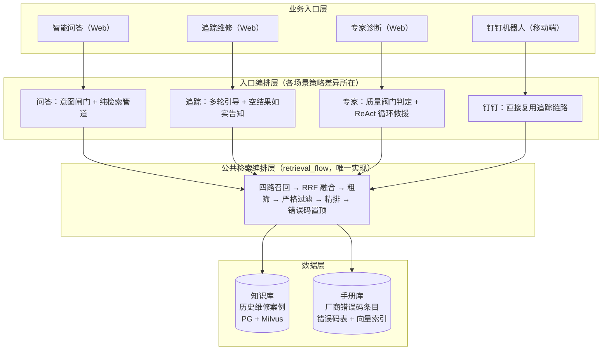
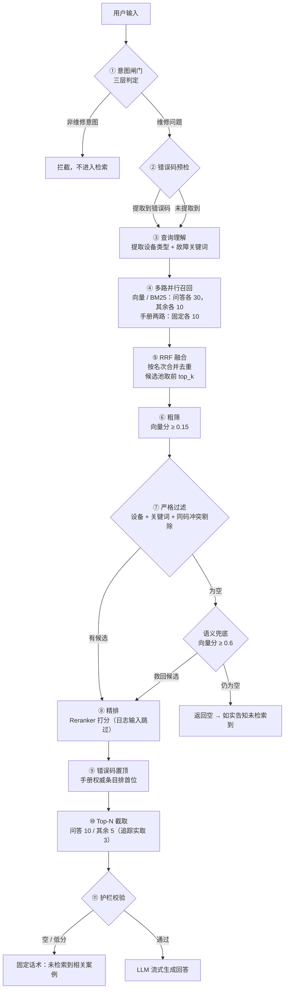
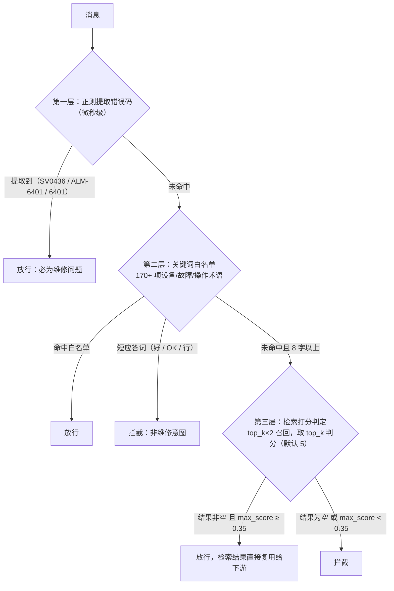
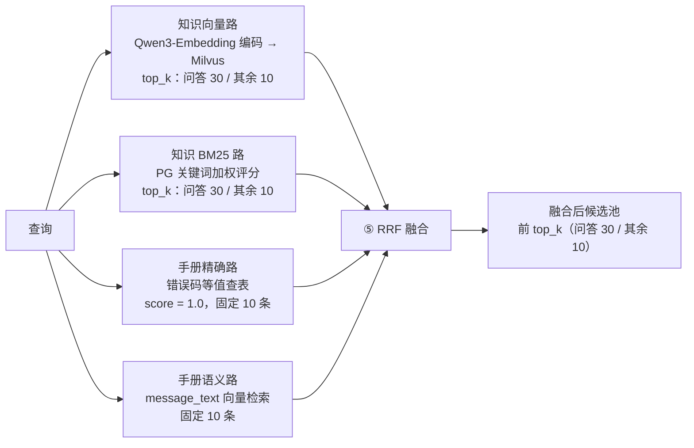
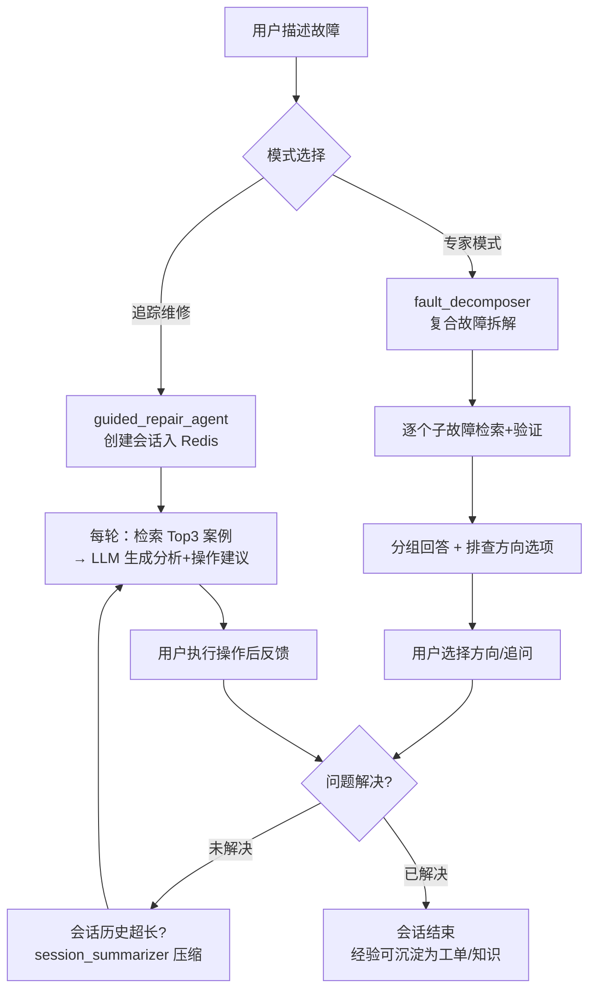
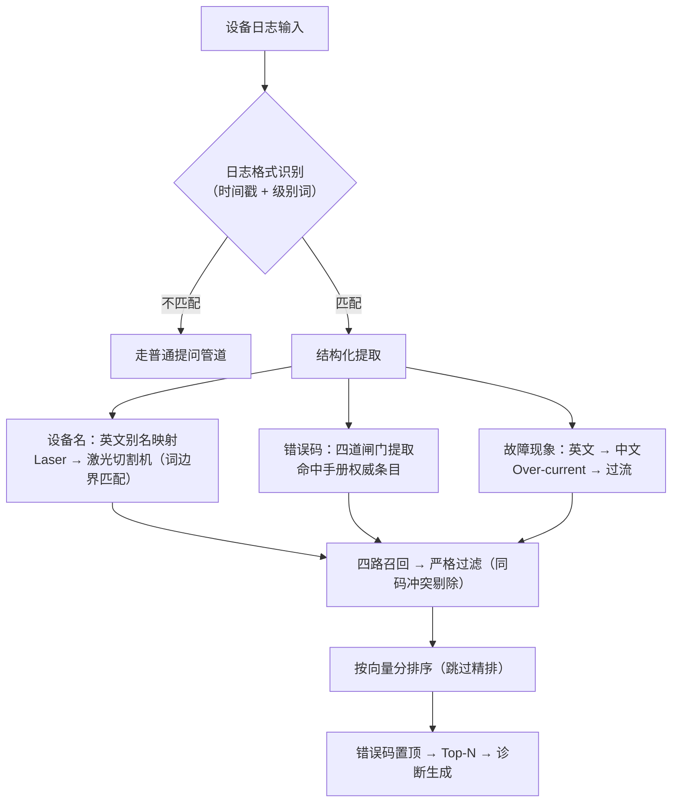
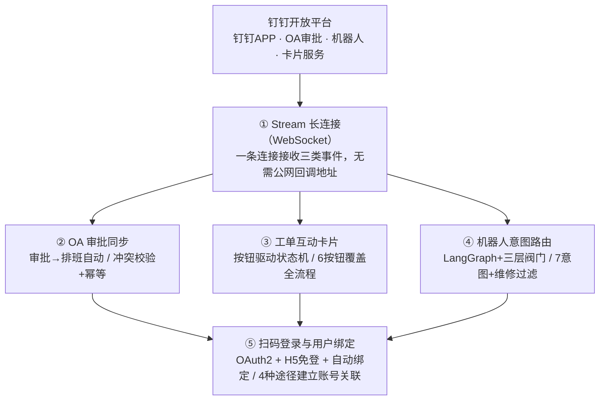
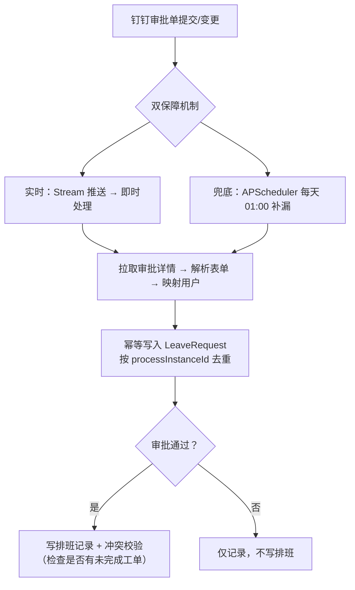
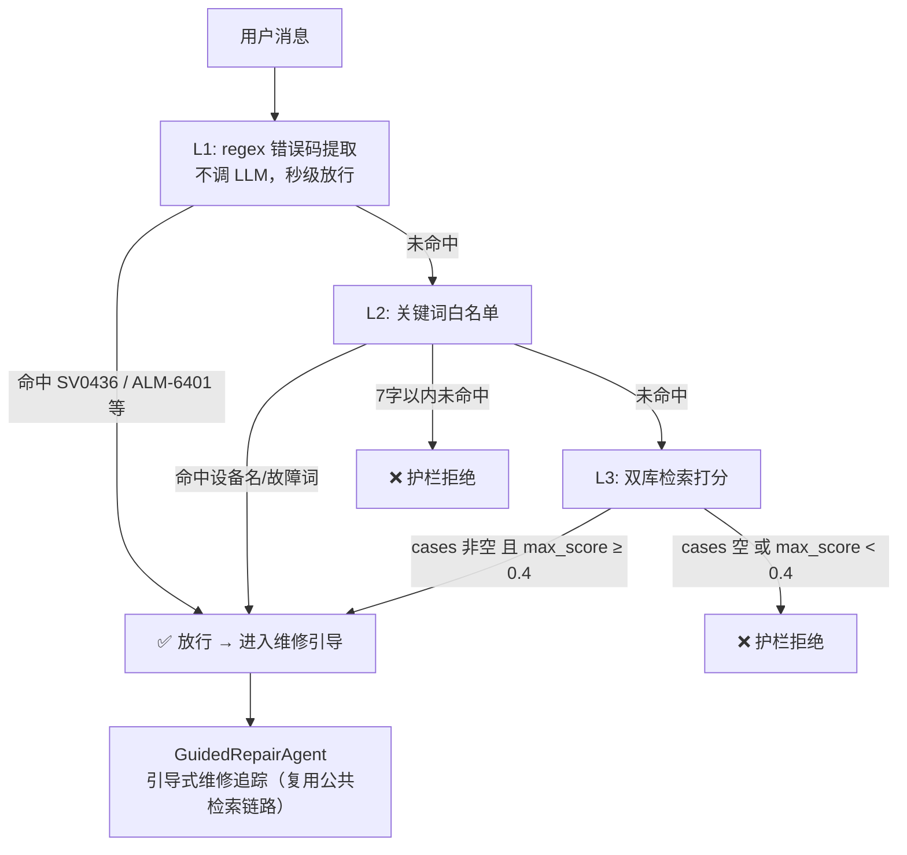

# Smart-Repair-System

> 面向制造企业的设备维修数字化平台 —— 把老师傅的经验沉淀为知识库，让维修人员一句话问出诊断方案
> 
> 覆盖能力：📋 工单全生命周期 · 🧠 AI 智能问答 · 📚 知识库 RAG · 🔧 追踪维修 / 专家模式 · 📱 钉钉集成

---

## 一、项目概述

### 1.1 项目背景

在制造企业中，设备维修长期依赖「老师傅经验」。新人遇到设备故障时，通常需要打电话问老师傅、翻纸质手册、翻历史工单，存在以下痛点：

- **经验难传承**：维修经验存在老师傅脑子里，离职即带走，隐性经验无法沉淀；
- **检索效率低**：历史工单、设备手册、故障码散落各处，新人难以快速定位；
- **流程不透明**：工单从上报到维修完成缺少统一状态管理，进度不可追溯；
- **知识难复用**：修完就完，没有把「怎么修的」沉淀成可检索的知识。
- **新老设备混杂**：工厂设备新旧，种类多，维修成本高

### 1.2 项目定位

**Smart-Repair-System** 是一个面向制造企业的**设备维修数字化平台**，核心目标是把老师傅的维修经验沉淀为结构化工单和知识库，让维修人员通过自然语言提问，即可检索历史案例、设备手册错误码和 AI 诊断建议，实现「**问一句，就查到怎么修**」。

> **一句话总结**
>
> 工单/历史工单 → 知识抽取、去重、人工审核 → 知识库；新人提问 → 意图路由 → 混合检索（向量 + BM25 + 手册错误码）→ RRF 融合 → 过滤 → Reranker 精排 → AI 诊断回答。

维修现场对"设备坏了"有三种不同心智：**快速拿答案**、**被带着一步步查**、**疑难深挖**——三种模式对应三种场景：

| 维度 | 智能问答 | 追踪维修 | 专家诊断 |
|---|---|---|---|
| 用户心智 | "拿答案就走" | "故障说不清，带着我查" | "问题很怪，帮我深挖" |
| 典型提问 | "SV0436 是什么意思？" | "X 轴定位偏差" | "报警+异响+加工异常一起来" |
| 交互形态 | 单轮一问一答 | 多轮引导 | 单轮深诊断 |
| 延迟预算 | 低 | 中 | 允许高 |
| 检索取向 | 查准够用（30→10） | 查准优先（10→5→3） | 查全优先（阀门不达标即 ReAct） |

**为什么不是一种模式包打天下**：

①交互形态不可调和（一次性交付 vs 对话式引导，上下文管理设计完全不同）；

②延迟与查全取舍方向相反（全走 ReAct 日常延迟不可接受，全走管道疑难无人兜底——阀门让 ReAct 只发生在真正需要时）；

③现场工作流决定分工（模式划分本质是把不同成本预算匹配给不同问题难度）。

> 钉钉不是第四种模式，是**渠道**：移动端碎片化操作最适合多轮引导，直接复用追踪链路，保证移动端与 Web 端结果一致。

### 1.3 总体架构：四个入口，一套引擎



**设计原则**：检索逻辑统一收口公共编排层，四个入口全部复用——同一问题在任何入口得到一致结果，策略只维护一处。

**双库定位**：

| 库 | 内容 | 角色 |
|---|---|---|
| 知识库 | 历史维修工单沉淀的案例（PG + Milvus 向量索引） | 经验：解决"以前怎么修的" |
| 手册库 | 厂商维修手册的错误码条目（报警含义、情形清单、排查步骤） | 权威：解决"官方怎么说"，错误码精确命中时优先级最高 |

### 1.4 技术栈总览

| 层级               | 技术                                   | 作用                                                 |
| ------------------ | -------------------------------------- | ---------------------------------------------------- |
| **Web 框架**       | FastAPI + Uvicorn                      | 路由、请求校验、自动生成 OpenAPI 文档（/docs）       |
| **ORM / 迁移**     | SQLAlchemy 2.0 + Alembic               | Python 类 ↔ PostgreSQL 表映射，版本化表结构变更      |
| **关系数据库**     | PostgreSQL + pg_trgm                   | 主数据库 + BM25 关键词检索（PG 扩展）                |
| **缓存 / 会话**    | Redis                                  | 会话持久化（24h TTL）+ 通用缓存                      |
| **向量数据库**     | Milvus                                 | 语义向量检索，Qwen3-Embedding-4B 编码存储与查询     |
| **Embedding 模型** | Qwen3-Embedding-4B                     | 阿里通义千问出品，4096 维多语言向量编码       |
| **Reranker 模型**  | Qwen3-Reranker-0.6B                    | 交叉编码器精排，过滤后少量候选精细打分               |
| **模型推理**       | vLLM（GPU 托管）                     | vLLM 托管双模型于 GPU 服务器（8010 OpenAI 兼容）            |
| **LLM**            | DeepSeek（OpenAI 兼容接口）            | 对话生成、意图分类、故障拆解、工单分析等             |
| **LLM 框架**       | LangChain                              | 统一 LLM 调用接口、消息格式、流式输出                |
| **Agent 编排**     | LangGraph                              | StateGraph 状态机：QaGraph / RobotGraph / 导入流水线 |
| **钉钉集成**       | dingtalk-stream SDK                    | Stream 长连接接收机器人消息 / OA 审批 / 卡片回调     |
| **定时任务**       | APScheduler                            | OA 审批兜底同步、库存预警等定时任务                  |
| **鉴权**           | python-jose + passlib(bcrypt)          | JWT 令牌 + 密码哈希加密                              |
| **异步 HTTP**      | httpx + aiohttp                        | 调用 DeepSeek、钉钉 API                              |
| **MCP 服务**       | fastmcp                                | 暴露检索/工单等工具给外部 AI 客户端                  |
| **前端**           | Vue 3 + Vite + Element Plus            | 组合式 API + 企业级组件库 + 快速构建                 |
| **部署**           | Docker 容器化 + Nginx 反代（HTTPS）     | 企业服务器（内网/私有云）常驻；本地开发一键启动      |

> **选型原则**：轻量优先（只用框架 20% 核心功能）、确定性前置（规则能搞定的不用 LLM）、每层有降级（任何组件挂了都有兜底）、检索收口（所有 Agent 共用 retrieval_flow）、开源可自建（核心组件全部本地部署，不依赖外部 SaaS）。

## 二、Agent 体系总览

> **判定标准**：具备自主决策、多步推理或状态管理能力的才算真正的 Agent。单次 LLM 调用的工具类（如 TicketUnderstandingAgent、DedupAgent、KnowledgeExtractorAgent）不算在内。

整个系统共有 **6 个 Agent**，分两个层级：业务对话层（3 个，直接面向用户做维修引导）和流程编排层（3 个，LangGraph 图结构，负责任务路由与流水线执行）。

---

### 2.1 业务对话层 Agent

#### ① GuidedRepairAgent（追踪维修引导 Agent）

**作用**：一步一步带着维修员排查故障，每轮检索案例 + 用户反馈动态调整方向，最多 30 步。

#### ② ExpertRepairAgent（专家维修 Agent）

**作用**：处理复合故障（多个故障现象同时出现）的深度诊断引导，做共因判定、优先级排序和多轮引导。

#### ③ RetrievalAssistantAgent（检索助手 Agent / ReAct Agent）

**作用**：自主选择检索策略的 ReAct 循环 Agent，思考→行动→观察→判断，最多 5 轮迭代。

---

### 2.2 流程编排层 Agent（LangGraph 图）

#### ④ QaGraph（智能问答图）

**作用**：智能问答入口的 LangGraph 主图，意图路由 + 三子图分发，替代原先的 if-else 分支。

#### ⑤ RobotGraph（钉钉机器人意图路由图）

**作用**：钉钉机器人消息的意图路由图，8 种意图分发。

#### ⑥ WorkOrderImporter（工单导入流水线图）

**作用**：历史工单 PDF 批量导入的流水线，解析→抽取→校验→存草稿，人工确认前不入生产库。

---

### 2.3 Agent 调用关系总览

```
用户入口层
  ├── Web 智能问答 → QaGraph（图编排）
  │                       └─ fault 子图 → 公共检索编排层（retrieval_flow）
  ├── Web 追踪维修 → GuidedRepairAgent（多轮引导）
  │                       └─ 每轮检索 → 公共检索编排层
  ├── Web 专家诊断 → ExpertRepairAgent（多故障多轮引导）
  │                       ├─ 管道检索 → 公共检索编排层
  │                       └─ 质量不足 → RetrievalAssistantAgent（ReAct 救援）
  └── 钉钉机器人 → RobotGraph（意图路由图）
                          └─ repair 意图 → GuidedRepairAgent（复用追踪链路）

知识沉淀层
  └── 历史工单导入 → WorkOrderImporter（导入流水线图）
                          └→ 人工审核 → 入知识库
```

**核心原则**：

- 检索逻辑统一收口 `retrieval_flow`，所有 Agent 复用，策略只维护一处
- ReAct 只在专家模式且管道不达标时才触发，日常不走昂贵的多轮推理
- 图结构可扩展：QaGraph 和 RobotGraph 都是"主图+子图"架构，新增意图只加节点不动路由


## 三、检索主流程

### 3.1 主流程图



### 3.2 关键节点详解

#### ① 意图闸门：三层判定（重点）

**职责**：判断消息是否为维修问题，闲聊、问候、简单应答直接拦截，不空跑检索。三层从快到慢，任何一层命中即结束：



**设计说明**：前两层纯规则，微秒级、可预测、无幻觉；第三层弥补白名单无法穷举真实语言的缺口——其检索结果直接复用给下游（真实故障零额外开销），对无关消息则用一次检索换掉一次 LLM 调用。

#### ② 错误码预检：四道正则闸门

**职责**：从输入提取错误码，决定走双路还是四路召回。全程零 LLM，延迟微秒级。

| 闸门 | 处理对象 | 匹配策略 | 策略依据 |
|---|---|---|---|
| 混合码正则 | SV0436 / ALM-6401 / E3091 | 自由匹配，宁多勿漏 | 误提取无害：最多多查一路手册 |
| 纯数字正则 | 6401 | 白名单裁决，宁少勿滥 | 纯数字与时间戳、工艺数值形态相同，须由码表裁决 |
| 字母码扫描 | CW_OT / SERVO_AL | 码表全量词边界匹配 | 无数字，形态正则覆盖不到 |
| 边界守卫 | 2026 / S/N 20260015 | 零宽断言排除 | 年份、序列号不进入错误码集合 |

**典型例子**："Start cycle 2026" 的年份被分隔符约束与年份排除规则正确丢弃；序列号 "20260015" 由前后数字断言拦截，不会截取出 "202600"。

#### ③ 查询理解

**职责**：提取设备类型 + 故障关键词，供 ⑦ 严格过滤使用。分两条路径：

| 输入类型 | 提取方式 |
|---|---|
| 普通中文提问 | QueryExtractor：设备词白名单（动态加载库内设备，最长词优先）+ LLM 兜底 |
| 设备日志 | `parse_log_query` 结构化解析：设备名（英文别名映射 Laser → 激光切割机）+ 现象翻译（Over-current → 过流、Brake → 抱闸） |

#### ④ 四路并行召回（重点）

**职责**：多路出击保证查全。



| 召回路 | 检索方式 | 解决的问题 |
|---|---|---|
| 知识向量路 | Qwen3-Embedding-4B 编码 → Milvus 语义检索 | 提问与案例用词不一致（"异响" vs "噪音"） |
| 知识 BM25 路 | PG 关键词加权评分 | 错误码、设备型号等精确 token，语义模型对不准 |
| 手册精确路 | 错误码等值查表（score = 1.0） | 权威命中，最高优先级 |
| 手册语义路 | message_text 向量检索 | 英文屏幕原文与英文日志直接语义对齐 |

**要点**：

- **向量与 BM25 互补**：向量管"说得不一样但意思一样"，BM25 管"就是这几个字"，单路都有盲区
- **手册双路仅在提取到错误码时启用**：无错误码查手册库无意义，省两路开销
- **Qwen3-Embedding-4B 选型核心原因**：阿里通义千问出品，4096 维 dense 多语言向量，英文日志与中文案例可直接跨语言对齐（MIRACL 多语言检索基准中英领先）；与精排 Qwen3-Reranker 同属 Qwen 生态，模型栈统一

**top-k 全链路流转**：

| 阶段 | 问答 | 追踪 / 钉钉 | 专家 |
|---|---|---|---|
| 召回 top_k（向量 / BM25 各路） | 30（RECALL_TOP_K） | 10 | 10 |
| 手册两路（固定） | 各 10 | 各 10 | 各 10 |
| RRF 候选池 | 前 30 | 前 10 | 前 10 |
| 最终输出 top_n | 10（FINAL_TOP_N） | 5（Prompt 实取 3） | 5 |

> 设计意图：问答"一次提问拿全量参考"，召回宽输出多（30→10）；引导/诊断类场景逐轮预算紧，整体收紧（10→5→3）。

#### ⑤ RRF 融合（重点：计算公式）

**要解决的问题**：多路分数量纲不可比（向量余弦 0~1、BM25 加权词频分、手册精确 1.0），直接相加相当于不同货币直接相加。

**RRF 的解法——只看名次，不看分数**：

```
RRF得分(d) = Σ 1 / (k + rank_i(d))        k = 60

rank_i(d) = 文档 d 在第 i 路结果中的名次（从 1 开始）
k = 60：SIGIR 2009 论文实验结论（60~100 近最优），Elasticsearch 等主流引擎默认值
```

**示例演算**（k = 60）：

| 候选案例 | 向量路 | BM25 路 | RRF 分计算 | RRF 分 |
|---|---|---|---|---|
| A 伺服过流案例 | 第 1 名 | 第 4 名 | 1/61 + 1/64 | **0.0320** |
| B 同设备案例 | 第 2 名 | — | 1/62 | 0.0161 |
| C 泛相似案例 | — | 第 1 名 | 1/61 | 0.0164 |

**要点**：

- A 靠**双路共识**登顶——多算法同时认为相关，是最强的相关性证据
- 名次差异被 k=60 平滑压缩（第 1 名 1/61 vs 第 2 名 1/62），任何单路的极端分数无法垄断排名
- **去重键**：`_dedup_key`（跨库隔离）> `knowledge_id` > `id`——同一案例多路召回时合并累加名次分，而非重复占位

#### ⑥ 粗筛（重点：为什么在 RRF 之后）

**职责**：把候选池里语义无关的部分先清掉。

```
放行条件：向量分（余弦相似度）≥ 0.15   或   该候选为 rrf_only（未进向量路，无向量分）
```

**为什么不与向量路召回时的排序重复**：向量召回只做排序 + 容量截断（`score_threshold=0.0`，刻意不做删除）；全链路按语义分数**删除**候选的动作只有粗筛这一处——排序在前面，删除统一收口在粗筛。

**为什么删除不能挪到 RRF 之前**：

1. **RRF 会洗牌**：一条向量分仅 0.12 的候选（向量路第 8 名）若同时在 BM25 路排第 1，RRF 分 ≈ 0.031，足以排进池内前列——排序拦不住，只有融合后的分数质检能拦住
2. **rrf_only 例外规则只能在池层面判定**："有向量分用阈值、无向量分放行（上限 30 条）"的判定对象是融合池的混合候选，单路召回时不知道自己将来是否 rrf_only
3. **规则收口与降级判定**：各路自筛会把阈值规则散落四处；向量服务降级时"全池 rrf_only、跳过阈值"的判定同样只能在池上做

次级原因：单路提前过滤会使存活候选名次前移（原第 8 名变第 5 名），人为抬高名次分，扭曲 RRF 名次共识语义。

> 一句话：**RRF 负责公平合并，粗筛负责融合后的语义质检——洗牌之后必须再验一次货**。

#### ⑦ 严格过滤

**职责**：设备精确匹配 + 故障关键词命中的确定性过滤，**前置到精排之前**（毫秒级规则放前面、约 60 秒的模型精排放后面，只对真正相关的少量候选做精排）。

| 规则 | 说明 |
|---|---|
| 设备约束仅对库内设备生效 | 日志提取的设备（如 PLC）库中无条目时，退化为仅按故障现象过滤（伺服过流等现象跨设备通用） |
| 跨系统同码冲突剔除 | 同一错误码在不同系统含义不同（PLC 的 SV0401 是过流，CNC 的 SV0401 是位置偏差）；查询设备与条目设备无共同 token 时判为冲突，不豁免、不置顶 |
| 语义兜底 | 词法过滤为空时保留向量分 ≥ 0.6 的候选；兜底后仍为空则返回空，由回答层如实告知——混淆的结果比没有结果危害更大 |

#### ⑧ 精排（重点：模型原理）

**职责**：交叉编码器对"查询 × 案例"逐对精细打分，定最终胜负。

| | bi-encoder（向量路，用于召回） | cross-encoder（Reranker，用于精排） |
|---|---|---|
| 计算方式 | `sim(q, d) = cos( E(q), E(d) )` | `score(q, d) = f( [q ; d] )` → 0~1 |
| 过程 | 查询与案例**分别编码**，再算余弦 | 查询与案例**拼接成一条序列**进同一个 Transformer |
| 交互粒度 | 两侧无交互，语义粒度粗 | token 级交叉注意力，能判断"设备+故障组合是否对得上" |
| 成本 | 文档向量可离线预计算，线上毫秒级扫全库 | 每对都要过一次模型，不可能扫全库 |
| 分工 | 广撒网（召回 top_k） | 定胜负（只打过滤后的少量候选） |

**工程实现**：Qwen3-Reranker-0.6B 交叉编码器，对严格过滤后的候选（典型个位数条）打分写入 `rerank_score`；排序键三级——`rerank_score` > `score`（向量分）> `rrf_score`（名次分），对应精排 / 正常 / BM25 降级三条路径。

**日志输入跳过精排**：

| 局限 | 说明 |
|---|---|
| 跨语言打分失效 | 英文日志 × 中文案例，模型难以判断相关性 |
| 无增量价值 | 排序已由 Qwen3-Embedding-4B 向量分保证正确顺序，精排纯属重复开销 |
| 降级引入偏差 | 模型调用失败降级规则重排后，英文关键词在中文条目零命中 → 正确候选被压分 |

而日志场景正确性已由两层保证：严格过滤管准入（现象已翻译为中文词）、Qwen3-Embedding-4B 向量分管排序（4096 维多语言向量，实测分数顺序与相关性一致）——精排无增量价值，跳过。**中文查询照常走精排**。

#### ⑨⑩⑪ 收尾三步

- **错误码置顶**：手册精确命中条目始终排首位
- **Top-N 截取**：问答 10 条 / 其余 5 条（各场景 LLM 上下文预算不同）
- **护栏校验**：案例为空或最高分低于阈值时返回固定话术，不调 LLM；Prompt 约束只引用案例内容、不得编造

---

## 四、四类场景的编排差异

四个入口共享第二节的主干，差异集中在**入口编排策略**与**空结果的兜底方式**（三种模式的设计动因见 1.2 节）。

### 4.1 智能问答：纯检索管道

```
用户提问 → 意图闸门 → 四路召回（top_k=30）→ 融合/过滤/精排（top_n=10）→ 护栏校验 → LLM 流式回答
```

最直接的链路：闸门拦截非维修问题，其余全走公共主干，检索为空即如实回答。多故障提问先由故障分解器拆分为子故障，再逐个走管道。

### 4.2 追踪维修与专家诊断



每轮基于检索结果给出下一步排查建议。检索为空时如实告知并给出人工兜底建议，对话不中断——5但**不做宽松降级**：兜底后仍为空说明库内确无相关知识，放宽约束捞回的只是低分跨设备噪声，基于噪声生成排查方向会误导维修员。

### 4.3 钉钉机器人：链路复用

```
钉钉消息 → 机器人指令解析 → 意图闸门 → 复用追踪维修链路（top_k=10，top_n=5）→ 卡片/文本回复
```

移动端维修问答直接复用追踪链路（同一套四路召回与过滤），与 Web 端检索结果一致。工程上是复用而非重新实现。

### 4.4 设备日志检索：结构化提取专线（重点）



**性能优化实践**（同一段 PLC 伺服过流日志：优化前耗时异常返回“未检索到”，优化后 5.9 秒返回全部相关案例）：

| 优化前问题 | 对应措施 | 效果 |
|---|---|---|
| 英文原文词作关键词无法命中中文案例 → 词法过滤为空 | 结构化提取（先翻译为设备/错误码/中文现象词） | 过滤信号与库内语言对齐 |
| 过滤为空触发宽松降级，对 30 条候选重复精排 → 约 60 秒无效等待 | 严格过滤前置到精排之前 | 精排候选压缩到个位数 |
| 跨语言精排超时降级规则重排，英文关键词零命中 → 正确候选被压分 | 日志输入跳过精排 | 消除 60 秒开销与降级偏差 |

优化后：检索 5.9 秒，返回案例全部伺服过流相关，噪声 0 条、跨系统冲突 0 条；中文提问与各场景回归全部正常。

---

## 五、钉钉集成模块

> **模块定位**：制造业设备维修系统的钉钉原生集成模块，让维修员在钉钉单聊窗口完成从报修到完工的全链路移动端操作，无需 PC 后台。
>
> **核心设计理念**：让维修员用最少的操作完成最多的工作；快速失败、优雅降级——每一层都有 Plan B。

### 5.1 模块全景：五大核心能力



| 传统方案的痛点 | 钉钉集成方案 |
|---|---|
| 维修人员不在电脑前，PC 后台操作繁琐 | 维修员在钉钉单聊窗口完成所有操作 |
| HTTP 回调需配置域名/证书/回调地址 | Stream 长连接，无需公网回调地址 |
| 审批和排班脱节，手动同步容易遗漏 | OA 审批自动同步排班，实时+兜底双保障 |
| 维修员打电话确认接单，效率低 | 工单卡片一键点击，状态自动流转 |

---

### 5.2 能力①：Stream 长连接引擎

**一句话**：一条 WebSocket 替代三个公网回调，内网即可运行。

| 传统 HTTP 回调 | Stream 长连接 |
|---|---|
| 需要公网 IP + 域名 + HTTPS 证书 | 无需公网回调地址，服务器出站长连接 |
| 需要手动 AES 解密签名校验 | SDK 内部处理握手/鉴权/心跳/重连 |
| 三个回调地址分别配置 | 一条连接接收全部三类事件 |
| 外部配置项多（域名/证书/回调地址） | 配置集中，SDK 自动维护连接 |

**三个事件处理器**：

| 处理器 | 接收事件 | 下游处理 |
|---|---|---|
| `_OurEventHandler` | OA 审批变更 | `dingtalk_oa_sync.handle_oa_event()` |
| `RobotMessageCallbackHandler` | 机器人单聊消息 | `robot_handler.handle_robot_message()` |
| `CardButtonCallbackHandler` | 卡片按钮回调 | `dingtalk_wo_card.handle_card_callback()` |

**容错保障**：每 15 秒自动断线重连；APScheduler 每天 01:00 同步近 3 天 OA 审批单做兜底，防止断线期间遗漏。

---

### 5.3 能力②：OA 审批同步

**一句话**：钉钉请假审批 → 排班记录全自动写入，含冲突校验与幂等保障。

**核心链路**：



**5 个关键设计**：

| # | 设计 | 说明 |
|---|---|---|
| 1 | **表单字段映射** | 钉钉控件名 → 系统字段名，支持环境变量 JSON 覆盖，不改代码适配不同企业 |
| 2 | **DDHolidayField 特殊处理** | 钉钉自带请假控件将时间+假别打包 JSON，优先用拆分日期控件，DDHolidayField 兜底 |
| 3 | **幂等写入** | 按 processInstanceId 去重，同一审批单多次推送 → 更新而非插入 |
| 4 | **冲突校验** | 审批通过时检查审批人是否有未完成工单，有则回滚排班写入，记录冲突日志 |
| 5 | **ALL_DAY 拆分 + 顶岗人解析** | 全天请假拆成 MORNING + AFTERNOON 两条；顶岗人支持 userid/JSON/List/纯文本 |

---

### 5.4 能力③：工单互动卡片

**一句话**：按钮驱动的状态机，6 个按钮覆盖工单全流程，维修员点按钮即可推进状态。

**交互流程**：主管派工 → 系统推送互动卡片到维修员钉钉单聊 → 维修员点击按钮 → Stream 接收回调 → 校验身份 → 状态流转 → 刷新卡片 → 异步通知主管。

**6 个按钮覆盖全流程**：

```
待接受 → 确认接受 → 已接单 → 已到达现场 → 已到达 → 开始检查 → 检查中
→ 开始维修 → 维修中 → 完成维修 → 已完成 → 确认录入 → 待归档
```

**两个关键设计**：

- **按钮文字反查**：MarkdownButton 模板回调不保留 params.id，只回传按钮文字，系统通过文字反查动作映射表
- **身份校验**：回调人 userId 必须等于工单被指派维修员的 dingtalk_userid，非授权人员点击按钮会被拒绝；另有幂等保护防止重复点击

---

### 5.5 能力④：机器人意图路由

**一句话**：LangGraph 状态图实现 7 种意图路由，三层阀门过滤非维修问题。

**7 种意图**：help（帮助菜单）、create（工单录入）、todo（待办查询）、repair（维修引导）、inventory（备件查询）、duty（排班查询）、none（通用回复）

**三层维修意图阀门（repair 入口）**：



> **设计效果**：用户发"今天天气不错"在 L2 就被拦掉，不浪费 LLM 调用。三层是 OR 关系——任何一层放行就进入维修流程，误拦截率极低。
> **成本控制**：从最快（regex 零成本）到最准（检索打分），逐层过滤，确保只有真正的维修问题才消耗 LLM token。

> **与公共检索链路的关系**：repair 意图放行后直接复用追踪维修链路（同一套四路召回 + RRF 融合 + 过滤 + 精排），保证钉钉端与 Web 端检索结果一致。

---

### 5.6 能力⑤：扫码登录与用户绑定

**一句话**：4 种途径自动建立钉钉账号与系统账号的关联，用户不需要主动绑定。

| 途径 | 触发场景 | 绑定逻辑 |
|---|---|---|
| **扫码登录** | PC 端钉钉扫码 | code → userId → 查找/创建 User → 绑定 dingtalk_userid |
| **机器人自动绑定** | 首次向机器人发消息 | 通讯录 API 查 unionId/手机号/姓名 → 匹配已有用户 → 回填绑定 |
| **OA 审批绑定** | 钉钉提交请假审批 | 按 dingtalk_userid 匹配或新建用户 |
| **通讯录同步** | 管理员手动同步 | 批量 upsert 所有钉钉用户 |

**扫码登录三层回退**：OAuth2（新版）→ sns（旧版）→ H5 免登 → Mock（开发环境）

> 三层回退是贯穿整个钉钉模块的设计模式——登录、API 调用、身份识别都用了这个策略，体现了**"优雅降级"的工程理念**。

---

### 5.7 底层支撑与容错设计

**DingTalkClient（核心收口类）**：

| 核心设计 | 实现 |
|---|---|
| **双 URL 体系** | 新版 api.dingtalk.com 失败自动回退旧版 oapi.dingtalk.com |
| **Token 管理** | AppKey/AppSecret 换取 access_token，缓存 2h（减 300s 安全缓冲） |
| **Mock 模式** | 全局 Mock 开关 + 单次调用失败降级 Mock，开发环境与生产环境兼容 |

**多层次降级总览**：

```
配置级：DINGTALK_MOCK_MODE=true → 全局返回模拟数据
Token级：换取失败 → DINGTALK_API_TOKEN 直配
API级：新版 v1.0 失败 → 回退旧版 topapi → mock 兜底
登录级：OAuth2 失败 → sns → H5 免登 → Mock
Stream级：断线 → 15s 自动重连 → HTTP 回调模式兜底
OA同步级：Stream 遗漏 → APScheduler 每天 01:00 补齐
```

**设计原则**：快速失败、优雅降级——每一层都有 Plan B，不阻塞主流程。

---

### 5.8 与检索引擎的关系

钉钉模块是**渠道层**，不是第四种检索模式：

| 维度 | 说明 |
|---|---|
| **检索复用** | 机器人 repair 意图 → 直接复用追踪维修链路（top_k=10，top_n=5），与 Web 端结果一致 |
| **新增能力** | Stream 长连接、OA 审批同步、工单卡片推进、扫码登录——这些是钉钉渠道独有的流程能力 |
| **知识同源** | 所有维修知识仍来自知识库 + 手册库，检索逻辑收口在公共编排层，策略只维护一处 |

> **一句话**：钉钉是移动端的入口和操作界面，检索内核与 Web 端完全共享——同一套引擎，多一个渠道。

---

## 六、设计要点总结

| 设计要点             | 说明                                                         |
| -------------------- | ------------------------------------------------------------ |
| 三种模式匹配三种场景 | 问答快查、追踪引导、专家深挖——把不同成本预算匹配给不同问题难度 |
| 一套引擎四个入口     | 检索逻辑收口公共编排层，任何入口结果一致，策略只维护一处     |
| 双库四路召回         | 知识库管经验、手册库管权威；向量管语义、BM25 管精确，互补缺一不可 |
| RRF 只看名次         | 规避多路分数量纲不可比，多路共识自然胜出                     |
| 确定性规则前置       | 意图闸门、错误码提取、严格过滤全部零 LLM 零延迟，昂贵的计算放在最后 |
| 每层都有降级         | Reranker 不可用 → 规则重排；向量路不可用 → BM25-only；管道不达标 → ReAct 救援 |
| 如实回答原则         | 宁可返回"未检索到"，不输出混淆的硬凑回答                     |

> **一句话总结**：确定性规则快速收窄范围并守住正确性底线，模型能力只在规则覆盖不到的地方投入预算——整条链路每一层都是"先便宜的、后昂贵的"。

---

## 七、关键参数速查

| 参数              | 数值                                   | 说明                                |
| ----------------- | -------------------------------------- | ----------------------------------- |
| 召回结构          | 4 路 / 2 库                            | 向量 + BM25 + 手册精确 + 手册语义   |
| 召回 top_k        | 问答 30 / 其余 10；手册双路固定各 10   | RRF 候选池 = 前 top_k               |
| 最终输出 top_n    | 问答 10 / 其余 5（追踪 Prompt 实取 3） | 两阶段检索：广撒网再收窄            |
| RRF 平滑系数 k    | 60                                     | SIGIR 2009 实验结论，主流引擎默认值 |
| 粗筛阈值          | 0.15                                   | 余弦低于此值视为基本无关            |
| 语义兜底阈值      | 0.6                                    | 与专家阀门高分线同口径              |
| 专家阀门          | N≥3 且（H≥2 或 S_max≥0.7）             | 规则判定，零 LLM                    |
| ReAct 最大轮数    | 5                                      | 超轮按现有最优结果收口，不报错      |
| 意图判定检索线    | 0.35                                   | 第三层闸门相关判定下限              |
| rrf_only 放行上限 | 30（RERANKER_CANDIDATES）              | 无向量分候选的粗筛放行上限          |
| 日志检索优化      | 异常耗时 → 5.9s                           | 结构化提取 + 过滤前置 + 跳过精排    |
